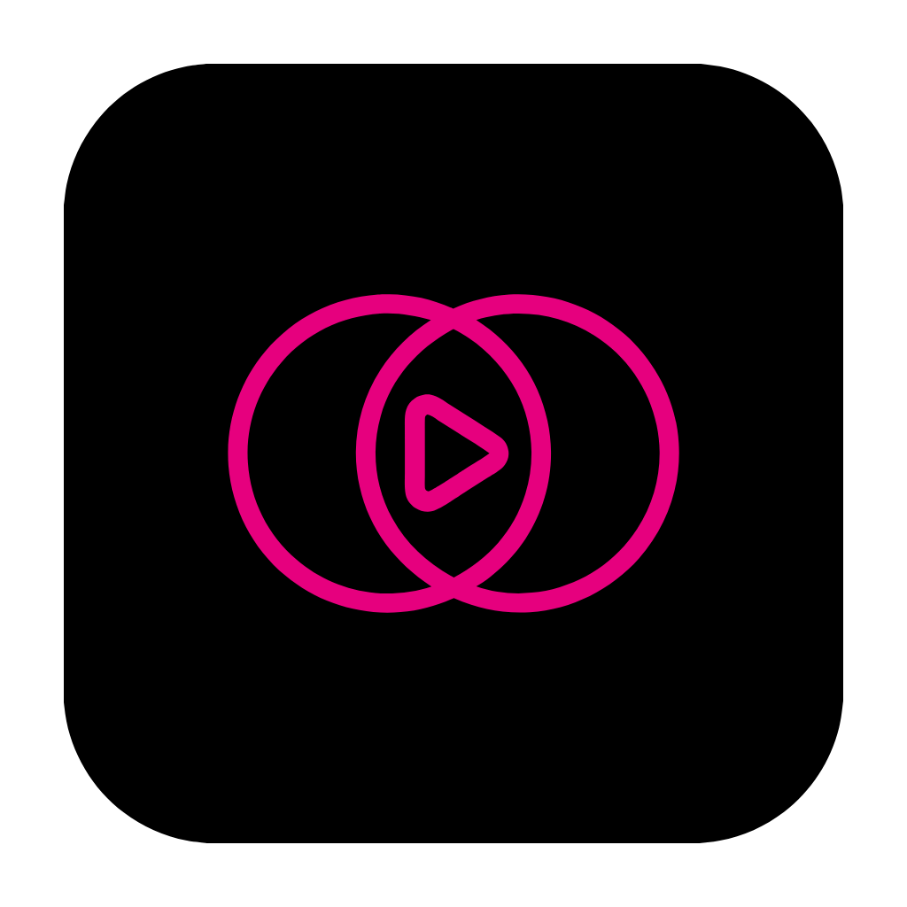
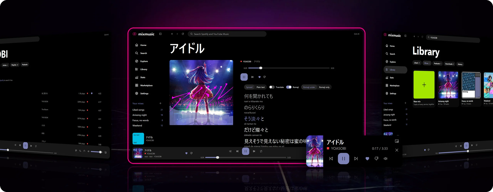
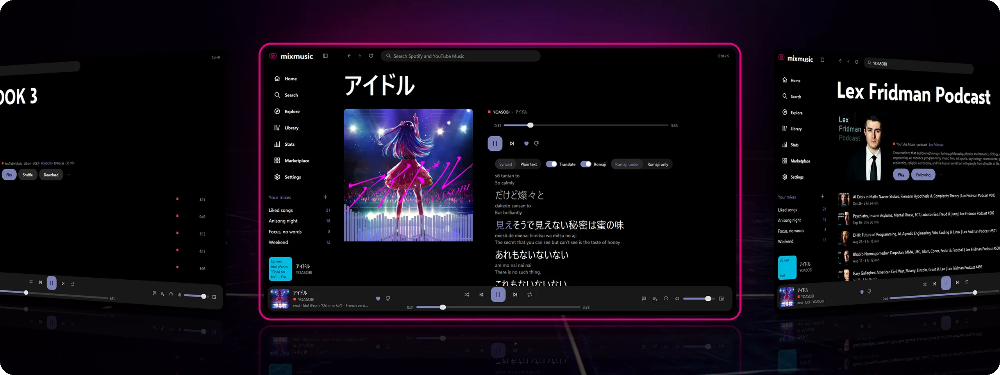
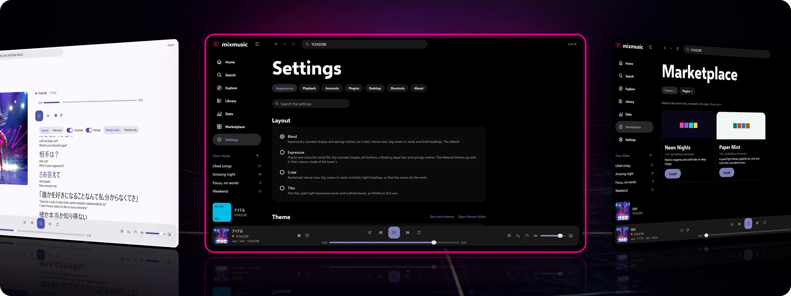

<p align="center"><a href="README.md">English</a> · <a href="README.hi.md">हिन्दी</a> · <a href="README.zh-CN.md">简体中文</a> · <a href="README.id.md">Bahasa Indonesia</a> · <a href="README.ur.md">اردو</a> · <a href="README.ha.md">Hausa</a> · <a href="README.pt-BR.md">Português (Brasil)</a> · <a href="README.bn.md">বাংলা</a> · <a href="README.ru.md">Русский</a> · <strong>አማርኛ</strong></p>

<p align="center">
  
</p>

<h1 align="center">MixMusic</h1>

<p align="center"><strong>ለYouTube Music እና ለSpotify አንድ ማጫወቻ።</strong></p>

<p align="center">ለmacOS፣ Windows እና Linux የYouTube Music እና የSpotify ደንበኛ። YouTube Music ያለ መለያ ይሠራል። አንድ ፍለጋ፣ አንድ ሰልፍ (ወረፋ)፣ የተቀላቀሉ ፕሌይሊስቶች፣ ከዘፈኑ ጋር የሚሄድ ግጥም፣ ገጽታዎችና ፕለጊኖች።</p>

<p align="center"><sub>ይህ የ<a href="README.md">እንግሊዝኛው README</a> ትርጉም ነው። በሁለቱ መካከል ልዩነት ካለ፣ ትክክለኛው የአሁኑ የእንግሊዝኛው ነው።</sub></p>

<p align="center">
  <a href="https://github.com/fzn0x/mixmusic/actions/workflows/ci.yml"></a>
  <a href="https://github.com/fzn0x/mixmusic/actions/workflows/pages.yml"></a>
  <a href="https://github.com/fzn0x/mixmusic/releases/latest"></a>
  <a href="https://github.com/fzn0x/mixmusic/releases"></a>
  <a href="https://pkg.go.dev/github.com/fzn0x/mixmusic"></a>
  <a href="go.mod"></a>
  <a href="https://awesomemygo.dev/apps/mixmusic"></a>
  
  <a href="#ፈቃድ"></a>
</p>

<p align="center">
  <a href="https://fzn0x.github.io/mixmusic/">ድረ-ገጽ</a> ·
  <a href="https://github.com/fzn0x/mixmusic/releases/latest">አውርድ</a> ·
  <a href="https://fzn0x.github.io/mixmusic/docs/">ሰነዶች</a> ·
  <a href="CHANGELOG.md">የለውጦች መዝገብ</a>
</p>

<p align="center">
  
</p>

## ለምን MixMusic

ሙዚቃዎ በYouTube Music እና በSpotify መካከል የተከፋፈለ ከሆነ፣ ብዙውን ጊዜ ሁለት
መተግበሪያዎች ያስፈልጉዎታል፤ ሁለት ፍለጋዎች፣ ሁለት ሰልፎችና ሁለት
ቤተ-መጻሕፍት። MixMusic ሁለቱንም አገልግሎቶች በአንድ ማጫወቻ ውስጥ ያሰባስባል፦

- **አንድ ፍለጋ።** በYouTube Music እና በSpotify በአንድ ጊዜ ይፈልጋል፣ እያንዳንዱንም
  ውጤት ከየትኛው አገልግሎት እንደመጣ ምልክት ያደርጋል።
- **አንድ ሰልፍ (ወረፋ) እና አንድ ቤተ-መጻሕፍት።** የSpotify ትራክ ከYouTube Music ትራክ
  በኋላ ወዲያውኑ ሊጫወት ይችላል፣ አንድ ፕሌይሊስትም የሁለቱንም ትራኮች መያዝ ይችላል።
- **መለያ አያስፈልግም።** YouTube Music መተግበሪያውን እንደከፈቱ ይጫወታል።
  የራስዎን ቤተ-መጻሕፍት ከፈለጉ ብቻ ይግቡ። Spotify አማራጭ ነው።
- **ትንሽ ፕሮግራም።** MixMusic የራሱን መስኮቶች በGPU ላይ የሚስል አንድ Go ፕሮግራም
  ነው። ለማውረድ ወይም በሜሞሪ ውስጥ ለማቆየት ውስጡ ምንም ብሮውዘር የለም።
- **የራስዎ እንዲሆን ይቀየራል።** አራት አቀማመጦችና አሥራ አራት ገጽታዎች አብረው
  ይመጣሉ፣ ማህበረሰቡ ተጨማሪ ገጽታዎችንና ፕለጊኖችን ይጨምራል፣ ማንኛውም ትዕዛዝም
  የራስዎ ቁልፍ ሊኖረው ይችላል።
- **ግላዊ።** MixMusic የራሱ መለያ፣ ሰርቨር፣ ትንታኔ ወይም ቴሌሜትሪ የለውም።
- **ነጻና ክፍት ምንጭ፣** በMIT ፈቃድ ወይም በGPL 3.0 ስር።

## ባህሪያት

### ፈልጎ ማጫወት

- **ለሁለቱም አገልግሎቶች አንድ ፍለጋ።** የYouTube Music እና የSpotify ውጤቶች
  ጎን ለጎን፣ እያንዳንዱ በአገልግሎቱ ምልክት ተደርጎ። የYouTube Music ውጤቶች
  እያንዳንዱ ትራክ ስንት ጊዜ እንደተጫወተ ያሳያሉ፣ ስለዚህ ዋናው ከቨርዥኖች
  (cover) ተለይቶ ይታያል።
- **አንድ ሰልፍ (ወረፋ)።** የሁለቱንም አገልግሎቶች ትራኮች ያዋህዱ፣ በመካከላቸው shuffle እና
  repeat ያድርጉ፣ ሰልፉ ሲያልቅም ራዲዮ እንዲቀጥል ያድርጉ።
- **አስስ።** አዳዲስ ልቀቶች፣ ተወዳጅ ዘፈኖች፣ ቻርቶች፣ ስሜቶችና ዘውጎች፣ እና
  ለሚጫወተው ዘፈን ተዛማጅ ዘፈኖች።
- **ከዘፈኑ ጋር የሚሄድ ግጥም**፣ ወይም ከመረጡ ተራ ጽሑፍ።
- **ሚኒ ማጫወቻ** ከሌሎች መስኮቶችዎ በላይ የሚቆይ።

### የእርስዎ ቤተ-መጻሕፍት

- **ሚክሶች፦** ከሁሉም አገልግሎቶች ትራኮችን የሚይዙ ፕሌይሊስቶች። የአንድ አገልግሎት
  ፕሌይሊስት ወደ ሚክስ ያስመጡ፣ ከማናቸውም ውስጥ ይፈልጉና ይደርድሩ።
- **የወደዷቸው ዘፈኖች** ከሁለቱም አገልግሎቶች በአንድ ዝርዝር ውስጥ።
- **ታሪክና የማዳመጥ ስታቲስቲክስ፣** ከቀን ወደ ቀን።
- **መለያዎችዎ።** ለመነሻ ምግብዎ (home feed)፣ ለወደዷቸው ዘፈኖች፣ ለፕሌይሊስቶች፣
  ለአልበሞችና ለአርቲስቶች በGoogle የራሱ ገጽ ላይ ወደ YouTube Music ይግቡ፣ እንደ
  መለያዎ ወይም እንደ ብራንድ ቻናሎቹ አንዱ። ለዚያ ያለዎትን ቤተ-መጻሕፍት ወደ
  Spotify ይግቡ። መውደዶች፣ የተቀመጡ አልበሞችና ፕሌይሊስቶች፣ እንዲሁም
  የሚከተሏቸው አርቲስቶች ወደ አገልግሎቱም ይደርሳሉ። የሚጫወቱት ነገር ምክሮቹ
  የሚመጡበትን የYouTube Music ታሪክዎን ይቀላቀላል።

### Spotify፣ በሦስት መንገዶች

- **በMixMusic ውስጥ፣** በSpotify ጥራት፣ ምንም የSpotify መተግበሪያ ሳይከፈት
  (Premium፣ በWindows እና በmacOS)።
- **በSpotify Connect፦** የSpotify መተግበሪያዎ፣ ስልክዎ ወይም ስፒከር።
- **ከYouTube Music፦** MixMusic የSpotify ትራኩን ቅጂ በYouTube Music ላይ
  ያጫውታል፣ ይህም ለመጫወት Premium አያስፈልገውም።

### ድምፅ

- Crossfade፣ እኩል የድምፅ መጠንና የድምፅ ማስተካከያ።
- አሥር ባንድ ያለው equalizer ከፕሪሴቶች ጋር።
- ቪዥዋላይዘር።
- ያጫወቷቸው ትራኮች ከመስመር ውጭ ካሽ።

### በዴስክቶፕዎ ላይ

- በWindows፣ በmacOS እና በLinux ላይ የሚዲያ ቁልፎችና የሲስተሙ የሚዲያ መቆጣጠሪያዎች።
- ለማጫወት፣ ለማቆም፣ ለመዝለል፣ ድምፅን ለመቀየር፣ ለማጥፋት፣ የሚጫወተውን ለመውደድ
  ወይም ላለመውደድ፣ ወይም MixMusic ን ለማሳየት የራስዎ አለም አቀፍ አቋራጮች፣
  የትኛውም መስኮት ከፊት ቢሆን።
- በWindows ላይ በተግባር አሞሌ ድንክዬ ላይ የማጫወቻው ቁልፎች።
- የትሬይ መቆጣጠሪያዎች፣ የአዳዲስ ትራኮች ማሳወቂያዎችና ሲገቡ መጀመር።
- `mixmusic://` ሊንኮች።
- **Last.fm፦** የሚሰሙት እያንዳንዱ ትራክ ፕሮፋይልዎን ይቀላቀላል፣ ከመስመር ውጭ
  የተደረጉ scrobbleዎች ተመልሰው መስመር ላይ ሲሆኑ ይላካሉ።
- **Discord፦** ፕሮፋይልዎ የሚጫወተውን ከሽፋን ምስሉና ከቀረው ጊዜ ጋር ያሳያል።
- **ዝማኔዎች፦** MixMusic በሚጀምርበትና በየጥቂት ሰዓታት አዲስ ልቀት መኖሩን
  ይፈትሻል፣ ፊርማውን ያረጋግጣል፣ ሲነግሩት ይጭነዋል፣ ወይም ከመረጡ በራሱ።

### የራስዎ ያድርጉት

- **አቀማመጦች።** ነባሪው Blend፣ በትላልቅ ሽፋኖች በተጨናነቁ ረድፎች ላይ ክብ
  ቅርጾችና ተለጣጭ እንቅስቃሴ አለው። Expressive፣ ከMaterial 3 Expressive
  የተወሰደ፣ ተጫዋች ነው፤ የቀለም ሙሌቶች፣ የክኒን ቅርጽ ቁልፎችና ተንሳፋፊ
  የማጫወቻ አሞሌ አለው። Crate ልከኛ ነው፣ ሽፋኖቹ ሥራውን እንዲሠሩ፤ Tiles ደግሞ
  የMixMusic የመጀመሪያ መልክ ነው፣ ጠፍጣፋ ሰቆችና ግዙፍ ትንንሽ ፊደል ቃላት ያሉት።
- **ገጽታዎች።** አሥራ አራት አብሮ የተሰሩ፣ እያንዳንዱ በማንኛውም አቀማመጥ ውስጥ፣
  ማስተካከል የሚችሏቸው ኢፌክቶች፣ አንድ ለብርሃን ሁነታ አንድ ለጨለማ ሁነታ
  ገጽታ፣ እና የራስዎ ወይም ከሚጫወተው የሽፋን ምስል የተወሰደ የአክሰንት ቀለም።
  Material እና Material Dark እያንዳንዱን ቀለም ከሽፋኑ ያደርጋሉ።
- **የማህበረሰብ ገጽታዎችና ፕለጊኖች፣** በገበያው ውስጥ በአንድ ጠቅታ።
- **ፕለጊኖች** በገጽታዎ ተስለው፣ በtyped API በኩል ገጾችን፣ ትዕዛዞችን፣
  የትራክ ድርጊቶችንና ዊጀቶችን ይጨምራሉ።
- **ቁልፍ ሰሌዳ መጀመሪያ።** ለተለመዱ ነገሮች ሁሉ አቋራጮች፣ ለማንኛውም ትዕዛዝ
  የራስዎ ቁልፍ፣ የፕለጊኖች ትዕዛዞችን ጨምሮ፣ ከማንኛውም መተግበሪያ ሙዚቃውን
  የሚቆጣጠሩ ቁልፎች፣ እና ለቀሩት የትዕዛዝ ፓሌት
  (<kbd>Ctrl</kbd> <kbd>K</kbd>)።
- **የቅንብሮች ፋይል።** ቅንብሮችዎ በዳታ ፎልደርዎ ውስጥ ያለው `settings.json` ናቸው
  (በWindows `%AppData%\MixMusic`፣ በmacOS `~/Library/Application Support/MixMusic`፣
  በLinux `~/.config/MixMusic`)፣ ከdotfilesዎ ጋር ማቆየት ይችላሉ።
  MixMusic እየሠራ ሳለ ያስቀምጡት፣ ወዲያውኑ ይተገበራል፤ Settings › Desktop ›
  Settings file (ቅንብሮች › ዴስክቶፕ › የቅንብሮች ፋይል) ይከፍተዋል።

## ዙሪያውን እንመልከት

<p align="center">
  
</p>

<p align="center"><sub><b>ያዳምጡ።</b> በመሃል በYOASOBI የተዘፈነው アイドル እየተጫወተ ነው፦ እያንዳንዱ መስመር ሲዘፈን ይበራል፣ ከበታቹ ሮማጂና ትርጉም አለ። በግራ በኩል አልበም፣ በቀኝ በኩል የሚከተሉት ፖድካስት።</sub></p>

<p align="center">
  
</p>

<p align="center"><sub><b>የራስዎ ያድርጉት።</b> በመሃል አራቱ አቀማመጦች፦ ነባሪው Blend፣ Expressive፣ Crate እና Tiles፣ ከገጽታዎቹ በታች። በግራ በኩል ቀለሞቹን ከሚጫወተው ሽፋን የሚወስድ የMaterial ገጽታ። በቀኝ በኩል በገበያው ውስጥ የማህበረሰብ ገጽታዎች።</sub></p>

## ጫን

ለሲስተምዎ የሚሆነውን ፋይል ከ[የቅርብ ጊዜ ልቀት](https://github.com/fzn0x/mixmusic/releases/latest)
ያውርዱ፦

| ሲስተም | ማውረጃ |
|---|---|
| macOS 12 እና ከዚያ በኋላ (Apple silicon እና Intel) | [`mixmusic-<version>-macos-universal.dmg`](https://github.com/fzn0x/mixmusic/releases/latest) |
| Windows 10 እና 11 (x64፣ Arm)፣ ጫኚ | [`mixmusic-<version>-windows-<arch>-setup.exe`](https://github.com/fzn0x/mixmusic/releases/latest) |
| Windows፣ ተንቀሳቃሽ፣ መጫን አያስፈልግም | [`mixmusic-<version>-windows-<arch>-portable.zip`](https://github.com/fzn0x/mixmusic/releases/latest) |
| Debian፣ Ubuntu እና ተዋጽኦዎቻቸው | [`mixmusic-<version>-linux-<arch>.deb`](https://github.com/fzn0x/mixmusic/releases/latest) |
| Fedora፣ openSUSE እና ተዋጽኦዎቻቸው | [`mixmusic-<version>-linux-<arch>.rpm`](https://github.com/fzn0x/mixmusic/releases/latest) |
| Arch Linux እና ተዋጽኦዎቹ (በቅርቡ ይመጣል) | [`mixmusic-bin`](https://aur.archlinux.org/packages/mixmusic-bin) በAUR ላይ፦ `yay -S mixmusic-bin` |
| ማንኛውም Linux፣ አንድ ፋይል | [`mixmusic-<version>-linux-<arch>.AppImage`](https://github.com/fzn0x/mixmusic/releases/latest) |
| ማንኛውም Linux፣ በሳንድቦክስ (Flatpak) | [`mixmusic-<version>-linux-<arch>.flatpak`](https://github.com/fzn0x/mixmusic/releases/latest) |
| ማንኛውም Linux፣ በhome ፎልደርዎ ውስጥ | [`mixmusic-<version>-linux-<arch>.tar.gz`](https://github.com/fzn0x/mixmusic/releases/latest)፣ ከ`install.sh` ጋር |

`<arch>` ለx64 `amd64` ሲሆን ለArm `arm64` ነው። እያንዳንዱ ልቀት ውርዶችን
ለመፈተሽ `SHA256SUMS` ይዘረዝራል። `update-…`፣ `….delta`፣
`mixmusic-<version>-macos-…` ወይም `-windows-<arch>.tar.gz` የተሰኙት ፋይሎች
አያስፈልጉዎትም፦ የተጫኑ መተግበሪያዎች ራሳቸውን የሚያዘምኑት ከእነሱ ነው።

ጫኚዎቹ፣ ተንቀሳቃሹ zip እና የLinux ማህደር ራሳቸውን ያዘምናሉ። `.deb`፣
`.rpm`፣ AppImage እና Flatpak የራሳቸውን ፋይሎች መተካት አይችሉም፣ ስለዚህ
አዲስ ስሪት ሲወጣ MixMusic ይነግርዎታል፣ ያወርድልዎታልም። የAUR `mixmusic-bin`
ከተቀረው ሲስተምዎ ጋር ይዘምናል። ተንቀሳቃሹን zip በየትኛውም ቦታ ፈትተው
`MixMusic.exe` ን ይክፈቱ። AppImage ን ሊሠራ የሚችል ያድርጉት (`chmod +x`)
እና ይክፈቱት። Flatpak ን በሶፍትዌር ማዕከልዎ ይክፈቱ፣ ወይም
`flatpak install ./mixmusic-<version>-linux-<arch>.flatpak` ን ያሂዱ፤ በመጀመሪያው
ጊዜ Flatpak የGNOME runtime ን ከFlathub ያመጣል።

በMac ላይ [Homebrew](https://brew.sh) MixMusic ን
ይጭናል፣ `brew upgrade` ደግሞ ያዘምነዋል።

```sh
brew install --cask fzn0x/tap/mixmusic
```

### የመጀመሪያው ማስጀመር

- **macOS፦** መተግበሪያው ገና በApple notarize አልተደረገም፣ ስለዚህ
  መጀመሪያ ሲከፍቱት macOS ማረጋገጥ እንደማይችል ይናገራል። ከSystem
  Settings › Privacy & Security › Open Anyway (የሲስተም ቅንብሮች › ግላዊነትና ደህንነት › ለማንኛውም ክፈት)
  ይክፈቱት፣ ወይም ይህን በTerminal ውስጥ አንድ ጊዜ ያሂዱ፦

  ```sh
  xattr -dr com.apple.quarantine /Applications/MixMusic.app
  ```
- **Windows፦** ጫኚው ገና አልተፈረመም፣ ስለዚህ SmartScreen ሊያስጠነቅቅ ይችላል፦
  More info (ተጨማሪ መረጃ) ከዚያ Run anyway (ለማንኛውም አሂድ) ይምረጡ። ወደ
  YouTube Music መግባትና Spotify ን በMixMusic ውስጥ ማጫወት WebView2 Runtime
  ያስፈልጋቸዋል፣ Windows 11 ይዞት ይመጣል።
- **Linux፦** MixMusic GTK 3 እና PulseAudio (PipeWire ም ያገለግላል) ወይም
  ALSA ያስፈልገዋል። ወደ YouTube Music መግባት WebKitGTK 4.1 ያስፈልገዋል፣
  የትሬይ አዶው `libayatana-appindicator3` ያስፈልገዋል፣ መግቢያዎችዎን
  በሲስተሙ keyring ውስጥ ማቆየት ደግሞ `libsecret` ያስፈልገዋል። `.deb` እና
  `.rpm` ይጭኗቸዋል፣ Flatpak ደግሞ ይዞአቸው ይመጣል፤ ለAppImage እና ለማህደሩ፦

  ```sh
  # Debian and Ubuntu
  sudo apt install libgtk-3-0 libpulse0 libwebkit2gtk-4.1-0 libayatana-appindicator3-1 libsecret-1-0
  # Fedora
  sudo dnf install gtk3 pulseaudio-libs webkit2gtk4.1 libayatana-appindicator-gtk3 libsecret
  ```
- **ሁሉም ሲስተሞች፦** MixMusic የአብዛኞቹን የYouTube Music ትራኮች ድምፅ
  ራሱ ያገኛል። ለቀሩት፣ ለምሳሌ ለልጆች ለተሠሩ ትራኮች፣
  [yt-dlp](https://github.com/yt-dlp/yt-dlp) ይጠቀማል፣ ይህንንም Settings ›
  Playback (ቅንብሮች › መልሶ ማጫወት) ውስጥ ይጭንልዎታል፣ ወቅታዊም ያደርገዋል።
  yt-dlp የJavaScript runtime ያስፈልገዋል፦ [Deno](https://deno.com)፣ Node.js፣
  Bun ወይም QuickJS። Flatpak Node.js አለው።

### Flatpak

Flatpak MixMusic ን በሳንድቦክስ ውስጥ ያሠራዋል፣ ይህም ኔትወርኩን፣ የድምፅ
ሰርቨሩን፣ ማሳያውንና GPU ን ያያል፣ ከhome ፎልደርዎ ግን ምንም አያይም።
MixMusic ቅንብሮቹንና ቤተ-መጻሕፍቱን በ`~/.var/app/io.github.fzn0x.mixmusic`
ውስጥ ያቆያል፣ ከ`.deb`፣ `.rpm`፣ AppImage ወይም ማህደር ቅጂ የተለየ፣ ሁለቱም
በአንድ ጊዜ ሊሠሩ ይችላሉ። የአንድ ቅጂ ቅንብሮችንና ቤተ-መጻሕፍት ለማምጣት፣
ሁለቱንም ዝጉ፣ `settings.json`፣ `library.json`፣ `queue.json` እና
`addons` ፎልደርን ከ`~/.config/MixMusic` ወደ
`~/.var/app/io.github.fzn0x.mixmusic/config/MixMusic` ገልብጡ፣ እና ወደ
መለያዎችዎ እንደገና ይግቡ፦ መግቢያዎች በሌላው ቅጂ keyring ውስጥ ይቀራሉ።

በFlatpak ውስጥ፣ ሲገቡ መጀመር በዴስክቶፕዎ በኩል ይሄዳል፣ መጀመሪያ ሊጠይቅዎ
ይችላል፣ የራስዎ yt-dlp ደግሞ በ`~/.var/app/io.github.fzn0x.mixmusic` ውስጥ
መሆን አለበት፣ ሳንድቦክሱ ሌላ ፎልደር አያይምና። Flatpak ያልሆነ Discord
መተግበሪያ MixMusic ሲጀምር እየሠራ ከነበረ ብቻ ነው የሚጫወተውን
የሚያሳየው፣ እስኪያስጀምር ድረስ፤ Flatpak የሆነው Discord በሁለቱም ይሠራል።
Flatpak አዲስ ነው፦ በዴስክቶፕዎ ላይ እንዴት እንደሚሠራ በ[issue](https://github.com/fzn0x/mixmusic/issues)
ይንገሩን።

### መለያዎች (ሁሉም አማራጭ)

- **YouTube Music፦** በSettings › Accounts (ቅንብሮች › መለያዎች) ውስጥ Sign in to
  YouTube Music ን ይምረጡና በሚከፈተው መስኮት ወደ Google ይግቡ። የሚተይቡት
  ወደ Google ብቻ ይሄዳል። MixMusic ክፍለ ጊዜውን የተመሰጠረ አድርጎ ያቆያል፣
  ቁልፉ ባለበት የሲስተምዎ keyring ውስጥ። ያ መስኮት መክፈት ካልቻለ፣ ወይም Google
  ካልተቀበለው፣ በራስዎ ብሮውዘር ይግቡ፣ MixMusic በራሱ አዲስ ፕሮፋይል ይከፍተዋል
  እና ከገቡ በኋላ ይሰርዘዋል፤ ወይም የገቡበትን ብሮውዘር ክፍለ ጊዜ ያስመጡ
  (MixMusic በyt-dlp ያነበዋል፣ የYouTube ኩኪዎችን ብቻ ያቆያል)፤ ወይም
  የገባ music.youtube.com ታብ የCookie header ይለጥፉ።
- **Spotify፦** Spotify አንድ መተግበሪያ እስከ አምስት ተጠቃሚዎች እንዲያገለግል
  ይፈቅዳል፣ ይህም ባለቤቱ Premium እስካለው ድረስ ብቻ ነው፣ ስለዚህ በራስዎ
  Spotify መተግበሪያ ይገባሉ። ሁለት ደቂቃ ይወስዳል፦ [docs/spotify.md](docs/spotify.md)
  ደረጃ በደረጃ ይመራዎታል።
- **Last.fm፦** በ[last.fm/api/account/create](https://www.last.fm/api/account/create)
  የAPI መለያ ይፍጠሩ (ማንኛውም ስም፣ callback URL አያስፈልግም)፣ የAPI ቁልፉንና
  shared secret ን በSettings › Accounts ውስጥ ይለጥፉ፣ እና MixMusic ን
  በብሮውዘርዎ ያጽድቁ።
- **Discord፦** የDiscord መተግበሪያ እየሠራ ሳለ ፕሮፋይልዎ የሚያዳምጡትን
  ያሳያል። በSettings › Desktop (ቅንብሮች › ዴስክቶፕ) ውስጥ ያጥፉት።

የሆነ ነገር አልሠራም? [docs/troubleshooting.md](docs/troubleshooting.md)
የተለመዱ ችግሮችንና የታወቁ ጉዳዮችን ይሸፍናል።

## ከምንጭ ገንባ

[Go](https://go.dev/dl/) 1.27.3 ወይም ከዚያ በኋላ፣ የMyGo ትዕዛዝ መስመርን
የሚያሠራ [Bun](https://bun.sh) 1.2 ወይም ከዚያ በኋላ፣ እና Git ያስፈልጉዎታል።
MyGo C compiler አያስፈልገውም፣ ስለዚህ ማንኛውም ሲስተም MixMusic ን
ለሁሉም ሲስተሞች ይገነባል።

### Windows

```powershell
winget install GoLang.Go
winget install Oven-sh.Bun
winget install Git.Git
```

አዲስ ተርሚናል ይክፈቱ፣ ከዚያ፦

```powershell
git clone https://github.com/fzn0x/mixmusic
cd mixmusic
bun install
bun run dev
```

መግባትና የSpotify መልሶ ማጫወት WebView2 Runtime ያስፈልጋቸዋል፣ Windows 11
ይዞት ይመጣል። በWindows 10 ላይ ከ
[Microsoft](https://developer.microsoft.com/microsoft-edge/webview2/) ይጫኑት።

### macOS

በ[Homebrew](https://brew.sh)፦

```sh
brew install go oven-sh/bun/bun
git clone https://github.com/fzn0x/mixmusic
cd mixmusic
bun install
bun run dev
```

### Linux

Go ን ከ[go.dev/dl](https://go.dev/dl/) ይጫኑ (የዲስትሮ ፓኬጆች ብዙውን ጊዜ
ከ1.27.3 የቆዩ ናቸው)፣ ከዚያ Bun ን እና MixMusic የሚሠራባቸውን ላይብረሪዎች፦

```sh
curl -fsSL https://bun.sh/install | bash
# Debian and Ubuntu
sudo apt install git libgtk-3-0 libpulse0 libwebkit2gtk-4.1-0 libayatana-appindicator3-1 libsecret-1-0
# Fedora
sudo dnf install git gtk3 pulseaudio-libs webkit2gtk4.1 libayatana-appindicator-gtk3 libsecret
```

ከዚያ፦

```sh
git clone https://github.com/fzn0x/mixmusic
cd mixmusic
bun install
bun run dev
```

### Nix

በ[Nix](https://nixos.org)፣ `nix develop` ልቀቶች የሚገነቡባቸውን መሣሪያዎች
`flake.lock` በሚቸነክራቸው ስሪቶች ይሰጥዎታል፦ Go፣ Bun፣ NSIS፣ GoReleaser
እና Zola። `nix build` MixMusic ን ለLinux ከምንጭ ወደ `result/` ይገነባል።

### አዳብር

`bun run dev` መተግበሪያውን ይገነባል፣ ያስጀምራል፣ እና ሲያርሙ እንደገና
ይገነባል። ዳታው ከተጫነው MixMusic የተለየ ሆኖ `MixMusic Dev` በሚል ስም
ይቆያል።

```sh
bun run build:plugins          # the plugins' JavaScript, from their TypeScript
go test ./...                  # the app's tests
bun run typecheck              # the plugin SDK and the community's plugins
go run ./tools/registry -check # the community registry
bun run build                  # the packaged app for this system, in build/
bun run build -- -platform windows/amd64,linux/amd64,linux/arm64
```

በNix shell ውስጥ፣ ልቀቶች እንደሚያደርጉት የLinux ውርዶችን
`.github/scripts/build.sh linux/amd64,linux/arm64` ገንቡ። እዚያ ተራ
`bun run build` የNix የራሱን loader የሚጠይቅ የLinux ፕሮግራም ይሠራል፣
እሱም በNixOS ላይ ብቻ ይጀምራል። `go run ./tools/elfloader build/linux-amd64`
ግንባታን ይፈትሻል።

[ድረ-ገጹ](https://fzn0x.github.io/mixmusic/) በ`site/` ውስጥ ነው፣
በ[Zola](https://www.getzola.org) የተገነባ፣ በ`docs/` ውስጥ ያሉ መመሪያዎችም
የእሱ `/docs/` ገጾች ናቸው። `go run ./tools/sitedocs && zola --root site serve`
ቅድመ እይታ ይሰጣል። ልቀቶች በNix shell ውስጥ ተገንብተው በ[GoReleaser](https://goreleaser.com)
(`.goreleaser.yaml`) ይታተማሉ።

[docs/architecture](docs/architecture/README.md) ክፍሎቹ እንዴት እንደሚጣጣሙ
ያብራራል።

### አወቃቀር

መተግበሪያው ሥር ያለው ፓኬጅ ነው፣ ከሥሩ የ`internal/` ፓኬጆች አሉ። ከ`internal/`
ውጭ ያሉት ፓኬጆች ለማንኛውም ሰው ለማስመጣት ናቸው፣ እና በ
[pkg.go.dev](https://pkg.go.dev/github.com/fzn0x/mixmusic) ላይ ተመዝግበዋል።

```
*.go                 the app and its windows: the pages, the player bar, the
                     mini player, the tray, media keys, deep links
fonts/               the typefaces the windows draw with
internal/app         the services the windows call, and the desktop integration
internal/player      the queue, played by the audio engine or on Spotify's devices
internal/audio       MixMusic's audio engine, and the system's audio output
internal/plugins     plugins, each in a JavaScript engine of its own
internal/youtube     YouTube Music's catalog, and your account there
internal/spotify     the Spotify Web API, its sign-in and Spotify Connect
internal/stream      audio streams, from YouTube or yt-dlp, opened for the engine
internal/match       Spotify tracks matched to their YouTube Music recordings
internal/romaji      Japanese lyrics in romaji, kanji read by kagome
internal/library     liked and disliked songs, mixes, history and stats
internal/lastfm      scrobbling to Last.fm
internal/discord     what plays, on your Discord profile
internal/diag        the log, without secrets, and the reports of crashes
internal/addons      themes and plugins, and the community registry
builtin/themes       the themes MixMusic ships with
public/              the page of Spotify's player, on Windows
sdk/                 the types of the plugin API
community/           community themes and plugins, and their registry
```

ማስመጣት የሚችሏቸው ፓኬጆች፦

```
opus/                an Opus decoder in pure Go, a port of libopus's
aac/                 an AAC-LC decoder in pure Go
ac3/                 an AC-3 and E-AC-3 decoder in pure Go, written from ATSC A/52
webm/                the audio of WebM files: packets, times and seeking
mp4/                 the audio of MP4 files: packets, times and seeking
resample/            sample rate conversion, with Kaiser-windowed sincs
lyrics/              synced lyrics from Unison and LRCLIB, and translations
brand/               MixMusic's logo, for code that draws it
```

## ማህበረሰብ

ማንኛውም ሰው የማህበረሰብ ገጽታዎችንና ፕለጊኖችን ከገበያው፣ በጎን አሞሌው ላይ ካለው
የሱቅ አዶ መጫን ይችላል፣ የእርስዎንም መጨመር ይችላሉ።

### ገጽታ ይስሩ

ገጽታ ቀለሞችን፣ ፎንቶችንና ማዕዘኖችን የሚያስተካክል `theme.json` ፋይል ነው፣
እነዚህም ተጠቃሚው በመረጠው አቀማመጥ ውስጥ ይታያሉ።
[docs/themes.md](docs/themes.md) እያንዳንዱን ቶከን ይዘረዝራል፣ ሙሉ ገጽታም
ያሳያል። የእርስዎን ለመሞከር፣ ፎልደሩን በገጽታዎች ፎልደር ውስጥ ያስቀምጡ
(Settings › Appearance › open themes folder (ቅንብሮች › ገጽታ › የገጽታዎች ፎልደርን ክፈት))
እና በSettings › Appearance ውስጥ ይምረጡት።

### ፕለጊን ይስሩ

ፕለጊን በTypeScript ወይም በJavaScript የተጻፈ፣ ገጾችን፣ ትዕዛዞችን፣
የትራክ ድርጊቶችንና ዊጀቶችን የሚጨምር ትንሽ ሞጁል ነው።
[docs/plugins.md](docs/plugins.md) APIውን ያብራራል፣ ለአርታዒዎ
[types](sdk/index.d.ts) አሉት። የማህበረሰቡ
[sleep timer](community/plugins/sleep-timer) እና
[spectrum](community/plugins/spectrum) የሚሠሩ ምሳሌዎች ናቸው።

### ያካፍሉት

1. ይህን repository ይፎርኩ።
2. አንድ ፎልደር ይጨምሩ፦ ለገጽታ `community/themes/<id>/`፣ ወይም ለፕለጊን
   `community/plugins/<id>/`፣ ከ`plugin.json` እና ከ`index.ts` ጋር።
3. `bun run build:plugins`፣ `go run ./tools/registry` እና
   `go run ./tools/registry -check` ን ያሂዱ።
4. pull request ይክፈቱ።

ከተዋሃደ በኋላ CI ወደ [registry branch](https://github.com/fzn0x/mixmusic/tree/registry)
ያትመዋል፣ በሁሉም ሰው ገበያ ውስጥም ይታያል። [community/README.md](community/README.md)
ዝርዝሮቹ አሉት።

## ግላዊነት

MixMusic የራሱ መለያ፣ ሰርቨር፣ ትንታኔ ወይም ቴሌሜትሪ የለውም። የሚያናግራቸው፦

- **YouTube እና Google፦** የYouTube Music ካታሎግ፣ ዥረቶቹና እያንዳንዱ ትራክ
  ምን ያህል ድምፅ እንዳለው፣ ሳይገቡ የሚጠየቁ፣ እንዲሁም የሽፋን ምስሎች፤ አንዳንድ ዥረቶች
  በyt-dlp በኩል። ከገቡ፣ እዚያ ያለው ቤተ-መጻሕፍትዎ፣ እና፣ በSettings ›
  Accounts ካላጠፉት፣ የሚያጫውቷቸው ትራኮች፣ እነሱም የYouTube Music ታሪክዎን
  ይቀላቀላሉ።
- **Spotify፣** ከገቡ በኋላ፦ ቤተ-መጻሕፍትዎ፣ የSpotify Connect መሣሪያዎችዎ፣
  እና Spotify በMixMusic ውስጥ ሲጫወት ከ`sdk.scdn.co` የሚጫነው የSpotify
  ማጫወቻ።
- **Unison፦** የሚጫወተው ትራክ video ID፣ ወይም ያለዚያ ርዕሱ፣ አርቲስቶቹ፣
  አልበሙና ርዝመቱ፣ ግጥሙን ለማግኘት። ከግጥሙ አጠገብ translate ወይም romanize
  ሲያበሩ ብቻ፣ የሚጫወተው ትራክ ግጥም ከvideo ID ጋር፣ Unison በGoogle
  እንዲተረጉመው።
- **LRCLIB፦** የሚጫወተው ትራክ ርዕስ፣ አርቲስቶች፣ አልበምና ርዝመት፣ ግጥሙን
  ለማግኘት።
- **GitHub፦** በሚጀምርበትና በየጥቂት ሰዓታት አዲስ ስሪት መኖሩን መፈተሽ፣
  በSettings › About (ቅንብሮች › ስለ) ውስጥ ሊያጠፉት ይችላሉ፤ ገበያውን ሲከፍቱ
  የማህበረሰብ registry፤ የyt-dlp ውርዶች፤ እና ከጃፓንኛ ግጥም አጠገብ ሮማጂን
  በመጀመሪያ ሲያበሩ የካንጂ ንባቦች መዝገበ ቃላት (11.7 MB)። ሮማጂ በኮምፒውተርዎ
  ላይ ይሠራል፦ ግጥሙ አይላክም።
- **Last.fm፣** ሲያገናኙት፦ የሚያጫውቱት።
- **Discord፣** ካላጠፉት፦ የሚጫወተው፣ በኮምፒውተርዎ ላይ ወዳለው የDiscord
  መተግበሪያ ይላካል፣ እሱም በፕሮፋይልዎ ላይ ያሳየዋል።

በኮምፒውተርዎ ላይ የሚያቆየው፦

- ቅንብሮችዎና ቤተ-መጻሕፍትዎ (የወደዷቸውና ያልወደዷቸው ዘፈኖች፣ ሚክሶች፣ ታሪክና
  የቅርብ ጊዜ ፍለጋዎች)፣ Settings › About በሚሰይመው ፎልደር ውስጥ።
- ያጫወቷቸው ትራኮች፣ በካሽ ውስጥ፣ በSettings › Playback ውስጥ የፈቀዱትን ያህል፣
  እና YouTube ምን ያህል ድምፅ እንዳላቸው የለካው።
- ያዩዋቸው ሽፋኖች፣ እስከ 256 MB።
- ያበሩዋቸው የግጥም ትርጉሞች፣ በትራክና በቋንቋ፣ እና ሮማጂ ካንጂን
  የሚያነብበት መዝገበ ቃላት፣ ካበሩት በኋላ።
- መግቢያዎችዎ፣ የYouTube Music ክፍለ ጊዜን ጨምሮ፣ በሲስተሙ keyring ውስጥ።
  በWindows ላይ፣ Credential Manager አንዱን ማቆየት ሳይችል ሲቀር፣ ለWindows
  መለያዎ በተመሰጠረ ፋይል ውስጥ ይገባል፤ keyring በሌለው Linux ላይ ደግሞ
  ተጠቃሚዎ ብቻ በሚያነባቸው ፋይሎች ውስጥ።
- መዝገቡ (log)፣ ያለ መግቢያዎችዎ።

የቤተ-መጻሕፍቱ የታሪክ ገጽ ያጫወቱትን ያጸዳል፣ Settings › Playback ካሽንና
ሽፋኖችን ያጸዳል፣ ከአገልግሎት መውጣት ደግሞ መግቢያውን ይሰርዛል።

በWindows ላይ ቪዥዋላይዘሩ በዚህ ኮምፒውተር ላይ፣ በMixMusic ወይም በSpotify
መተግበሪያ ውስጥ፣ የሚጫወተውን የSpotify ድምፅ ይሰማል፣ በWindows process
loopback በኩል፣ ይህም የዚያን መተግበሪያ ብቻ ይሰማል። በmacOS 14.2 እና ከዚያ በኋላ፣
macOS እንደሚጠይቀው ሲፈቅዱ፣ በMixMusic ውስጥ የሚጫወተውን Spotify በprocess tap
በኩል ይሰማል። ድምፁን በሜሞሪ ውስጥ ይተነትናል፣ በጭራሽ አይቀዳም ወይም
አይልክም።

## ምስጋናዎች

MixMusic የተገነባው በእነዚህ ፕሮጀክቶች ላይ ነው፦

- **[MyGo](https://github.com/egoist/mygo)**፣ MixMusic የተገነባበት የዴስክቶፕ
  ፍሬምወርክ። MixMusic የMyGo ቤተኛ UI ይጠቀማል፦ MyGo እያንዳንዱን መስኮት
  ራሱ በGo፣ ያለ webview፣ ከገጾቹና ከማጫወቻ አሞሌው እስከ ሚኒ ማጫወቻው ድረስ
  ይስላል። የትዕዛዝ መስመሩ መተግበሪያውን ከጫኚዎቹና ራሱን ከሚያዘምንባቸው
  የተፈረሙ ዝማኔዎች ጋር ያሽጋል።
- **[Go](https://go.dev)**፣ የመተግበሪያው ቋንቋ፣ ከ
  [purego](https://github.com/ebitengine/purego) ጋር፣ ይህም የሲስተሙን
  ላይብረሪዎች ያለ cgo ይጠራል፣ እንዲሁም
  [golang.org/x/image](https://pkg.go.dev/golang.org/x/image) እና
  [golang.org/x/text](https://pkg.go.dev/golang.org/x/text)።
- **[Sobek](https://github.com/grafana/sobek)**፣ እያንዳንዱ ፕለጊን የሚሠራበት
  JavaScript ሞተር።
- **[Nix](https://nixos.org)**፣ ልቀቶች የሚገነቡባቸውን መሣሪያዎች የሚቸነክር፣
  እና MixMusic ን ለLinux ከምንጭ የሚገነባ።
- **[GoReleaser](https://goreleaser.com)**፣ ልቀቶችን የሚያትም፣ እና
  [nFPM](https://nfpm.goreleaser.com) የሚባለው የእሱ፣ የRPM ፓኬጆችን የሚሠራ።
- **[Bun](https://bun.sh)**፣ ግንባታውን የሚያሠራ፣ እና
  **[TypeScript](https://www.typescriptlang.org)**፣ ፕለጊኖችን የሚያጠናቅርና
  የፕለጊን SDK አይነቶችን የሚፈትሽ።
- **[Zola](https://www.getzola.org)**፣ ድረ-ገጹን የሚገነባ።
- **[NSIS](https://nsis.sourceforge.io)**፣ የWindows ጫኚዎችን የሚሠራ፣ እና
  [appimagetool](https://github.com/AppImage/appimagetool)፣ AppImageዎችን።
- **[yt-dlp](https://github.com/yt-dlp/yt-dlp)**፣ MixMusic ራሱ ማግኘት
  የማይችላቸውን ትራኮች ድምፅ የሚያገኝ።
- **[Unison](https://unison.betterlyrics.org)**፣ በODbL ስር ያለ ክፍት፣ በህዝብ
  ተሳትፎ የሚሞላ የግጥም ዳታቤዝ፣ እና **[LRCLIB](https://lrclib.net)**፣ ክፍት
  የተመሳሰሉ ግጥሞች ዳታቤዝ።
- **[kagome](https://github.com/ikawaha/kagome)**፣ የግጥሞችን ካንጂ ለሮማጂያቸው
  የሚያነብ የጃፓንኛ morphological analyser፣ ከmecab-ipadic በተሠራው
  የ[kagome-dict](https://github.com/ikawaha/kagome-dict) IPA መዝገበ ቃላት
  ጋር፣ MixMusic ሮማጂ በመጀመሪያ ሲበራ ያወርደዋል።
- **[libopus](https://opus-codec.org)**፣ የOpus decoder ፖርት የተደረገበት
  decoder ያለው፣ እና **[SharpJaad](https://github.com/jimm98y/SharpJaad)**፣
  የAAC decoder የተገኘበት የ[JAAD](https://sourceforge.net/projects/jaadec/)
  C# ፖርት።
- **[FFmpeg](https://ffmpeg.org)**፣ የdecoderዎቹ ሙከራዎች የሚያነጻጽሩት።
- **[Selawik](https://github.com/microsoft/Selawik)**፣
  **[Quicksand](https://github.com/andrew-paglinawan/QuicksandFamily)**፣
  **[Roboto Flex](https://github.com/googlefonts/roboto-flex)** እና
  **[Archivo](https://github.com/Omnibus-Type/Archivo)**፣ የመስኮቶቹ ፊደል ቅርጾች።
- **[Material Color Utilities](https://github.com/material-foundation/material-color-utilities)**፣
  የMaterial ገጽታዎች ቀለሞች ፖርት የሆኑበት የHCT የቀለም ሳይንስ ባለቤት።
- **[Kevin MacLeod](https://incompetech.com)**፣ በ
  [CC BY 4.0](https://creativecommons.org/licenses/by/4.0/) ስር ያለው ሙዚቃው
  በድረ-ገጹ ላይ የሚጫወት።

## አስተዋጽኦ

ማስተካከያዎች፣ ባህሪያት፣ ገጽታዎች፣ ፕለጊኖችና የችግር ሪፖርቶች ሁሉም ተቀባይነት
አላቸው።

- **ችግር ያሳውቁ** ከSettings › About › report a problem (ቅንብሮች › ስለ › ችግር ሪፖርት አድርግ)።
  ስሪትዎን፣ ሲስተምዎን፣ ገጽታዎን እና ፕለጊኖችዎን ሞልቶ አዲስ GitHub issue
  ይከፍታል። ወይም በራስዎ [issue ይክፈቱ](https://github.com/fzn0x/mixmusic/issues/new)።
- **ለውጥ ይላኩ** እንደ pull request። [CONTRIBUTING.md](CONTRIBUTING.md)
  የሚያሂዷቸውን ፍተሻዎች፣ የcommit ዘይቤውን፣ እና ሰዎች የሚያስተውሉት ለውጥ
  የሚያስፈልገውን የchangelog ግቤት ያብራራል።
- **ገጽታ ወይም ፕለጊን ያካፍሉ፦** [ማህበረሰብ](#ማህበረሰብ) ይመልከቱ።

[CONTRIBUTORS.md](CONTRIBUTORS.md) ኮዳቸው፣ ሃሳባቸውና ሪፖርታቸው MixMusic ን
ላበጀው ሰዎች ምስጋና ይሰጣል።

## ፈቃድ

MixMusic ሁለት ፈቃዶች አሉት፦ በ[MIT ፈቃድ](LICENSE-MIT) ወይም በ[GNU General
Public License፣ ስሪት 3](LICENSE-GPL) ከመረጡት ጋር ይጠቀሙት። መዋጮዎች በሁለቱም
ስር ተቀባይነት አላቸው። በ`fonts` ውስጥ ያሉት ፊደል ቅርጾች በSIL Open Font License
ስር ናቸው፦ [የSelawik](fonts/OFL.txt)፣ [የQuicksand](fonts/quicksand-OFL.txt)፣
[የRoboto Flex](fonts/robotoflex-OFL.txt) እና [የArchivo](fonts/archivo-OFL.txt)።
የOpus decoder የlibopus ፖርት ነው፣ በ[BSD ፈቃዱ](opus/LICENSE.libopus) ስር፤
የAAC decoder ከSharpJaad የተገኘ ነው፣ በ[MIT ፈቃዱ](aac/LICENSE.sharpjaad) ስር፤
የHCT የቀለም ሳይንስም የMaterial Color Utilities ፖርት ነው፣ በ
[Apache ፈቃዱ](internal/hct/LICENSE.material-color-utilities) ስር።

MixMusic ከSpotify ወይም ከGoogle ጋር የተቆራኘ፣ በእነሱ የተደገፈ ወይም
የተስፋፋ አይደለም። እነዚህ አገልግሎቶች ለተጠቃሚዎቻቸው የሚያቀርቡትን
በአገልግሎቶቹ የራሳቸው መገናኛዎች በኩል ያጫውታል፤ በውሎቻቸው በሚፈቅዱት መጠን
ይጠቀሙበት። Spotify እና YouTube Music የባለቤቶቻቸው የንግድ ምልክቶች ናቸው።
