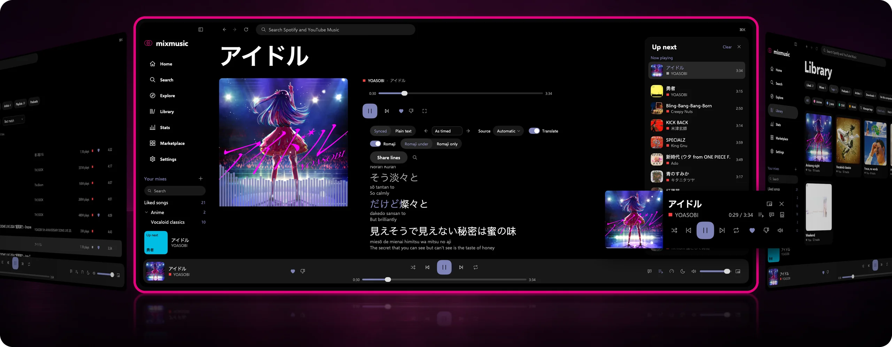

<p align="center"><a href="README.md">English</a> · <a href="README.hi.md">हिन्दी</a> · <a href="README.zh-CN.md">简体中文</a> · <strong>Bahasa Indonesia</strong> · <a href="README.ur.md">اردو</a> · <a href="README.ha.md">Hausa</a> · <a href="README.pt-BR.md">Português (Brasil)</a> · <a href="README.bn.md">বাংলা</a> · <a href="README.ru.md">Русский</a> · <a href="README.am.md">አማርኛ</a></p>

<p align="center">
  
</p>

<h1 align="center">MixMusic</h1>

<p align="center"><strong>Satu pemutar untuk YouTube Music dan Spotify.</strong></p>

<p align="center">Klien YouTube Music dan Spotify untuk macOS, Windows, dan Linux. YouTube Music bisa dipakai tanpa akun. Satu pencarian, satu antrean, playlist campuran, lirik tersinkron, podcast, file musik Anda sendiri, casting, tema, dan plugin.</p>

<p align="center"><sub>Ini terjemahan dari <a href="README.md">README berbahasa Inggris</a>. Jika ada perbedaan, yang terbaru adalah versi bahasa Inggris.</sub></p>

<p align="center">
  <a href="https://github.com/fzn0x/mixmusic/actions/workflows/ci.yml"></a>
  <a href="https://github.com/fzn0x/mixmusic/actions/workflows/pages.yml"></a>
  <a href="https://github.com/fzn0x/mixmusic/releases/latest"></a>
  <a href="https://github.com/fzn0x/mixmusic/releases"></a>
  <a href="https://pkg.go.dev/github.com/fzn0x/mixmusic"></a>
  <a href="go.mod"></a>
  <a href="https://awesomemygo.dev/apps/mixmusic"></a>
  
  <a href="#lisensi"></a>
</p>

<p align="center">
  <a href="https://trendshift.io/repositories/313095?utm_source=trendshift-badge&amp;utm_medium=badge&amp;utm_campaign=badge-trendshift-313095" target="_blank" rel="noopener noreferrer"></a>
</p>

<p align="center">
  <a href="https://mixmusic.functionx.dev/">Situs web</a> ·
  <a href="https://github.com/fzn0x/mixmusic/releases/latest">Unduh</a> ·
  <a href="https://mixmusic.functionx.dev/docs/">Dokumentasi</a> ·
  <a href="docs/features.md">Semua fitur</a> ·
  <a href="CHANGELOG.md">Catatan perubahan</a>
</p>

<p align="center">
  
</p>

## Mengapa MixMusic

Jika musik Anda terbagi antara YouTube Music dan Spotify, biasanya Anda
perlu dua aplikasi, dengan dua pencarian, dua antrean, dan dua pustaka.
MixMusic menyatukan kedua layanan itu dalam satu pemutar:

- **Satu pencarian.** MixMusic mencari di YouTube Music dan Spotify
  sekaligus, dan menandai setiap hasil dengan layanan asalnya.
- **Satu antrean dan satu pustaka.** Lagu Spotify bisa diputar tepat setelah
  lagu YouTube Music, dan satu playlist bisa berisi lagu dari keduanya, juga
  dari file musik di komputer Anda.
- **Tidak perlu akun.** YouTube Music langsung bisa diputar begitu aplikasi
  dibuka. Masuk ke akun hanya jika Anda ingin memakai pustaka Anda sendiri.
  Spotify bersifat opsional.
- **Program kecil.** MixMusic adalah satu program Go yang menggambar
  jendelanya sendiri di GPU. Tidak ada browser di dalamnya yang harus
  diunduh atau ditampung di memori.
- **Bebas diubah.** Ada empat tata letak dan empat belas tema bawaan,
  komunitas menambahkan tema dan plugin lainnya, dan setiap perintah bisa
  diberi tombol pilihan Anda sendiri.
- **Dalam bahasa Anda.** Jendelanya tersedia dalam 66 bahasa selain bahasa
  Inggris, dengan tata letak kanan ke kiri untuk bahasa Arab, Ibrani, Persia,
  dan Urdu.
- **Privat.** MixMusic tidak punya akun, server, analitik, atau telemetri
  sendiri.
- **Gratis dan open source,** di bawah lisensi MIT atau GPL 3.0.

## Fitur

Apa yang bisa dilakukan MixMusic, bidang demi bidang, dan di mana
menemukannya di aplikasi. **Built in** (Bawaan) berarti fitur itu berjalan
sendiri. [Fitur](docs/features.md) mencantumkan 363 fitur dari 0.1.0 sampai
0.5.12, satu baris untuk tiap fitur, beserta versi saat fitur itu hadir.

### Cari dan putar

- **Satu pencarian untuk kedua layanan.** Hasil dari YouTube Music dan
  Spotify tampil berdampingan, masing-masing ditandai dengan layanannya,
  bersama file musik Anda sendiri. Hasil YouTube Music menunjukkan berapa
  kali setiap lagu diputar, sehingga versi aslinya mudah dibedakan dari
  versi cover. *Bilah atas*
- **Semua jenis hasil.** Lagu, video, album, artis, playlist, dan podcast,
  diurutkan menurut kecocokan terbaik, paling sering diputar, atau terbaru,
  serta YouTube sendiri untuk pertunjukan langsung dan unggahan yang tidak
  ada di katalog musik. Tautan YouTube atau Spotify yang ditempelkan di
  kotak pencarian langsung diputar. *Pencarian*
- **Satu antrean.** Campur lagu dari kedua layanan, acak dan ulangi
  semuanya sekaligus, pindahkan lagu agar diputar berikutnya, dan biarkan
  radio melanjutkan saat antrean habis. Antrean kembali seperti yang Anda
  tinggalkan setelah aplikasi dimulai ulang. *Bilah pemutar, Antrean*
- **Halaman untuk semuanya.** Album, artis, dan playlist dengan tombol Putar
  dan Acak, semua lagu seorang artis, dan musik terkait dengan lagu yang
  sedang diputar. *Pencarian, Beranda*
- **Lewati yang tidak Anda mau.** Tandai lagu sebagai tidak disukai agar
  dilewati radio, lewati lagu buatan AI dan bagian video yang ditandai
  SponsorBlock, serta sembunyikan konten eksplisit atau pilih versi bersih.
  *Bilah pemutar, Settings › Playback (Pengaturan › Pemutaran)*
- **Sleep timer dan kecepatan.** Berhenti setelah sekian waktu, setelah satu
  lagu, atau setelah antrean habis, dengan suara memudar, atau otomatis di
  malam hari, dan putar lagu serta podcast lebih cepat atau lebih lambat
  dengan nada yang tetap. *Bilah pemutar*
- **Video musik dan sampul bergerak.** Video musik sebuah lagu sebagai
  pengganti sampulnya, dan video pendek yang diulang-ulang oleh beberapa
  album. *Sedang diputar, Settings › Playback*
- **Pilih, bagikan, dan lihat lebih dekat.** Pilih beberapa lagu sekaligus
  untuk dimasukkan ke antrean, ditambahkan, atau diunduh, bagikan lagu atau
  album sebagai kartu gambar, dan lihat dari mana sebuah lagu berasal serta
  mengapa lagu itu tidak bisa diputar. *Menu lagu*

### Beranda dan Explore

- **Beranda** dengan rak-rak Anda, Jump back in (Lanjutkan), dan rilis baru
  dari artis yang Anda ikuti, disusun sesuai selera Anda. *Beranda*
- **Explore (Jelajahi):** rilis baru, tangga lagu, mood, dan genre.
  *Explore*

### Lirik

- **Lirik tersinkron** yang mengikuti lagu, kata demi kata jika sumbernya
  mendukung, juga layar penuh, atau teks biasa jika Anda lebih suka. *Panel
  lirik, Sedang diputar*
- **Terjemahan dan huruf Latin:** terjemahan di bawah setiap baris, romaji
  untuk bahasa Jepang, dan huruf Latin untuk bahasa Korea, Mandarin, Rusia,
  Arab, dan banyak aksara lain. *Panel lirik*
- **Sumber sesuai pilihan Anda:** Better Lyrics, Unison, LRCLIB, YouTube
  Music, dan teks keterangan YouTube, dalam urutan yang Anda atur, dengan
  sumber lain, pencarian, serta suntingan dan pengaturan waktu Anda sendiri
  hanya sejauh satu klik. *Settings › Playback › Lyrics, Panel lirik*
- **Cari di dalam lirik,** bagikan beberapa barisnya sebagai kartu, dan baca
  lirik yang tersimpan di file lagu Anda sendiri. *Panel lirik*

### Podcast

- **Podcast YouTube Music dan Spotify.** Temukan dan ikuti acara, mulai
  setiap episode dari tempat Anda berhenti, tandai episode sebagai sudah
  diputar, baca bab dan transkripnya, dan atur kecepatan yang terpisah dari
  kecepatan lagu. *Pencarian, Halaman acara, Library › Podcasts (Pustaka ›
  Podcast)*

### Pustaka Anda

- **Mix:** playlist yang berisi lagu dari semua layanan, dalam urutan pilihan
  Anda, bisa dicari dan diurutkan, dengan sampul buatan Anda sendiri.
  *Library › Mixes, Sidebar (Pustaka › Mix, Bilah samping)*
- **Lagu yang disukai** dari kedua layanan dalam satu daftar, serta playlist,
  album, dan artis YouTube Music dan Spotify Anda, yang bisa Anda simpan,
  buat, bagikan, dan kerjakan bersama. Lagu yang disukai dan yang disimpan
  juga sampai ke layanannya. *Pustaka*
- **Pin, folder, dan tag** menjaga pustaka yang besar tetap rapi, dan yang
  tidak ingin Anda lihat di sana bisa disembunyikan. *Bilah samping, Menu
  sebuah ubin*
- **Ikuti artis,** dengan akun atau tanpa akun, dan lihat rilis baru mereka.
  *Halaman artis, Library › Artists*
- **Riwayat, Stats, dan Your year:** menit per hari, lagu dan artis teratas
  Anda, serta kartu untuk dibagikan. *Library › History, Stats*
- **Unduhan** untuk diputar tanpa jaringan, dan cache offline untuk lagu
  yang pernah Anda putar. *Menu lagu, Library › Downloads*

### Musik di komputer ini

- **File musik Anda sendiri** di pustaka dan di pencarian, dari folder yang
  dipantau MixMusic: MP3, FLAC, WAV, M4A, Opus, dan Vorbis, lengkap dengan
  tag dan sampulnya. *Settings › Playback › Music on this computer*
- **Sunting tag-nya,** kumpulkan salinan dari satu lagu, dan buka atau
  jatuhkan file untuk memutarnya. *Menu lagu, Jatuhkan ke jendela*

### Akun dan layanan

- **YouTube Music.** Masuk lewat halaman milik Google sendiri, lewat browser
  Anda atau dengan sesi sebuah browser, sebagai akun Anda atau salah satu
  channel brand-nya, untuk mendapatkan feed beranda, lagu yang disukai,
  playlist, album, dan artis Anda. Lagu yang Anda putar masuk ke riwayat
  YouTube Music Anda, yang menjadi dasar rekomendasinya. *Settings ›
  Accounts (Pengaturan › Akun)*
- **Last.fm:** setiap lagu yang Anda putar sampai setengahnya, atau selama
  empat menit, tercatat di profil Anda, dan scrobble yang dibuat saat offline
  dikirim begitu Anda kembali online. *Settings › Accounts*
- **ListenBrainz:** sama seperti itu, bersama Last.fm atau tanpanya, ke
  ListenBrainz atau server Anda sendiri, seperti Maloja. Lagu yang Anda
  sukai bisa dikirim ke salah satu atau keduanya sebagai love. *Settings ›
  Accounts*
- **Libre.fm:** sama seperti itu, ke Libre.fm atau server GNU FM lain, tanpa
  perlu membuat akun API. *Settings › Accounts*
- **Discord:** profil Anda menampilkan lagu yang sedang diputar, lengkap
  dengan sampul dan sisa waktunya, sesuai pilihan Anda. *Settings › Desktop*

### Spotify, tiga cara

- **Langsung di MixMusic,** dengan kualitas Spotify, tanpa membuka aplikasi
  Spotify (Premium, di Windows dan macOS).
- **Lewat Spotify Connect:** di aplikasi Spotify, ponsel, atau speaker Anda,
  dalam kualitas lossless jika aplikasi Spotify mengaktifkannya.
- **Dari YouTube Music:** MixMusic memutar rekaman lagu Spotify tersebut yang
  ada di YouTube Music, yang bisa diputar tanpa Premium.

Pilih di Settings › Playback › Spotify tracks.

### Suara

- **Equalizer sepuluh band** dengan 23 preset dan preset buatan Anda sendiri,
  mode sederhana berisi Bass, Mid, dan Treble, serta koreksi untuk lebih
  dari 8.800 headphone dari AutoEq. *Settings › Playback › Equalizer*
- **Crossfade, album tanpa jeda, kenyaringan yang setara, dan perataan
  volume.** *Settings › Playback › Sound*
- **Reverb, gema, crossfeed, balance, dan lebar stereo.** *Settings ›
  Playback*
- **Surround 5.1** jika sebuah lagu memilikinya, dan perangkat keluaran
  suara pilihan Anda. *Bilah pemutar, Settings › Playback › Sound*
- **Visualizer,** digambar dari mesin audio MixMusic sendiri. *Sedang
  diputar*

### Casting, teman, dan komputer lain

- **Cast** ke Chromecast, speaker Google Home dan Nest beserta grupnya,
  renderer DLNA dan UPnP, serta penerima FCast, termasuk file musik Anda
  sendiri. *Bilah pemutar, Pemutar mini*
- **Dengarkan bersama teman:** buat ruang yang memutar lagu serempak di
  komputer teman-teman Anda, di jaringan Anda atau di mana saja lewat tautan
  undangan. *Menu cast di bilah pemutar*
- **Kendali jarak jauh:** kendalikan MixMusic di komputer lain di jaringan
  Anda, dan pindahkan lagu yang diputar di antara keduanya. *Menu cast di
  bilah pemutar, Settings › Desktop*
- **Asisten AI** di komputer Anda bisa mengetahui lagu yang sedang diputar,
  mencari, memutar, dan mengatur sleep timer, lewat Model Context Protocol.
  *Settings › Desktop › AI assistants*

### Di desktop Anda

- **Pemutar mini** yang tetap berada di atas jendela-jendela lain, dengan
  antrean dan lirik di panelnya. *Bilah pemutar, <kbd>Ctrl</kbd> <kbd>M</kbd>*
- **Tombol media** dan kontrol media sistem di Windows, macOS, dan Linux.
  *Built in*
- **Pintasan global** pilihan Anda untuk memutar, menjeda, melewati lagu,
  mengubah volume, membisukan, menyukai atau tidak menyukai lagu yang sedang
  diputar, atau menampilkan MixMusic, di jendela mana pun yang sedang di
  depan. *Settings › Shortcuts*
- **Tombol pemutar** di thumbnail taskbar Windows, dan pemutar di sekitar
  notch MacBook. *Built in, Settings › Desktop*
- **Kontrol di tray,** notifikasi lagu baru, tetap di atas, dan berjalan
  otomatis saat login. *Settings › Desktop*
- **Tautan `mixmusic://`** dan flag seperti `--next`, untuk tombol Stream Deck
  atau skrip. *Baris perintah*
- **Sedang diputar untuk overlay:** kartu lagu yang sedang diputar untuk
  sumber browser OBS, dan datanya untuk halaman buatan Anda sendiri.
  *Settings › Desktop*

### Sesuaikan sesuka Anda

- **Tata letak.** Blend, yang bawaan, berbentuk membulat dengan gerak yang
  lentur pada deretan padat sampul besar. Expressive, mengikuti Material 3
  Expressive, terasa ceria, dengan isian warna tonal, tombol berbentuk pil,
  dan bilah pemutar yang melayang. Crate bersahaja, agar sampul-sampulnya
  yang berbicara, dan Tiles adalah tampilan pertama MixMusic, dengan ubin
  datar dan kata-kata raksasa berhuruf kecil. *Settings › Appearance
  (Pengaturan › Tampilan)*
- **Tema.** Empat belas tema bawaan, masing-masing bisa dipakai di tata
  letak mana pun, dengan efek yang bisa diatur, satu tema untuk mode terang
  dan satu untuk mode gelap, serta warna aksen pilihan Anda sendiri atau
  yang diambil dari sampul lagu yang sedang diputar. Material dan Material
  Dark membuat setiap warnanya dari sampul lagu. *Settings › Appearance*
- **Tema dan plugin komunitas,** cukup sekali klik di marketplace.
  *Marketplace*
- **Plugin** menambahkan halaman, perintah, aksi lagu, dan widget lewat API
  bertipe, dan semuanya tampil dengan tema Anda. *Settings › Plugins*
- **Mengutamakan keyboard.** Pintasan untuk semua hal yang umum, tombol
  pilihan Anda sendiri untuk perintah apa pun (termasuk perintah dari
  plugin), tombol yang mengendalikan musik dari aplikasi mana pun, dan palet
  perintah (<kbd>Ctrl</kbd> <kbd>K</kbd>) untuk sisanya.
- **Bahasa Anda.** 66 bahasa selain bahasa Inggris, kanan ke kiri untuk
  bahasa yang memang dibaca begitu, dengan tanggal dan angka sesuai
  penulisan di wilayah Anda. *Settings › Appearance › Language*
- **Untuk pembaca layar dan keyboard.** Nama dan pengumuman untuk pembaca
  layar, setiap kontrol bisa dijangkau dengan keyboard, ukuran teks, zoom,
  dan pengurangan gerakan. *Built in, Settings › Appearance*
- **File pengaturan.** Pengaturan Anda tersimpan sebagai `settings.json` di
  folder data Anda (`%AppData%\MixMusic` di Windows,
  `~/Library/Application Support/MixMusic` di macOS, `~/.config/MixMusic` di
  Linux), jadi bisa Anda simpan bersama dotfiles Anda. Simpan file itu saat
  MixMusic berjalan, dan perubahannya langsung berlaku. *Settings › Desktop ›
  Settings file*

### Cadangan, impor, dan ekspor

- **Cadangkan dan pulihkan** pustaka, pengaturan, dan add-on Anda, secara
  manual atau otomatis, di komputer ini atau komputer lain. *Settings ›
  Desktop › Backups*
- **Impor playlist** dari file serta dari data Spotify dan Google Anda, dan
  ekspor daftar serta pustaka Anda ke file yang bisa dibaca pemutar lain.
  *Library › Mixes, Menu More di sebuah halaman*

### Pembaruan

- MixMusic memeriksa rilis baru saat dibuka dan setiap beberapa jam,
  memeriksa tanda tangan digitalnya, lalu memasangnya saat Anda memintanya,
  atau secara otomatis jika Anda memilih opsi itu. *Settings › About*

## Sekilas tampilan

<p align="center">
  
</p>

<p align="center"><sub><b>Dengarkan.</b> Di tengah, アイドル oleh YOASOBI sedang diputar: setiap baris menyala saat dinyanyikan, dengan romaji dan terjemahan di bawahnya. Di kiri, sebuah album; di kanan, podcast yang Anda ikuti.</sub></p>

<p align="center">
  
</p>

<p align="center"><sub><b>Sesuaikan sesuka Anda.</b> Di tengah, keempat tata letak: Blend, yang bawaan, Expressive, Crate, dan Tiles, di atas tema-temanya. Di kiri, tema Material yang mengambil warnanya dari sampul lagu yang diputar. Di kanan, tema komunitas di marketplace.</sub></p>

## Dokumentasi

Panduannya ada di situs web, di
[mixmusic.functionx.dev/docs](https://mixmusic.functionx.dev/docs/), juga di
[fzn0x.github.io/mixmusic/docs](https://fzn0x.github.io/mixmusic/docs/),
tempat pencarian bisa menemukan panduan mana pun, dan di
[`docs/`](docs) di sini.

- **Memulai:** [Memulai](docs/getting-started.md),
  [Fitur](docs/features.md), [Akun](docs/accounts.md),
  [Spotify](docs/spotify.md), [Pemecahan masalah](docs/troubleshooting.md)
- **Memakai MixMusic:** [Memutar musik](docs/playing-music.md),
  [Beranda](docs/home.md), [Pustaka Anda](docs/library.md),
  [Impor dan ekspor playlist](docs/import-export.md),
  [Musik di komputer ini](docs/local-music.md), [Lirik](docs/lyrics.md),
  [Podcast](docs/podcasts.md), [Tampilan dan nuansa](docs/look-and-feel.md),
  [Di desktop](docs/desktop.md),
  [Overlay untuk siaran langsung](docs/stream-overlay.md),
  [Casting](docs/casting.md), [Kendali jarak jauh](docs/remote-control.md),
  [Dengarkan bersama teman](docs/listen-with-friends.md),
  [Asisten AI](docs/ai-assistants.md),
  [Marketplace](docs/marketplace.md), [Pengaturan](docs/settings.md)
- **Cara kerjanya:** [Cara kerja MixMusic](docs/how-it-works.md),
  [Mesin audio](docs/audio-engine.md),
  [Dari mana stream audio berasal](docs/streams.md),
  [Cara lagu Spotify diputar](docs/spotify-playback.md),
  [Data dan privasi Anda](docs/data-and-privacy.md)
- **Buat sendiri:** [Tema](docs/themes.md), [Plugin](docs/plugins.md)
- **Proyeknya:** [Kredit](docs/credits.md), [Lisensi](docs/license.md),
  [Arsitektur](docs/architecture/README.md),
  [Berkontribusi](CONTRIBUTING.md), [Kode etik](CODE_OF_CONDUCT.md),
  [Keamanan](SECURITY.md)

## Pemasangan

Unduh file untuk sistem Anda dari
[rilis terbaru](https://github.com/fzn0x/mixmusic/releases/latest):

| Sistem | Unduhan |
|---|---|
| macOS 12 dan yang lebih baru (Apple silicon dan Intel) | [`mixmusic-<version>-macos-universal.dmg`](https://github.com/fzn0x/mixmusic/releases/latest) |
| Windows 10 dan 11 (x64, Arm), installer | [`mixmusic-<version>-windows-<arch>-setup.exe`](https://github.com/fzn0x/mixmusic/releases/latest) |
| Windows, portabel, tanpa instalasi | [`mixmusic-<version>-windows-<arch>-portable.zip`](https://github.com/fzn0x/mixmusic/releases/latest) |
| Debian, Ubuntu, dan turunannya | [`mixmusic-<version>-linux-<arch>.deb`](https://github.com/fzn0x/mixmusic/releases/latest) |
| Fedora, openSUSE, dan turunannya | [`mixmusic-<version>-linux-<arch>.rpm`](https://github.com/fzn0x/mixmusic/releases/latest) |
| Arch Linux dan turunannya (segera hadir) | [`mixmusic-bin`](https://aur.archlinux.org/packages/mixmusic-bin) di AUR: `yay -S mixmusic-bin` |
| Linux apa saja, satu file | [`mixmusic-<version>-linux-<arch>.AppImage`](https://github.com/fzn0x/mixmusic/releases/latest) |
| Linux apa saja, dalam sandbox (Flatpak) | [`mixmusic-<version>-linux-<arch>.flatpak`](https://github.com/fzn0x/mixmusic/releases/latest) |
| Linux apa saja, di folder home Anda | [`mixmusic-<version>-linux-<arch>.tar.gz`](https://github.com/fzn0x/mixmusic/releases/latest), beserta `install.sh` |

`<arch>` adalah `amd64` untuk x64 dan `arm64` untuk Arm. Setiap rilis
menyertakan `SHA256SUMS` untuk memeriksa file yang Anda unduh. Anda tidak
perlu file bernama `update-…`, `….delta`, `mixmusic-<version>-darwin-universal.tar.gz`,
atau `-windows-<arch>.tar.gz`: file-file itu dipakai aplikasi yang sudah
terpasang untuk memperbarui dirinya.

Installer, zip portabel, dan arsip Linux bisa memperbarui dirinya sendiri.
`.deb`, `.rpm`, AppImage, dan Flatpak tidak bisa menimpa file instalasinya
sendiri, jadi MixMusic akan memberi tahu Anda saat versi baru tersedia dan
mengunduhkannya untuk Anda. `mixmusic-bin` dari AUR diperbarui bersama
sistem Anda yang lain. Untuk zip portabel, ekstrak di mana saja lalu
buka `MixMusic.exe`. Untuk AppImage, jadikan file itu bisa dijalankan
(`chmod +x`) lalu buka. Untuk Flatpak, buka dengan pusat perangkat lunak
(software center) Anda, atau jalankan
`flatpak install ./mixmusic-<version>-linux-<arch>.flatpak`; saat pertama
kali, Flatpak akan mengambil runtime GNOME dari Flathub.

Di Mac, [Homebrew](https://brew.sh) juga bisa memasang MixMusic, dan
`brew upgrade` memperbaruinya:

```sh
brew install --cask fzn0x/tap/mixmusic
```

[Memulai](docs/getting-started.md) memandu pemasangan dan peluncuran pertama
di setiap sistem.

### Pertama kali dijalankan

- **macOS:** aplikasi ini belum dinotarisasi oleh Apple, jadi saat pertama
  kali Anda membukanya, macOS akan memberi tahu bahwa aplikasi ini tidak bisa
  diperiksa. Tetap buka aplikasinya lewat
  System Settings › Privacy & Security › Open Anyway (Pengaturan Sistem ›
  Privasi & Keamanan › Tetap Buka), atau jalankan perintah ini sekali di
  Terminal:

  ```sh
  xattr -dr com.apple.quarantine /Applications/MixMusic.app
  ```
- **Windows:** installer ini belum ditandatangani, jadi SmartScreen mungkin
  memberi peringatan: pilih More info (Info selengkapnya), lalu Run anyway
  (Tetap jalankan). Masuk ke YouTube Music dan memutar Spotify di MixMusic
  memerlukan WebView2 Runtime, yang sudah ada di Windows 11.
- **Linux:** MixMusic memerlukan GTK 3, serta PulseAudio (PipeWire juga
  menyediakannya) atau ALSA. Masuk ke YouTube Music memerlukan WebKitGTK
  4.1, ikon tray memerlukan `libayatana-appindicator3`, dan menyimpan data
  login Anda di keyring sistem memerlukan `libsecret`. `.deb` dan `.rpm`
  sudah memasangnya, dan Flatpak membawanya sendiri; untuk AppImage
  dan arsip:

  ```sh
  # Debian and Ubuntu
  sudo apt install libgtk-3-0 libpulse0 libwebkit2gtk-4.1-0 libayatana-appindicator3-1 libsecret-1-0
  # Fedora
  sudo dnf install gtk3 pulseaudio-libs webkit2gtk4.1 libayatana-appindicator-gtk3 libsecret
  ```

  MixMusic tidak menyertakan font untuk huruf Mandarin, Jepang, dan Korea,
  dan di Linux huruf yang tidak dimiliki font mana pun yang terpasang tampil
  sebagai ruang kosong. `.deb` dan `.rpm` memintanya; dengan yang lain,
  pasang sendiri satu font lalu mulai ulang MixMusic:

  ```sh
  # Debian and Ubuntu
  sudo apt install fonts-noto-cjk
  # Fedora
  sudo dnf install google-noto-sans-cjk-vf-fonts
  # Arch
  sudo pacman -S noto-fonts-cjk
  ```
- **Semua sistem:** MixMusic menemukan sendiri audio sebagian besar lagu
  YouTube Music. Untuk sisanya, seperti lagu yang dibuat untuk anak-anak,
  MixMusic memakai [yt-dlp](https://github.com/yt-dlp/yt-dlp), yang
  dipasang MixMusic untuk Anda dari Settings › Playback (Pengaturan ›
  Pemutaran) dan selalu diperbaruinya. yt-dlp memerlukan runtime
  JavaScript: [Deno](https://deno.com), Node.js, Bun, atau QuickJS. Flatpak
  sudah menyertakan Node.js.

### Flatpak

Flatpak menjalankan MixMusic di dalam sandbox, yang bisa melihat jaringan,
server suara, layar, dan GPU, dan tidak bisa melihat folder home Anda,
kecuali profil browser yang dipasang dari Flathub, hanya untuk dibaca, yang
bisa dipakai untuk mengimpor sesi masuk YouTube Music. Flatpak tersedia untuk
x64 dan Arm64, seperti Raspberry Pi 5, Asahi Linux, dan laptop Snapdragon.
Untuk saat ini MixMusic belum ada di Flathub: pasang `.flatpak` dari rilis.

Flatpak menyimpan pengaturan dan pustakanya di
`~/.var/app/io.github.fzn0x.mixmusic`, terpisah dari instalasi `.deb`,
`.rpm`, AppImage, atau arsip, dan keduanya bisa berjalan bersamaan. Untuk
memindahkan pengaturan dan pustaka dari instalasi lain, cadangkan di
Settings › Desktop › Backups lalu pulihkan file itu di Flatpak. Untuk
menyalin file secara manual, tutup keduanya, lalu salin `settings.json`,
`library.json`, `plays.jsonl`, `local-copies.json`, `queue.json`,
`positions.json`, dan folder `addons` serta `mix-covers` dari
`~/.config/MixMusic` ke `~/.var/app/io.github.fzn0x.mixmusic/config/MixMusic`.
Tutup keduanya lebih dulu: MixMusic yang berjalan menyimpan `library.json`
dan sebagian besar berkas lain di memori, lalu menimpa berkas salinan saat
penyimpanan berikutnya. Setelah itu masuk lagi ke akun-akun Anda: data login
tetap tersimpan di keyring instalasi yang lain.
[Halaman data dan privasi](docs/data-and-privacy.md#the-data-folder)
menjelaskan isi setiap file.

Di Flatpak, fitur berjalan otomatis saat login diatur lewat desktop Anda,
yang mungkin akan meminta izin Anda terlebih dahulu, dan yt-dlp milik Anda
sendiri harus berada di `~/.var/app/io.github.fzn0x.mixmusic`, karena
sandbox tidak bisa melihat folder lain. Aplikasi Discord yang bukan Flatpak
hanya menampilkan lagu yang sedang diputar jika Discord sudah berjalan saat
MixMusic dibuka, dan hanya sampai Discord dimulai ulang; Discord versi
Flatpak tetap berfungsi, apa pun urutannya. Versi Flatpak ini masih baru:
ceritakan kepada kami lewat [issue](https://github.com/fzn0x/mixmusic/issues)
bagaimana Flatpak berjalan di desktop Anda.

### Akun (semuanya opsional)

- **YouTube Music:** pilih Sign in to YouTube Music (Masuk ke YouTube Music)
  di Settings › Accounts (Pengaturan › Akun), lalu masuk ke Google di jendela
  yang terbuka. Apa yang Anda ketik hanya dikirim ke Google. MixMusic
  menyimpan sesi itu dalam keadaan terenkripsi, dengan kunci di keyring
  sistem Anda jika tersedia. Jika jendela itu tidak bisa dibuka, atau Google
  menolaknya, masuklah dengan browser Anda sendiri, yang dibuka MixMusic
  dengan profil baru miliknya sendiri dan dihapusnya begitu Anda berhasil
  masuk; impor sesi dari browser yang pernah Anda pakai untuk masuk
  (MixMusic membacanya dengan yt-dlp-nya, dan hanya menyimpan cookie
  YouTube); atau tempelkan header Cookie dari tab music.youtube.com yang
  sudah masuk.
- **Spotify:** Spotify hanya mengizinkan sebuah aplikasi melayani paling
  banyak lima pengguna, dan hanya selama pemiliknya berlangganan Premium,
  jadi Anda masuk dengan aplikasi Spotify buatan Anda sendiri. Hanya butuh
  dua menit: [docs/spotify.md](docs/spotify.md) memandu Anda langkah demi
  langkah.
- **Last.fm:** buat akun API di
  [last.fm/api/account/create](https://www.last.fm/api/account/create)
  (nama apa saja, tanpa callback URL), tempelkan API key dan shared secret
  dari akun itu di Settings › Accounts, lalu setujui MixMusic di browser
  Anda.
- **ListenBrainz:** tempelkan user token dari
  [pengaturan ListenBrainz Anda](https://listenbrainz.org/settings/), atau
  dari server Anda sendiri, di Settings › Accounts.
- **Libre.fm:** hubungkan di Settings › Accounts, lalu setujui MixMusic di
  halaman Libre.fm di browser Anda, atau di halaman server GNU FM lain.
- **Discord:** selama aplikasi Discord berjalan, profil Anda menampilkan apa
  yang sedang Anda dengarkan. Matikan di Settings › Desktop (Pengaturan ›
  Desktop).

[Akun](docs/accounts.md) menjelaskan setiap langkah masuk satu per satu.

### Batasan yang diketahui

- **Windows di Arm** kurang diuji dibanding x64, dan zip portabel tidak
  mendaftarkan tautan `mixmusic://`.
- **Aplikasi Spotify dalam mode pengembangan,** seperti yang Anda pakai untuk
  masuk, hanya memberi sepuluh hasil pencarian untuk tiap jenis, dan lagu
  dalam playlist yang bukan milik Anda tetap tersembunyi.
- **Di Linux,** Spotify diputar lewat Spotify Connect secara bawaan, karena
  WebKitGTK tidak bisa memutar audio Spotify yang dilindungi.
- **YouTube** bisa mengubah antarmukanya dan merusak pencarian, pemutaran,
  atau proses masuk sampai MixMusic atau yt-dlp menyusul.

Ada yang tidak berfungsi? [Pemecahan masalah](docs/troubleshooting.md)
membahas masalah yang umum terjadi dan masalah yang sudah diketahui.

## Membangun dari kode sumber

Anda memerlukan [Go](https://go.dev/dl/) 1.27.3 atau yang lebih baru,
[Bun](https://bun.sh) 1.4 atau yang lebih baru, yang menjalankan CLI MyGo,
dan Git. MyGo tidak memerlukan compiler C, jadi sistem apa pun bisa
membangun MixMusic untuk semua sistem.

### Windows

```powershell
winget install GoLang.Go
winget install Oven-sh.Bun
winget install Git.Git
```

Buka terminal baru, lalu:

```powershell
git clone https://github.com/fzn0x/mixmusic
cd mixmusic
bun install
bun run dev
```

Fitur masuk akun dan pemutaran Spotify memerlukan WebView2 Runtime, yang
sudah ada di Windows 11. Di Windows 10, pasang dari
[Microsoft](https://developer.microsoft.com/microsoft-edge/webview2/).

### macOS

Dengan [Homebrew](https://brew.sh):

```sh
brew install go oven-sh/bun/bun
git clone https://github.com/fzn0x/mixmusic
cd mixmusic
bun install
bun run dev
```

### Linux

Pasang Go dari [go.dev/dl](https://go.dev/dl/) (paket dari distribusi
sering kali lebih lama dari 1.27.3), lalu Bun dan library yang dipakai
MixMusic untuk berjalan:

```sh
curl -fsSL https://bun.sh/install | bash
# Debian and Ubuntu
sudo apt install git libgtk-3-0 libpulse0 libwebkit2gtk-4.1-0 libayatana-appindicator3-1 libsecret-1-0
# Fedora
sudo dnf install git gtk3 pulseaudio-libs webkit2gtk4.1 libayatana-appindicator-gtk3 libsecret
```

Kemudian:

```sh
git clone https://github.com/fzn0x/mixmusic
cd mixmusic
bun install
bun run dev
```

### Nix

Dengan [Nix](https://nixos.org), `nix develop` menyediakan alat-alat yang
dipakai untuk membangun rilis, pada versi yang dikunci oleh `flake.lock`:
Go 1.27, Bun, GoReleaser, jq, zip, dan Zola, serta di Linux NSIS,
osslsigncode, dan binutils. `nix build` membangun MixMusic untuk Linux dari
kode sumber, ke dalam `result/`, dan `nix run github:fzn0x/mixmusic`
menjalankannya.

### Pengembangan

`bun run dev` membangun aplikasi, menjalankannya, dan membangunnya ulang
setiap kali Anda mengedit kode. Datanya terpisah dari MixMusic yang
terpasang, dengan nama `MixMusic Dev`.

```sh
bun run build:plugins          # the plugins' JavaScript, from their TypeScript
go test ./...                  # the app's tests
bun run typecheck              # the plugin SDK and the community's plugins
go run ./tools/registry -check # the community registry
bun run build                  # the packaged app for this system, in build/
bun run build -- -platform windows/amd64,linux/amd64,linux/arm64
```

Di shell Nix, buat file unduhan untuk Linux dengan
`.github/scripts/build.sh linux/amd64,linux/arm64`, seperti saat membuat
rilis. `bun run build` biasa di sana menghasilkan program Linux yang meminta
loader milik Nix sendiri, sehingga hanya bisa berjalan di NixOS.
`go run ./tools/elfloader build/linux-amd64` memeriksa hasil build.

[Situs web](https://mixmusic.functionx.dev/) ada di `site/`, dibangun
dengan [Zola](https://www.getzola.org), dan panduan di `docs/` menjadi
halaman `/docs/` di situs itu. `go run ./tools/sitedocs && zola --root site serve`
menampilkan pratinjaunya. Rilis dibangun di shell Nix dan diterbitkan oleh
[GoReleaser](https://goreleaser.com) (`.goreleaser.yaml`).

[CONTRIBUTING.md](CONTRIBUTING.md) berisi pemeriksaan yang perlu dijalankan
sebelum pull request, dan [docs/architecture](docs/architecture/README.md)
menjelaskan bagaimana bagian-bagiannya saling terhubung, satu halaman untuk
tiap bagian.

### Struktur kode

Aplikasinya ada di package root, dengan package-package di `internal/` di
bawahnya. Package di luar `internal/` boleh diimpor oleh siapa saja, dan
didokumentasikan di [pkg.go.dev](https://pkg.go.dev/github.com/fzn0x/mixmusic).

```
*.go                 the app and its windows: the pages, the player bar, the
                     mini player, the tray, media keys, deep links
fonts/               the typefaces the windows draw with
locales/             the app's words, in English and 66 other languages
internal/app         the services the windows call, and the desktop integration
internal/player      the queue, played by the audio engine or on Spotify's devices
internal/audio       MixMusic's audio engine, and the system's audio output
internal/stream      audio streams, from YouTube or yt-dlp, opened for the engine
internal/youtube     YouTube Music's catalog, and your account there
internal/spotify     the Spotify Web API, its sign-in and Spotify Connect
internal/match       Spotify tracks matched to their YouTube Music recordings
internal/library     liked and disliked songs, mixes, history and stats
internal/localfiles  the music on this computer; tags and tagwrite, its tags
internal/romaji      Japanese lyrics in romaji, kanji read by kagome;
                     romanize, the Latin letters of other scripts
internal/cast        casting to Chromecasts; upnp, to DLNA renderers; fcast,
                     to FCast receivers; dnssd finds them on the network
internal/room        Listen with friends; remote, remote control; portmap,
                     the router's forwarded port
internal/mcp         AI assistants, over the Model Context Protocol
internal/lastfm      scrobbling to Last.fm; listenbrainz and librefm, to
                     theirs; scrobble, which plays count
internal/discord     what plays, on your Discord profile
internal/plugins     plugins, each in a JavaScript engine of its own
internal/addons      themes and plugins, and the community registry
internal/backup      backups and restores; playlistio and export, the files
                     of lists and tracks in and out
internal/diag        the log, without secrets, and the reports of crashes
internal/settings    your preferences and their defaults
builtin/themes       the themes MixMusic ships with
public/              the pages MyGo embeds: Spotify's player, on Windows and
                     macOS, and the picture of music videos
sdk/                 the types of the plugin API
community/           community themes and plugins, and their registry
docs/                the guides, the website's /docs/ pages
site/                the website, built with Zola
tools/               the commands that build and check the repository's parts
packaging/, nix/     the Flatpak, Flathub, AUR and Homebrew packages, and Nix
changelog.d/         the changelog entries of what isn't released yet
```

[docs/architecture](docs/architecture/README.md) menjelaskan package lain di
`internal/`, satu halaman untuk tiap bagian aplikasi.

Package yang bisa Anda impor:

```
opus/                an Opus decoder in pure Go, a port of libopus's
aac/                 an AAC-LC decoder in pure Go
ac3/                 an AC-3 and E-AC-3 decoder in pure Go, written from ATSC A/52
flac/                a FLAC decoder in pure Go, as RFC 9639 has it
ogg/                 the packets of Ogg files, as RFC 3533 has them
webm/                the audio of WebM files: packets, times and seeking
mp4/                 the audio of MP4 files: packets, times and seeking
resample/            sample rate conversion, with Kaiser-windowed sincs
lyrics/              synced lyrics from Better Lyrics, Unison and LRCLIB, and translations
brand/               MixMusic's logo, for code that draws it
```

## Komunitas

Siapa pun bisa memasang tema dan plugin komunitas dari marketplace (ikon
toko di sidebar), dan Anda juga bisa menambahkan karya Anda sendiri.

### Membuat tema

Tema adalah file `theme.json` yang mengatur warna, font, dan bentuk sudut,
yang tampil dalam tata letak pilihan pengguna.
[docs/themes.md](docs/themes.md) mencantumkan setiap token dan memberi
contoh tema yang lengkap. Untuk mencoba tema Anda, letakkan foldernya di
folder tema (Settings › Appearance › open themes folder, atau Pengaturan ›
Tampilan › buka folder tema), lalu pilih tema itu di Settings › Appearance.

### Membuat plugin

Plugin adalah modul kecil, ditulis dalam TypeScript atau JavaScript, yang
menambahkan halaman, perintah, aksi lagu, dan widget.
[docs/plugins.md](docs/plugins.md) mendokumentasikan API-nya, beserta
[definisi tipenya](sdk/index.d.ts) untuk editor Anda. Plugin komunitas
[sleep timer](community/plugins/sleep-timer) dan
[spectrum](community/plugins/spectrum) adalah contoh yang benar-benar
berfungsi.

### Bagikan

1. Fork repositori ini.
2. Tambahkan satu folder: `community/themes/<id>/` dengan `theme.json` untuk
   tema, atau `community/plugins/<id>/` dengan `plugin.json` dan `index.ts`
   untuk plugin.
3. Jalankan `bun install`, `bun run build:plugins`,
   `go run ./tools/registry`, dan `go run ./tools/registry -check`.
4. Buka pull request, beserta tangkapan layar.

Setelah digabungkan, CI akan menerbitkannya ke
[branch registry](https://github.com/fzn0x/mixmusic/tree/registry), dan
karya Anda akan muncul di marketplace semua orang. Detailnya ada di
[community/README.md](community/README.md).

## Privasi

MixMusic tidak punya akun, server, analitik, atau telemetri sendiri.
MixMusic berkomunikasi dengan:

- **YouTube dan Google:** katalog YouTube Music, stream audionya, dan
  tingkat kenyaringan setiap lagu, yang diminta tanpa login, serta gambar
  sampul; sebagian stream lewat yt-dlp. Jika Anda masuk: pustaka Anda di
  sana, dan lagu yang Anda putar, yang masuk ke riwayat YouTube Music Anda,
  kecuali Anda mematikannya di Settings › Accounts (Pengaturan › Akun).
  YouTube sendiri, tanpa login dan tanpa cookie, untuk pilihan pencarian
  YouTube, pemeriksaan lagu buatan AI, teks keterangan sebagai lirik dan
  transkrip, serta lirik yang disesuaikan waktunya dengan video musik.
- **Spotify,** setelah Anda masuk: pustaka Anda, perangkat Spotify Connect
  Anda, dan pemutar Spotify, yang dimuat dari `sdk.scdn.co` saat Spotify
  diputar di MixMusic.
- **Better Lyrics:** judul, artis pertama, album, dan durasi lagu yang
  sedang diputar, untuk mencari liriknya, setelah lagu itu punya album dan
  durasi.
- **Unison:** ID video lagu yang sedang diputar, atau, jika tidak ada,
  judul, artis, album, dan durasinya, untuk mencari liriknya. Hanya saat
  Anda menyalakan terjemahan, atau romanisasi huruf Arab, di samping lirik:
  lirik lagu yang sedang diputar, beserta ID videonya, yang oleh Unison
  diterjemahkan atau diromanisasi lewat Google.
- **LRCLIB:** judul, artis, album, dan durasi lagu yang sedang diputar,
  untuk mencari liriknya.
- **SponsorBlock,** saat Anda menyalakan Skip the parts SponsorBlock
  marks (Lewati bagian yang ditandai SponsorBlock): 4 karakter pertama
  dari hash ID setiap video, tidak pernah ID-nya, untuk mencari bagian
  yang ditandainya.
- **GitHub:** pemeriksaan versi baru saat aplikasi dibuka dan setiap
  beberapa jam, yang bisa Anda matikan di Settings › About (Pengaturan ›
  Tentang); registry komunitas saat Anda membuka marketplace; unduhan
  yt-dlp; daftar headphone AutoEq beserta profil yang Anda pilih; dan, saat
  pertama kali Anda menyalakan romaji di samping lirik bahasa Jepang, kamus
  bacaan kanji (11,7 MB). Romaji, dan huruf Latin untuk aksara lain kecuali
  Arab, dibuat di komputer Anda: liriknya tidak dikirim.
- **Last.fm,** setelah Anda menghubungkannya: lagu yang Anda putar.
- **ListenBrainz,** atau server Anda sendiri yang memakai API-nya, setelah
  Anda menghubungkannya: lagu yang Anda putar.
- **Libre.fm,** atau server GNU FM lain, setelah Anda menghubungkannya: lagu
  yang Anda putar.
- **Discord,** kecuali Anda mematikannya: lagu yang sedang diputar, dikirim
  ke aplikasi Discord di komputer Anda, yang kemudian menampilkannya di
  profil Anda.
- **Perangkat tujuan cast Anda,** di jaringan Anda: judul, artis, dan sampul
  lagu yang sedang diputar. Perangkat itu mengambil audionya dari MixMusic.
- **Komputer lain yang memakai MixMusic,** untuk kendali jarak jauh dan
  Listen with friends (Dengarkan bersama teman), terenkripsi, di jaringan
  Anda atau, saat Anda mengizinkan teman di luar jaringan itu bergabung,
  lewat internet. Saat itu router Anda diminta meneruskan satu port, dan
  tautan undangan Anda membawa alamat internet Anda.
- **Asisten AI** di komputer Anda, selama Anda mengizinkannya: lagu yang
  sedang diputar, antrean, hasil pencarian mereka, dan nama playlist Anda,
  yang bisa diteruskan asisten itu ke model AI yang dipakainya.
- **YouTube dan Spotify,** untuk mengetahui apakah jaringan menjawab:
  permintaan lewat HTTPS yang dibalas dengan jawaban kosong.

Plugin bisa mengirim apa saja yang mereka mau: izin sebuah plugin
ditampilkan kepada Anda, tidak ditegakkan, itulah sebabnya MixMusic meminta
Anda memercayai plugin sebelum mengaktifkannya.
[Data dan privasi Anda](docs/data-and-privacy.md#what-each-feature-sends-where)
memuat tabel tentang apa yang dikirim setiap fitur ke mana.

Yang disimpan MixMusic di komputer Anda:

- Pengaturan dan pustaka Anda (lagu yang disukai dan tidak disukai, mix,
  setiap pemutaran yang dihitung statistik Anda, artis dan acara yang
  diikuti, pin, folder dan tag, riwayat, pencarian terakhir, dan indeks file
  musik Anda), di folder yang disebutkan di Settings › About.
- Lagu yang pernah Anda putar, di cache, sebanyak yang Anda izinkan di
  Settings › Playback (Pengaturan › Pemutaran), beserta tingkat
  kenyaringannya menurut pengukuran YouTube. Lagu yang Anda unduh, di folder
  unduhan.
- Sampul yang pernah Anda lihat, hingga 256 MB.
- Terjemahan lirik yang Anda nyalakan, menurut lagu dan bahasa, serta kamus
  yang dipakai romaji untuk membaca kanji, setelah Anda menyalakannya.
- Data login Anda, termasuk sesi YouTube Music, di keyring sistem. Di
  Windows, jika Credential Manager (Manajer Kredensial) tidak bisa
  menyimpannya, data itu disimpan di file yang dienkripsi untuk akun Windows
  Anda; di Linux tanpa keyring, di file yang hanya bisa dibaca oleh pengguna
  Anda.
- Log, tanpa data login Anda.

Halaman riwayat di pustaka bisa menghapus daftar lagu yang pernah Anda
putar, Settings › Playback bisa menghapus cache dan sampul, dan keluar dari
sebuah layanan akan menghapus data login layanan tersebut.
[Hapus, pindahkan, atau setel ulang](docs/data-and-privacy.md#clear-move-or-reset)
menjelaskan cara memindahkan data Anda, menyimpan salinan portabel dengan
`MIXMUSIC_DATA_DIR`, atau memulai dari awal.

Di Windows, visualizer mendengarkan audio Spotify yang diputar di komputer
ini, baik di MixMusic maupun di aplikasi Spotify, lewat process loopback
Windows, yang hanya mendengar aplikasi itu saja. Di macOS 14.2 ke atas,
visualizer mendengarkan Spotify yang diputar di MixMusic lewat process tap,
setelah Anda mengizinkannya, seperti yang diminta macOS. Visualizer
menganalisis audio itu di memori dan tidak pernah merekam atau
mengirimkannya.

## Kredit

MixMusic dibangun di atas proyek-proyek berikut:

- **[MyGo](https://github.com/egoist/mygo)**, framework desktop yang dipakai
  untuk membangun MixMusic. MixMusic memakai UI native MyGo: MyGo menggambar
  sendiri setiap jendela, dengan Go, tanpa webview, mulai dari halaman dan
  bilah pemutar hingga pemutar mini. CLI MyGo mengemas aplikasi ini,
  lengkap dengan installer dan pembaruan bertanda tangan yang dipakai
  aplikasi untuk memperbarui dirinya.
- **[Go](https://go.dev)**, bahasa pemrograman aplikasi ini, bersama
  [purego](https://github.com/ebitengine/purego), yang memanggil library
  sistem tanpa cgo, serta [golang.org/x/image](https://pkg.go.dev/golang.org/x/image)
  dan [golang.org/x/text](https://pkg.go.dev/golang.org/x/text).
- **[Sobek](https://github.com/grafana/sobek)**, mesin JavaScript tempat
  setiap plugin berjalan.
- **[Nix](https://nixos.org)**, yang mengunci versi alat-alat untuk
  membangun rilis, dan membangun MixMusic untuk Linux dari kode sumber.
- **[GoReleaser](https://goreleaser.com)**, yang menerbitkan rilis, dan
  [nFPM](https://nfpm.goreleaser.com) miliknya, yang membuat paket RPM.
- **[Bun](https://bun.sh)**, yang menjalankan proses build, dan
  **[TypeScript](https://www.typescriptlang.org)**, yang mengompilasi plugin
  dan memeriksa tipe pada SDK plugin.
- **[Zola](https://www.getzola.org)**, yang membangun situs web.
- **[NSIS](https://nsis.sourceforge.io)**, yang membuat installer Windows,
  dan [appimagetool](https://github.com/AppImage/appimagetool), yang membuat
  AppImage.
- **[yt-dlp](https://github.com/yt-dlp/yt-dlp)**, yang menemukan audio
  lagu-lagu yang tidak bisa ditemukan MixMusic sendiri.
- **[SponsorBlock](https://sponsor.ajay.app)**, database terbuka hasil
  urunan banyak orang tentang bagian-bagian video YouTube, oleh Ajay
  Ramachandran dan para kontributornya, yang bagian-bagiannya dilewati
  MixMusic saat Anda memintanya. Uses SponsorBlock data licensed under
  [CC BY-NC-SA 4.0](https://creativecommons.org/licenses/by-nc-sa/4.0/)
  from https://sponsor.ajay.app/.
- **[Better Lyrics](https://betterlyrics.org)**, layanan yang menyimpan lirik dengan waktu per kata.
- **[Unison](https://unison.betterlyrics.org)**, database lirik terbuka
  hasil urunan banyak orang, di bawah Unison Community License, dan
  **[LRCLIB](https://lrclib.net)**, database terbuka berisi lirik
  tersinkron.
- **[kagome](https://github.com/ikawaha/kagome)**, penganalisis morfologi
  bahasa Jepang yang membaca kanji pada lirik untuk menghasilkan romajinya,
  dengan kamus IPA dari
  [kagome-dict](https://github.com/ikawaha/kagome-dict), yang dibuat dari
  mecab-ipadic, dan diunduh MixMusic saat pertama kali romaji dinyalakan.
- **[libopus](https://opus-codec.org)**, karena decoder Opus MixMusic adalah
  port dari decodernya, dan **[SharpJaad](https://github.com/jimm98y/SharpJaad)**,
  port C# dari [JAAD](https://sourceforge.net/projects/jaadec/) yang
  menjadi dasar decoder AAC.
- **[Chromium](https://www.chromium.org)**, yaitu Web Audio-nya, yang biquad,
  DynamicsCompressor, dan AnalyserNode-nya menjadi sumber port untuk filter
  equalizer, perataan volume, dan visualizer.
- **[AutoEq](https://github.com/jaakkopasanen/AutoEq)**, oleh Jaakko Pasanen
  dan para kontributornya, yang profilnya mengoreksi suara headphone, dalam
  format [Equalizer APO](https://sourceforge.net/projects/equalizerapo/).
- **[go-mp3](https://github.com/hajimehoshi/go-mp3)** dan
  **[jfreymuth/vorbis](https://github.com/jfreymuth/vorbis)**, yang
  mendekode file MP3 dan Vorbis di komputer Anda, serta
  **[Xiph.Org](https://xiph.org)**, yang FLAC dan Ogg-nya dibaca oleh `flac`
  dan `ogg`.
- **[FFmpeg](https://ffmpeg.org)**, yang menjadi pembanding dalam pengujian
  decoder.
- **[Selawik](https://github.com/microsoft/Selawik)**,
  **[Quicksand](https://github.com/andrew-paglinawan/QuicksandFamily)**,
  **[Roboto Flex](https://github.com/googlefonts/roboto-flex)** dan
  **[Archivo](https://github.com/Omnibus-Type/Archivo)**, jenis huruf yang
  dipakai di jendela aplikasi.
- **[Material Color Utilities](https://github.com/material-foundation/material-color-utilities)**,
  yang ilmu warna HCT-nya diportkan menjadi warna-warna tema Material.
- **[FCast](https://docs.fcast.org)**, protokol terbuka yang dipakai MixMusic
  untuk memutar lagu di penerima FCast. MixMusic adalah implementasi
  independennya, dan tidak berafiliasi dengan FUTO; FCast adalah merek dagang
  terdaftar milik FUTO.
- **[Kevin MacLeod](https://incompetech.com)**, yang musiknya, di bawah
  lisensi [CC BY 4.0](https://creativecommons.org/licenses/by/4.0/),
  diputar di situs web.

[Kredit](docs/credits.md) menyebut setiap proyek, makalah, dan standar yang
menjadi dasar MixMusic.

## Berkontribusi

Perbaikan, fitur, tema, plugin, dan laporan bug, semuanya diterima dengan
senang hati.

- **Laporkan masalah** dari Settings › About › report a problem
  (Pengaturan › Tentang › laporkan masalah). Ini akan membuka issue GitHub baru yang
  sudah terisi versi, sistem, tema, dan plugin Anda. Atau
  [buka issue](https://github.com/fzn0x/mixmusic/issues/new) sendiri.
- **Kirim perubahan** sebagai pull request.
  [CONTRIBUTING.md](CONTRIBUTING.md) menjelaskan pemeriksaan yang perlu
  dijalankan, gaya commit, dan entri changelog yang diperlukan untuk
  perubahan yang akan disadari pengguna.
- **Bagikan tema atau plugin:** lihat [Komunitas](#komunitas).
- **Laporkan kerentanan** secara privat, seperti yang dijelaskan
  [SECURITY.md](SECURITY.md).

Semua yang ikut serta mengikuti [kode etik](CODE_OF_CONDUCT.md).
[CONTRIBUTORS.md](CONTRIBUTORS.md) berterima kasih kepada orang-orang yang
kode, ide, dan laporannya ikut membentuk MixMusic.

## Lisensi

MixMusic memiliki lisensi ganda: gunakan di bawah [lisensi MIT](LICENSE-MIT)
atau [GNU General Public License, versi 3](LICENSE-GPL), mana pun yang Anda
pilih. Kontribusi diterima di bawah kedua lisensi tersebut. Jenis huruf di
`fonts` berada di bawah SIL Open Font License:
[lisensi Selawik](fonts/OFL.txt),
[lisensi Quicksand](fonts/quicksand-OFL.txt),
[lisensi Roboto Flex](fonts/robotoflex-OFL.txt), dan
[lisensi Archivo](fonts/archivo-OFL.txt). Decoder Opus adalah port dari
libopus, di bawah [lisensi BSD-nya](opus/LICENSE.libopus), decoder AAC
berasal dari SharpJaad, di bawah [lisensi MIT-nya](aac/LICENSE.sharpjaad),
dan ilmu warna HCT adalah port dari Material Color Utilities, di bawah
[lisensi Apache-nya](internal/hct/LICENSE.material-color-utilities). Bagian
lain mengikuti lisensi dari sumber turunannya, seperti filter Web Audio
Chromium, go-mp3, jfreymuth/vorbis, kagome, dan data Unihan:
[Lisensi](docs/license.md) mencantumkan masing-masing.

MixMusic tidak berafiliasi dengan, tidak didukung secara resmi oleh, dan
tidak disponsori oleh Spotify maupun Google. MixMusic memutar apa yang
disediakan layanan-layanan ini untuk penggunanya, melalui antarmuka milik
layanan itu sendiri; gunakan MixMusic sesuai dengan yang diizinkan oleh
ketentuan layanan tersebut. Spotify dan YouTube Music adalah merek dagang
milik pemiliknya masing-masing.
