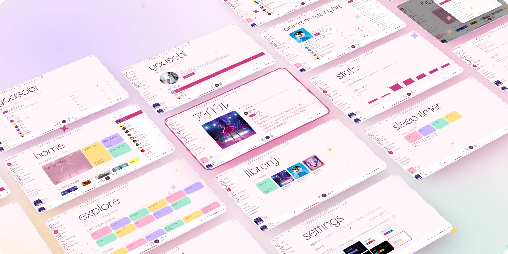
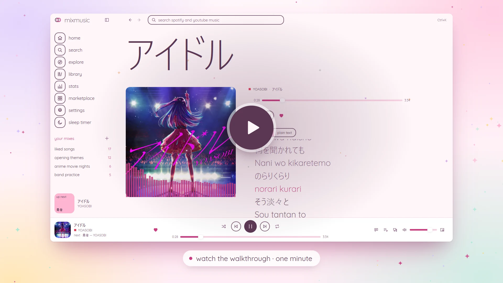
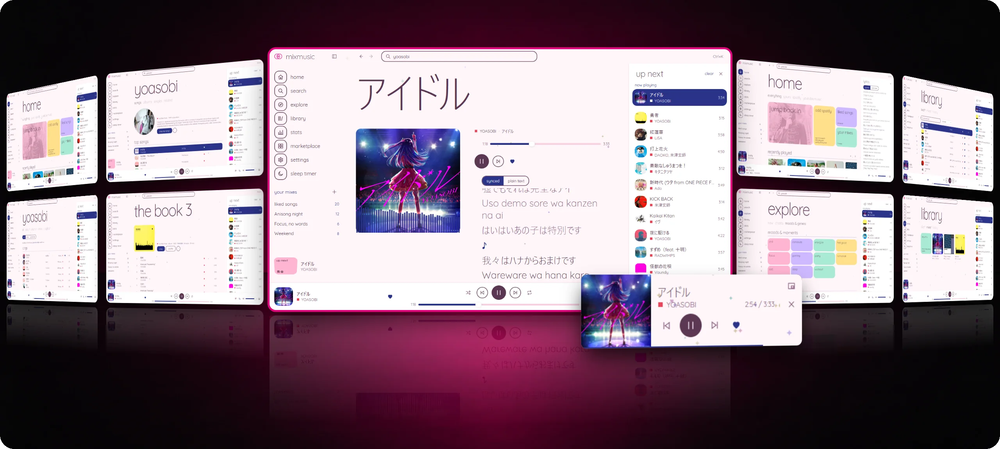
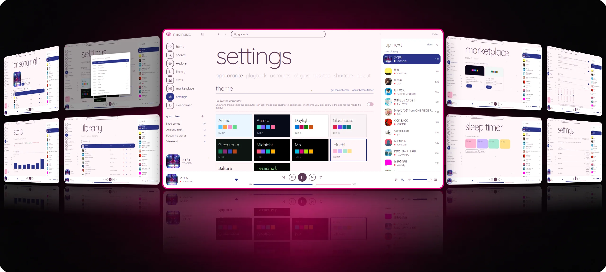

<p align="center">
  
</p>

<h1 align="center">MixMusic</h1>

<p align="center"><strong>Spotify and YouTube Music in one player, shaped the way you like it.</strong></p>

<p align="center">YouTube Music plays the moment you open it, with no account. Add Spotify when you want it.</p>

<p align="center">
  <a href="https://fzn0x.github.io/mixmusic/">Website</a> ·
  <a href="https://github.com/fzn0x/mixmusic/releases/latest">Download</a> ·
  <a href="CHANGELOG.md">Changelog</a> ·
  <a href="community/README.md">Themes and plugins</a>
</p>

<p align="center">
  
</p>

MixMusic is an open-source desktop music player for macOS, Windows and Linux. One
search looks through YouTube Music and Spotify at once, one queue mixes
tracks of both, and one library keeps liked songs and playlists that hold
tracks of either service. Its whole look is a theme, and the community adds
themes and plugins to it from a shared registry.

It is a single small Go program built on [MyGo](https://github.com/egoist/mygo),
which draws its windows itself, on the GPU: there is no browser inside to
download or keep in memory.

## Features

- **One search, two services.** Results of YouTube Music and Spotify side by
  side, every track marked with where it comes from, and YouTube Music's
  with how many times each played, so the original stands out of the
  covers.
- **One queue.** Play a Spotify track after a YouTube Music one, shuffle and
  repeat across both, and let a radio carry on when the queue runs out.
- **Your mixes.** Playlists that hold tracks of every service, liked songs
  across both, import of a service's playlist into a mix, search and sort
  inside any of them, history and listening stats day by day.
- **Your accounts.** Sign in to YouTube Music, on Google's own page, for
  your home feed and your liked songs, playlists, albums and artists, as
  your account or one of its brand channels; sign in to Spotify for your
  library there. Like a song, save an album or a playlist, or follow an
  artist, and it reaches the service too. Make playlists on YouTube Music
  and add tracks of either service to them, and what you play joins your
  YouTube Music history, which its recommendations come from.
- **Explore.** New releases, trending songs, the charts, moods and genres,
  and related songs under what plays.
- **Spotify your way.** Spotify tracks play in MixMusic itself, at Spotify's
  quality, with no Spotify app open (Premium, on Windows), on Spotify
  Connect (your Spotify app, your phone, a speaker), or here, from their
  recording on YouTube Music, with no Premium needed.
- **A real player.** Crossfade, volume levelling, a 10-band equalizer with
  presets, a visualizer, synced lyrics that follow the song or read as plain
  text, and an offline cache of tracks you played.
- **At home on the desktop.** Media keys, the system's media controls on
  Windows, macOS and Linux, the player's buttons on the taskbar thumbnail
  on Windows, tray controls, notifications of new tracks, a mini player
  that stays on top, start at login, and `mixmusic://` links.
- **Scrobbling and Discord.** Connect Last.fm and every track you hear
  joins your profile there, with scrobbles made offline sent once you are
  back. Your Discord profile shows what plays, with its artwork and the
  time left.
- **Updates.** MixMusic looks for a new release at start and every few
  hours, checks its signature, and asks to install it in a pop-up, or
  installs it by itself if you choose.
  Settings › About shows the newest version and installs it, or, for a
  copy that cannot replace itself, downloads its file of the same kind.
- **Keyboard first.** Shortcuts for everything common, a key of your own for
  any command, plugins' too, and a command palette
  (<kbd>Ctrl</kbd> <kbd>K</kbd>) for the rest.
- **Themes.** Ten built in, with effects you tune, a theme for the
  computer's light mode and one for its dark mode, an accent of your own or
  taken from the artwork playing, and community themes one click away.
- **Plugins.** Small ES modules that add pages, commands, track actions and
  widgets through a typed API, drawn in your theme.

## A look around

Every page, in the Mochi theme, playing anime songs from YouTube Music. The
walkthrough goes through them in a minute.

<p align="center">
  <a href="https://fzn0x.github.io/mixmusic/assets/walkthrough.mp4"></a>
</p>

<p align="center">
  
</p>

<p align="center"><sub><b>Listen.</b> Now playing with a visualizer and synced lyrics · home · one search across both services · artists · albums · explore · liked songs · mixes · the mini player, on top of your other windows</sub></p>

<p align="center">
  
</p>

<p align="center"><sub><b>Make it yours.</b> Ten built-in themes and more from the community · the marketplace · plugins, like a sleep timer · a ten-band equalizer · a key of your own for any command · <kbd>Ctrl</kbd> <kbd>K</kbd> for every command · stats day by day · history · Spotify, YouTube Music, Last.fm and Discord</sub></p>

## Install

Download the latest release for your system from
[Releases](https://github.com/fzn0x/mixmusic/releases):

| System | Download |
|---|---|
| macOS 12 and later (Apple silicon and Intel) | `mixmusic-<version>-macos-universal.dmg` |
| Windows 10 and 11 (x64, Arm) | `mixmusic-<version>-windows-<arch>-setup.exe` |
| Windows, without installing | `mixmusic-<version>-windows-<arch>-portable.zip` |
| Debian, Ubuntu and derivatives | `mixmusic-<version>-linux-<arch>.deb` |
| Fedora, openSUSE and derivatives | `mixmusic-<version>-linux-<arch>.rpm` |
| Any Linux, one file | `mixmusic-<version>-linux-<arch>.AppImage` |
| Any Linux, in your home folder | `mixmusic-<version>-linux-<arch>.tar.gz`, with `install.sh` |

`<arch>` is `amd64` for x64 and `arm64` for Arm. Each release lists
`SHA256SUMS` to verify the downloads with. The files named `update-…`,
`….delta` and `mixmusic-<version>-macos-…` or `-windows-<arch>.tar.gz`
are what installed apps update from: you need none of them.

The installers, the portable zip and the Linux archive update themselves.
The `.deb`, the `.rpm` and the AppImage cannot replace their own files: a
pop-up tells you when a new version is out, and downloads its `.deb`,
`.rpm` or AppImage, as Settings › About does. Unpack the
portable zip anywhere and open `MixMusic.exe` in it; your settings and
library stay in your Windows profile, as with the installer. Make the
AppImage executable (`chmod +x`) and open it.

### What it needs

- **macOS:** nothing more. The app is not notarized by Apple yet, so the
  first time you open it macOS says it cannot check it. Open it anyway
  from System Settings › Privacy & Security, with Open Anyway, or clear
  the download mark once in Terminal:

  ```sh
  xattr -dr com.apple.quarantine /Applications/MixMusic.app
  ```
- **Windows:** nothing more. Signing in to YouTube Music and playing
  Spotify in MixMusic take the WebView2 Runtime, which Windows 11 includes.
  The installer is not signed yet, so SmartScreen may warn about it: choose
  More info, then Run anyway.
- **Linux:** GTK 3, and PulseAudio, which PipeWire serves too, or ALSA.
  Signing in to YouTube Music takes WebKitGTK 4.1. On Debian and Ubuntu:

  ```sh
  sudo apt install libgtk-3-0 libpulse0 libwebkit2gtk-4.1-0 libayatana-appindicator3-1 libsecret-1-0
  ```

  On Fedora:

  ```sh
  sudo dnf install gtk3 pulseaudio-libs webkit2gtk4.1 libayatana-appindicator-gtk3 libsecret
  ```

  The tray icon needs `libayatana-appindicator3`, and keeping your sign-ins
  in the system's keyring needs `libsecret`. The `.deb` and the `.rpm`
  install both; MixMusic works without either. The AppImage holds MixMusic
  alone, and uses the system's libraries like the other downloads.
- **To play YouTube Music:** [yt-dlp](https://github.com/yt-dlp/yt-dlp), which
  MixMusic installs for you from Settings › Playback and keeps up to date,
  and a JavaScript runtime yt-dlp uses for YouTube: [Deno](https://deno.com),
  Node.js, Bun or QuickJS. MixMusic finds it on your `PATH`, and in the
  folders of Homebrew, Deno and Bun.

### Spotify

Spotify lets each app serve up to five users of its owner's choosing, while
the owner has Premium, so you sign in with an app of your own: create one in
the [Spotify developer dashboard](https://developer.spotify.com/dashboard) with
a Spotify account that has Premium, add the redirect URI
`http://127.0.0.1:47823/callback`, add your account under Users Management,
and paste its Client ID in Settings › Accounts.
[docs/spotify.md](docs/spotify.md) walks through it, and through what Spotify
allows apps to do.

### YouTube Music

YouTube Music plays without an account. To bring your own home feed and
library, choose Sign in to YouTube Music in Settings › Accounts and sign in
to Google in the window that opens. What you type goes to Google alone:
MixMusic keeps the session the window ends with, encrypted with a key in the
system's keyring where there is one. Tracks still play as they do signed
out: the session never goes to yt-dlp.

### Last.fm

Last.fm asks each app for an API account. Create one at
[last.fm/api/account/create](https://www.last.fm/api/account/create), where
any name will do and the callback URL can stay empty. Paste its API key and
shared secret in Settings › Accounts, and approve MixMusic on the page that
opens in your browser. A track counts once half of it played, or four
minutes.

### Discord

While the Discord app runs, your profile shows what you listen to, as
MixMusic. Turn it off with Show what plays on Discord in Settings ›
Desktop. To show another name, create an application in the
[Discord developer portal](https://discord.com/developers/applications)
and paste its application ID there.

## Make it yours

- [Themes](docs/themes.md): the colors, fonts and corners a theme sets, and
  how to make one.
- [Plugins](docs/plugins.md): the plugin API, with the
  [types](sdk/index.d.ts) for your editor.
- [Share them](community/README.md): add yours to the community registry, and
  everyone can install it from the marketplace.

## Troubleshooting

MixMusic writes what goes wrong to `mixmusic.log`, without your sign-ins:
Settings › About › open logs folder shows it, beside the reports of any
crash. Settings › About › report a problem opens a new issue on GitHub with
your version, system, tools, theme and plugins filled in; attach the log
after reading it. After a crash, MixMusic offers to report it the next
time it starts.

- **Nothing plays from YouTube Music.** Check Settings › Playback: yt-dlp
  has to be installed, and a JavaScript runtime found. MixMusic updates the
  yt-dlp it installed every day, as an old one stops finding streams; one of
  your own, chosen there, you keep up to date yourself (`yt-dlp -U`, or your
  package manager). A track that cannot play says why: some are not
  available in your country, or only to signed-in adults on YouTube's own
  website.
- **The JavaScript runtime is not found.** Opened from the Finder, the Dock
  or a desktop menu, MixMusic does not get the `PATH` of your terminal. It
  also looks where Homebrew, Deno, Bun, Volta, Scoop and WinGet install;
  elsewhere, choose the runtime in Settings › Playback.
- **YouTube Music signed you out.** Settings › Accounts says so when YouTube
  ends the session, as it does when you sign out of Google everywhere or
  change your password. Sign out there, then sign in again.
- **Google refuses the sign-in window** with "This browser or app may not
  be secure". Google decides this; try again later, or from another
  network.
- **Spotify plays from YouTube Music, not in MixMusic.** Spotify plays in
  MixMusic on Windows, with Premium, and with a sign-in made since MixMusic
  played Spotify itself: Settings › Playback asks you to sign in again when
  yours is older.
- **Spotify refuses the sign-in.** A Spotify app in development mode serves
  only while its owner has Premium, and only the accounts added under Users
  Management in its settings, by their Spotify email. Settings › Accounts
  says which it was: see
  [docs/spotify.md](docs/spotify.md#when-spotify-refuses-the-sign-in).
- **No tray icon on Linux.** The tray needs `libayatana-appindicator3` and a
  desktop that shows AppIndicator icons; GNOME needs its AppIndicator
  extension. Without it, closing the window quits MixMusic.
- **Linux does not start it.** Install GTK 3, as above.
- **macOS cannot check the app,** as it is not notarized yet: open it from
  System Settings › Privacy & Security › Open Anyway.

## Known issues

- MixMusic reads YouTube Music through the interfaces of its own website,
  and plays it through yt-dlp. When YouTube changes them, searching,
  playing or signing in can stop working until MixMusic or yt-dlp catches
  up.
- YouTube Music has no sign-in for other apps: MixMusic signs in with a
  browser session, which can do with your account what YouTube Music can.
  Treat it like a password; sign out in Settings › Accounts to delete it.
- Spotify plays in MixMusic itself only on Windows, whose webview,
  WebView2, plays Spotify's protected audio: WebKitGTK on Linux does not,
  and macOS's is not known to. Elsewhere, Spotify Connect plays it.
- Spotify allows apps in development mode up to five users, while their
  owner has Premium, and lets them read less: search shows ten results of
  each kind, and the tracks of playlists you do not own stay hidden.
- Tracks YouTube restricts to some countries, to signed-in adults or to a
  channel's members do not play, as streams are found signed out.
- The macOS app is not notarized and the Windows installer is not signed
  yet, so the first launch asks you to allow it.
- The portable zip does not register `mixmusic://` links, and Windows on Arm
  is less tested than the rest.

## Privacy

MixMusic has no account, server, analytics or telemetry of its own. It
talks to:

- **YouTube and Google:** YouTube Music's catalog, its streams through
  yt-dlp, and the artwork. Signed in, your library there, and, unless you
  turn it off in Settings › Accounts, the tracks you play, which join your
  YouTube Music history.
- **Spotify,** once you sign in: your library, your devices with Spotify
  Connect, and Spotify's player, loaded from `sdk.scdn.co`, when Spotify
  plays in MixMusic.
- **LRCLIB:** the title, artists, album and length of the track playing,
  to find its lyrics.
- **GitHub:** a check for a new version at start and every few hours,
  which you can turn off in Settings › About, and each time you open that
  page; the community registry when you open the marketplace, and the
  downloads of yt-dlp.
- **Last.fm,** once you connect it: what you play. **Discord**, unless you
  turn it off: what plays, to the Discord app on your computer, which shows
  it on your profile.

What it keeps on your computer: your settings and library (liked songs,
mixes, history and recent searches) in the folder Settings › About names;
the tracks you played in the cache, as much as you allow in Settings ›
Playback; your sign-ins in the system's keyring, or, where there is none,
in files only your user can read, the YouTube Music session encrypted;
and the log, without your sign-ins. The library's history clears what you
played, Settings › Playback the cache, and signing out of a service deletes
its sign-in.

On Windows, the visualizer hears the audio of Spotify playing on this
computer, in MixMusic or in the Spotify app, through Windows' process
loopback, which hears that one app: it analyses it in memory, and never
records or sends it.

## Develop

You need [Go](https://go.dev/dl/) 1.27 or later and [Bun](https://bun.sh) 1.2 or later,
which runs MyGo's command line.

```sh
bun install
bun run dev        # the app, rebuilt as you edit it
```

```sh
go test ./...                  # the app
bun run typecheck              # the plugin SDK and the community's plugins
bun run build                  # the packaged app of this system, in build/
bun run build -- -platform windows/amd64,linux/amd64,linux/arm64
go run ./tools/registry -check # the community registry
```

MyGo needs no C toolchain, so any machine builds MixMusic for every system.
[docs/architecture.md](docs/architecture.md) tells how the parts fit, and
[CONTRIBUTING.md](CONTRIBUTING.md) how to send a change.

### Layout

```
main.go              the app: windows, the tray, media keys, deep links
internal/native      the windows: the pages, the player bar, the mini player
internal/app         the services the windows call, and the desktop integration
internal/player      the queue, played by the audio engine or on Spotify's devices
internal/audio       MixMusic's audio engine, and the system's audio output
internal/plugins     plugins, each in a JavaScript engine of its own
internal/youtube     YouTube Music's catalog, and your account there
internal/spotify     the Spotify Web API, its sign-in and Spotify Connect
internal/stream      audio streams, found by yt-dlp and opened for the engine
internal/match       Spotify tracks matched to their YouTube Music recordings
internal/lyrics      synced lyrics
internal/library     liked songs, mixes, history and stats
internal/lastfm      scrobbling to Last.fm
internal/discord     what plays, on your Discord profile
internal/diag        the log, without secrets, and the reports of crashes
internal/addons      themes and plugins, and the community registry
builtin/themes       the themes MixMusic ships with
public/              the page of Spotify's player, on Windows
sdk/                 the types of the plugin API
community/           community themes and plugins, and their registry
```

## Good to know

MixMusic is not affiliated with, endorsed by or sponsored by Spotify or
Google. It plays what these services offer to their users, through the
services' own interfaces; use it as their terms allow. Spotify and YouTube
Music are trademarks of their owners.

## License

MixMusic is dual-licensed: use it under the [MIT license](LICENSE-MIT) or
the [GNU General Public License, version 3](LICENSE-GPL), whichever you
prefer. Contributions are accepted under both. The Selawik typeface in `internal/native/fonts` is under the
[SIL Open Font License](internal/native/fonts/OFL.txt).
