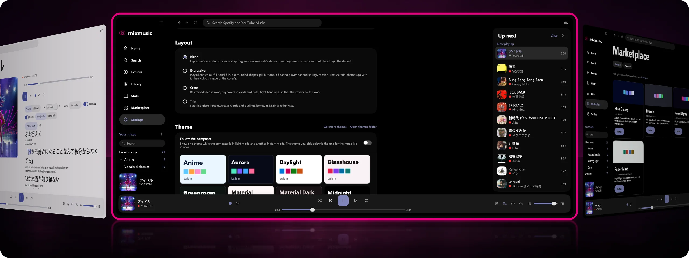

<p align="center"><a href="README.md">English</a> · <a href="README.hi.md">हिन्दी</a> · <a href="README.zh-CN.md">简体中文</a> · <a href="README.id.md">Bahasa Indonesia</a> · <a href="README.ur.md">اردو</a> · <a href="README.ha.md">Hausa</a> · <strong>Português (Brasil)</strong> · <a href="README.bn.md">বাংলা</a> · <a href="README.ru.md">Русский</a> · <a href="README.am.md">አማርኛ</a></p>

<p align="center">
  
</p>

<h1 align="center">MixMusic</h1>

<p align="center"><strong>Um único player para YouTube Music e Spotify.</strong></p>

<p align="center">Cliente de YouTube Music e Spotify para macOS, Windows e Linux. O YouTube Music funciona sem conta. Uma busca, uma fila, playlists mistas, letras sincronizadas, podcasts, seus próprios arquivos de música, transmissão para outros aparelhos, temas e plugins.</p>

<p align="center"><sub>Esta é uma tradução do <a href="README.md">README em inglês</a>. Se houver diferenças, vale a versão atual em inglês.</sub></p>

<p align="center">
  <a href="https://github.com/fzn0x/mixmusic/actions/workflows/ci.yml"></a>
  <a href="https://github.com/fzn0x/mixmusic/actions/workflows/pages.yml"></a>
  <a href="https://github.com/fzn0x/mixmusic/releases/latest"></a>
  <a href="https://github.com/fzn0x/mixmusic/releases"></a>
  <a href="https://pkg.go.dev/github.com/fzn0x/mixmusic"></a>
  <a href="go.mod"></a>
  <a href="https://awesomemygo.dev/apps/mixmusic"></a>
  
  <a href="#licença"></a>
</p>

<p align="center">
  <a href="https://mixmusic.functionx.dev/">Site</a> ·
  <a href="https://github.com/fzn0x/mixmusic/releases/latest">Baixar</a> ·
  <a href="https://mixmusic.functionx.dev/docs/">Documentação</a> ·
  <a href="docs/features.md">Todos os recursos</a> ·
  <a href="CHANGELOG.md">Changelog</a>
</p>

<p align="center">
  
</p>

## Por que o MixMusic

Se a sua música está dividida entre o YouTube Music e o Spotify, você
costuma precisar de dois apps, com duas buscas, duas filas e duas
bibliotecas. O MixMusic reúne os dois serviços em um só player:

- **Uma busca.** Ele pesquisa no YouTube Music e no Spotify ao mesmo tempo
  e marca cada resultado com o serviço de onde vem.
- **Uma fila e uma biblioteca.** Uma faixa do Spotify pode tocar logo depois
  de uma do YouTube Music, e uma playlist pode ter faixas dos dois e dos
  arquivos de música do seu computador.
- **Sem precisar de conta.** O YouTube Music toca assim que você abre o app.
  Entre na sua conta só se quiser a sua biblioteca. O Spotify é opcional.
- **Um programa pequeno.** O MixMusic é um programa em Go que desenha as
  próprias janelas na GPU. Não há navegador dentro dele para baixar nem para
  manter na memória.
- **Do seu jeito.** Vêm quatro layouts e catorze temas, a comunidade
  adiciona mais temas e plugins, e qualquer comando pode ter uma tecla
  sua.
- **No seu idioma.** A janela vem em 66 idiomas além do inglês, com o
  texto da direita para a esquerda em árabe, hebraico, persa e urdu.
- **Privado.** O MixMusic não tem conta, servidor, análise de uso nem
  telemetria próprios.
- **Livre e de código aberto,** sob a licença MIT ou a GPL 3.0.

## Recursos

O que o MixMusic faz, área por área, e onde você encontra cada coisa no
app. **Embutido** quer dizer que funciona por conta própria.
[Recursos](docs/features.md) lista os 363 recursos das versões de 0.1.0 a
0.5.12, um por linha, com a versão em que cada um chegou.

### Buscar e tocar

- **Uma busca para os dois serviços.** Resultados do YouTube Music e do
  Spotify lado a lado, cada um marcado com o seu serviço, e junto com eles
  seus próprios arquivos de música. Os resultados do YouTube Music mostram
  quantas vezes cada faixa foi tocada, para que a original se destaque das
  covers. *Barra superior*
- **Todo tipo de resultado.** Músicas, vídeos, álbuns, artistas, playlists
  e podcasts, ordenados por melhor correspondência, mais tocados ou mais
  recentes, e o próprio YouTube, para as apresentações ao vivo e os envios
  que o catálogo de música não tem. Um link do YouTube ou do Spotify colado
  na caixa de busca toca na hora. *Busca*
- **Uma fila.** Misture faixas dos dois serviços, use aleatório e repetir
  entre elas, passe uma faixa para tocar a seguir e deixe um rádio continuar
  quando a fila acabar. Ela volta como você a deixou depois de reiniciar o
  app. *Barra do player, Fila*
- **Uma página para tudo.** Álbuns, artistas e playlists com Tocar e
  Aleatório, todas as músicas de um artista e músicas relacionadas ao que
  está tocando. *Busca, Início*
- **Pule o que você não quer.** Descurta músicas para que os rádios passem
  direto por elas, pule músicas feitas com IA e as partes de vídeos que o
  SponsorBlock marca, e oculte conteúdo explícito ou prefira as versões
  limpas. *Barra do player, Configurações › Reprodução*
- **Um timer de sono e a velocidade.** Pare depois de um tempo, de uma faixa
  ou da fila, com fade-out, ou sozinho à noite, e toque músicas e podcasts
  mais rápido ou mais devagar, no tom original. *Barra do player*
- **Videoclipes e capas em movimento.** O videoclipe de uma música no lugar
  da capa, e os vídeos curtos que alguns álbuns repetem em loop. *Tocando
  agora, Configurações › Reprodução*
- **Selecione, compartilhe e veja de perto.** Selecione várias faixas para
  enfileirar, adicionar ou baixar de uma vez, compartilhe uma música ou um
  álbum como um cartão de imagem e veja de onde vem uma faixa e por que ela
  não pôde tocar. *Menu de uma faixa*

### Início e Explorar

- **Início** com as suas prateleiras, o Voltar de onde parou e os
  lançamentos dos artistas que você segue, organizados como você quiser.
  *Início*
- **Explorar:** lançamentos, as paradas, humores e gêneros. *Explorar*

### Letras

- **Letras sincronizadas** que acompanham a música, palavra por palavra
  quando a fonte tem isso, em tela cheia também, ou texto simples, se você
  preferir. *Painel de letras, Tocando agora*
- **Tradução e letras latinas:** uma tradução embaixo de cada linha, romaji
  para o japonês e letras latinas para coreano, chinês, russo, árabe e
  muitos outros sistemas de escrita. *Painel de letras*
- **Suas fontes à escolha:** Better Lyrics, Unison, LRCLIB, YouTube Music e
  as legendas do YouTube, na ordem que você definir, com outra fonte, uma
  busca, suas próprias edições e o ajuste de tempo a um clique de distância.
  *Configurações › Reprodução › Letras, Painel de letras*
- **Busque dentro da letra,** compartilhe trechos dela como um cartão e leia
  as letras que os seus próprios arquivos de música guardam. *Painel de
  letras*

### Podcasts

- **Podcasts do YouTube Music e do Spotify.** Encontre e siga programas,
  comece cada episódio de onde você parou, marque episódios como ouvidos,
  leia os capítulos e as transcrições deles e dê a eles uma velocidade
  separada da das músicas. *Busca, Página de um programa, Biblioteca ›
  Podcasts*

### Sua biblioteca

- **Mixes:** playlists que reúnem faixas de todos os serviços, na ordem que
  você quiser, com busca e ordenação e com capas suas. *Biblioteca › Mixes,
  Barra lateral*
- **Músicas curtidas** dos dois serviços em uma só lista, e suas playlists,
  álbuns e artistas do YouTube Music e do Spotify, que você pode salvar,
  criar, compartilhar e fazer em colaboração. Curtidas e itens salvos também
  chegam ao serviço. *Biblioteca*
- **Fixados, pastas e tags** mantêm uma biblioteca grande em ordem, e o que
  você não quer ali pode ficar oculto. *Barra lateral, Menu de um bloco*
- **Siga artistas,** com ou sem conta, e veja os lançamentos novos deles.
  *Página de um artista, Biblioteca › Artistas*
- **Histórico, Estatísticas e Seu ano:** minutos por dia, suas músicas e
  artistas mais ouvidos e cartões deles para compartilhar. *Biblioteca ›
  Histórico, Estatísticas*
- **Downloads** para tocar sem rede, e um cache offline das faixas que você
  tocou. *Menu de uma faixa, Biblioteca › Downloads*

### Músicas neste computador

- **Seus próprios arquivos de música** na biblioteca e na busca, de pastas
  que o MixMusic observa: MP3, FLAC, WAV, M4A, Opus e Vorbis, com as tags e
  as capas deles. *Configurações › Reprodução › Músicas neste computador*
- **Edite as tags deles,** reúna as cópias de uma mesma música e abra ou
  solte arquivos para tocá-los. *Menu de uma faixa, Soltar na janela*

### Contas e serviços

- **YouTube Music.** Entre na própria página do Google, pelo seu navegador
  ou com a sessão de um navegador, como a sua conta ou um de seus canais de
  marca, para ter seu feed inicial, músicas curtidas, playlists, álbuns e
  artistas. O que você toca entra no seu histórico do YouTube Music, de onde
  vêm as recomendações dele. *Configurações › Contas*
- **Last.fm:** cada faixa que você toca até a metade, ou por quatro
  minutos, entra no seu perfil, e os scrobbles feitos offline são enviados
  assim que você volta a ficar online. *Configurações › Contas*
- **ListenBrainz:** o mesmo, junto com o Last.fm ou sem ele, para o
  ListenBrainz ou um servidor seu, como o Maloja. As curtidas podem ir para
  qualquer um dos dois como loves. *Configurações › Contas*
- **Libre.fm:** o mesmo, para o Libre.fm ou outro servidor GNU FM, sem
  precisar criar uma conta de API. *Configurações › Contas*
- **Discord:** seu perfil mostra o que está tocando, com a capa e o tempo
  restante, como você escolher. *Configurações › Desktop*

### Spotify, de três jeitos

- **No próprio MixMusic,** na qualidade do Spotify, sem nenhum app do
  Spotify aberto (Premium, no Windows e no macOS).
- **No Spotify Connect:** seu app do Spotify, seu celular ou uma caixa de
  som, em lossless quando o app do Spotify o tem ligado.
- **Pelo YouTube Music:** o MixMusic toca a gravação da faixa do Spotify no
  YouTube Music, que não exige Premium para tocar.

Escolha em Configurações › Reprodução › Faixas do Spotify.

### Som

- **Um equalizador de dez bandas** com 23 predefinições e as suas, um modo
  simples de Graves, Médios e Agudos e a correção de mais de 8.800 fones de
  ouvido, do AutoEq. *Configurações › Reprodução › Equalizador*
- **Crossfade, álbuns sem pausa entre as faixas, volume uniforme e
  nivelamento de volume.** *Configurações › Reprodução › Som*
- **Reverb, eco, crossfeed, balanço e largura estéreo.** *Configurações ›
  Reprodução*
- **Surround 5.1** onde a faixa o tem, e o dispositivo de saída que você
  escolher. *Barra do player, Configurações › Reprodução › Som*
- **Um visualizador,** desenhado pelo motor de áudio do próprio MixMusic.
  *Tocando agora*

### Transmissão, amigos e outros computadores

- **Transmita** para Chromecasts, caixas Google Home e Nest e os grupos
  delas, renderizadores DLNA e UPnP e receptores FCast, e também seus
  próprios arquivos de música. *Barra do player, Mini player*
- **Ouça com amigos:** crie uma sala que toca em sincronia nos computadores
  dos seus amigos, na sua rede ou de qualquer lugar com um link de convite.
  *Menu de transmissão da barra do player*
- **Controle remoto:** controle o MixMusic em outro computador da sua rede e
  passe o que está tocando de um para o outro. *Menu de transmissão da barra
  do player, Configurações › Desktop*
- **Assistentes de IA** no seu computador podem saber o que está tocando,
  buscar, tocar e ajustar o timer de sono, pelo Model Context Protocol.
  *Configurações › Desktop › Assistentes de IA*

### No seu desktop

- **Um mini player** que fica por cima das suas outras janelas, com a fila e
  as letras no painel dele. *Barra do player, <kbd>Ctrl</kbd> <kbd>M</kbd>*
- **Teclas de mídia** e os controles de mídia do sistema no Windows, macOS e
  Linux. *Embutido*
- **Atalhos globais** seus para tocar, pausar, pular, mudar o volume,
  silenciar, curtir ou descurtir o que toca ou mostrar o MixMusic, seja qual
  for a janela na frente. *Configurações › Atalhos*
- **Os botões do player** na miniatura da barra de tarefas no Windows, e um
  player em volta do notch de um MacBook. *Embutido, Configurações › Desktop*
- **Controles na bandeja do sistema,** notificações de novas faixas, manter
  por cima e início junto com o sistema. *Configurações › Desktop*
- **Links `mixmusic://`** e opções como `--next`, para uma tecla do Stream
  Deck ou um script. *Linha de comando*
- **Tocando agora para overlays:** um cartão do que está tocando para uma
  fonte de navegador do OBS e os dados dele para uma página sua.
  *Configurações › Desktop*

### Deixe do seu jeito

- **Layouts.** O Blend, o padrão, tem formas arredondadas e movimento
  elástico em fileiras densas de capas grandes. O Expressive, inspirado no
  Material 3 Expressive, é divertido, com preenchimentos tonais, botões em
  formato de pílula e uma barra do player flutuante. O Crate é contido, para
  que as capas façam o trabalho, e o Tiles é o primeiro visual do MixMusic,
  com blocos planos e palavras gigantes em minúsculas. *Configurações ›
  Aparência*
- **Temas.** Catorze embutidos, cada um em qualquer layout, com efeitos que
  você pode ajustar, um tema para o modo claro e outro para o modo escuro, e
  uma cor de destaque sua ou tirada da capa que está tocando. Material e
  Material Dark tiram todas as cores da capa. *Configurações › Aparência*
- **Temas e plugins da comunidade,** a um clique de distância no marketplace.
  *Marketplace*
- **Plugins** adicionam páginas, comandos, ações de faixa e widgets por
  meio de uma API tipada, desenhados no seu tema. *Configurações › Plugins*
- **Teclado em primeiro lugar.** Atalhos para tudo o que é comum, uma tecla
  sua para qualquer comando, inclusive os dos plugins, teclas que controlam
  a música de qualquer app e uma paleta de comandos (<kbd>Ctrl</kbd>
  <kbd>K</kbd>) para o resto.
- **Seu idioma.** 66 idiomas além do inglês, da direita para a esquerda onde
  o idioma se lê assim, com datas e números como a sua região os escreve.
  *Configurações › Aparência › Idioma*
- **Para leitores de tela e para o teclado.** Nomes e avisos para leitores
  de tela, todos os controles ao alcance do teclado, tamanho do texto, zoom e
  movimento reduzido. *Embutido, Configurações › Aparência*
- **Um arquivo de configurações.** Suas configurações ficam em
  `settings.json`, na sua pasta de dados (`%AppData%\MixMusic` no Windows,
  `~/Library/Application Support/MixMusic` no macOS, `~/.config/MixMusic` no
  Linux), e você pode guardá-lo junto com seus dotfiles. Salve-o com o
  MixMusic aberto e ele vale na hora. *Configurações › Desktop › Arquivo de
  configurações*

### Backups, importação e exportação

- **Faça backup e restaure** sua biblioteca, suas configurações e seus
  complementos, à mão ou automaticamente, neste computador ou em outro.
  *Configurações › Desktop › Backups*
- **Importe playlists** de arquivos e dos seus dados do Spotify e do Google,
  e exporte listas e a sua biblioteca para arquivos que outros players
  leem. *Biblioteca › Mixes, Menu Mais de uma página*

### Atualizações

- O MixMusic procura uma nova versão ao iniciar e a cada poucas horas,
  verifica a assinatura dela e a instala quando você mandar, ou sozinho, se
  você escolher assim. *Configurações › Sobre*

## Uma olhada

<p align="center">
  
</p>

<p align="center"><sub><b>Ouça.</b> No meio, tocando agora アイドル, do YOASOBI: cada linha se acende quando é cantada, com romaji e uma tradução embaixo. À esquerda, um álbum; à direita, um podcast que você segue.</sub></p>

<p align="center">
  
</p>

<p align="center"><sub><b>Deixe do seu jeito.</b> No meio, os quatro layouts: Blend, o padrão, Expressive, Crate e Tiles, acima dos temas. À esquerda, um tema Material que tira as cores da capa que está tocando. À direita, temas da comunidade no marketplace.</sub></p>

## Documentação

Os guias estão no site, em
[mixmusic.functionx.dev/docs](https://mixmusic.functionx.dev/docs/), também
em [fzn0x.github.io/mixmusic/docs](https://fzn0x.github.io/mixmusic/docs/),
onde uma busca encontra qualquer um deles, e em [`docs/`](docs) aqui.

- **Primeiros passos:** [Primeiros passos](docs/getting-started.md),
  [Recursos](docs/features.md), [Contas](docs/accounts.md),
  [Spotify](docs/spotify.md), [Solução de problemas](docs/troubleshooting.md)
- **Usando o MixMusic:** [Tocar música](docs/playing-music.md),
  [Início](docs/home.md), [Sua biblioteca](docs/library.md),
  [Importar e exportar playlists](docs/import-export.md),
  [Músicas neste computador](docs/local-music.md), [Letras](docs/lyrics.md),
  [Podcasts](docs/podcasts.md), [Aparência](docs/look-and-feel.md),
  [No desktop](docs/desktop.md),
  [Overlays para transmissões ao vivo](docs/stream-overlay.md),
  [Transmissão para outros aparelhos](docs/casting.md), [Controle remoto](docs/remote-control.md),
  [Ouvir com amigos](docs/listen-with-friends.md),
  [Assistentes de IA](docs/ai-assistants.md),
  [Marketplace](docs/marketplace.md), [Configurações](docs/settings.md)
- **Como funciona:** [Como o MixMusic funciona](docs/how-it-works.md),
  [O motor de áudio](docs/audio-engine.md),
  [De onde vêm os streams de áudio](docs/streams.md),
  [Como as faixas do Spotify tocam](docs/spotify-playback.md),
  [Seus dados e a privacidade](docs/data-and-privacy.md)
- **Faça o seu:** [Temas](docs/themes.md), [Plugins](docs/plugins.md)
- **O projeto:** [Créditos](docs/credits.md), [Licença](docs/license.md),
  [Arquitetura](docs/architecture/README.md),
  [Contribuindo](CONTRIBUTING.md), [Código de conduta](CODE_OF_CONDUCT.md),
  [Segurança](SECURITY.md)

## Instalação

Baixe o arquivo para o seu sistema na
[última versão](https://github.com/fzn0x/mixmusic/releases/latest):

| Sistema | Download |
|---|---|
| macOS 12 ou posterior (Apple silicon e Intel) | [`mixmusic-<version>-macos-universal.dmg`](https://github.com/fzn0x/mixmusic/releases/latest) |
| Windows 10 e 11 (x64, Arm), instalador | [`mixmusic-<version>-windows-<arch>-setup.exe`](https://github.com/fzn0x/mixmusic/releases/latest) |
| Windows, portátil, sem instalação | [`mixmusic-<version>-windows-<arch>-portable.zip`](https://github.com/fzn0x/mixmusic/releases/latest) |
| Debian, Ubuntu e derivadas | [`mixmusic-<version>-linux-<arch>.deb`](https://github.com/fzn0x/mixmusic/releases/latest) |
| Fedora, openSUSE e derivadas | [`mixmusic-<version>-linux-<arch>.rpm`](https://github.com/fzn0x/mixmusic/releases/latest) |
| Arch Linux e derivadas (em breve) | [`mixmusic-bin`](https://aur.archlinux.org/packages/mixmusic-bin) no AUR: `yay -S mixmusic-bin` |
| Qualquer Linux, um único arquivo | [`mixmusic-<version>-linux-<arch>.AppImage`](https://github.com/fzn0x/mixmusic/releases/latest) |
| Qualquer Linux, em sandbox (Flatpak) | [`mixmusic-<version>-linux-<arch>.flatpak`](https://github.com/fzn0x/mixmusic/releases/latest) |
| Qualquer Linux, na sua pasta pessoal | [`mixmusic-<version>-linux-<arch>.tar.gz`](https://github.com/fzn0x/mixmusic/releases/latest), com `install.sh` |

`<arch>` é `amd64` para x64 e `arm64` para Arm. Cada versão lista os
`SHA256SUMS` para você conferir os downloads. Você não precisa dos arquivos
chamados `update-…`, `….delta`, `mixmusic-<version>-darwin-universal.tar.gz`
nem `-windows-<arch>.tar.gz`: os apps instalados se atualizam a partir deles.

Os instaladores, o zip portátil e o arquivo do Linux se atualizam sozinhos.
O `.deb`, o `.rpm`, o AppImage e o Flatpak não conseguem substituir os
próprios arquivos, então o MixMusic avisa quando há uma versão nova e a
baixa para você. O `mixmusic-bin` do AUR se atualiza junto com o resto do
seu sistema. No zip portátil, descompacte-o em qualquer lugar e abra o
`MixMusic.exe`. No AppImage, torne-o executável (`chmod +x`) e abra-o. No
Flatpak, abra-o com a sua central de programas ou rode
`flatpak install ./mixmusic-<version>-linux-<arch>.flatpak`; na primeira
vez, o Flatpak baixa o runtime do GNOME do Flathub.

No Mac, o [Homebrew](https://brew.sh) também instala o MixMusic, e
`brew upgrade` o atualiza:

```sh
brew install --cask fzn0x/tap/mixmusic
```

[Primeiros passos](docs/getting-started.md) mostra a instalação e a primeira
execução em cada sistema.

### A primeira execução

- **macOS:** o app ainda não é notarizado pela Apple, então, na primeira vez
  que você o abrir, o macOS diz que não consegue verificá-lo. Abra-o mesmo
  assim em System Settings › Privacy & Security › Open Anyway (Ajustes do
  Sistema › Privacidade e Segurança › Abrir Mesmo Assim), ou rode isto uma
  vez no Terminal:

  ```sh
  xattr -dr com.apple.quarantine /Applications/MixMusic.app
  ```
- **Windows:** o instalador ainda não é assinado, então o SmartScreen pode
  avisar sobre ele: escolha Mais informações e depois Executar assim mesmo.
  Entrar no YouTube Music e tocar Spotify no MixMusic exigem o WebView2
  Runtime, que o Windows 11 já inclui.
- **Linux:** o MixMusic precisa do GTK 3 e do PulseAudio (o PipeWire também
  o atende) ou do ALSA. Entrar no YouTube Music exige o WebKitGTK 4.1, o
  ícone da bandeja exige `libayatana-appindicator3`, e guardar suas contas
  no chaveiro do sistema exige `libsecret`. O `.deb` e o `.rpm` instalam
  tudo isso, e o Flatpak já o traz; para o AppImage e o arquivo compactado:

  ```sh
  # Debian and Ubuntu
  sudo apt install libgtk-3-0 libpulse0 libwebkit2gtk-4.1-0 libayatana-appindicator3-1 libsecret-1-0
  # Fedora
  sudo dnf install gtk3 pulseaudio-libs webkit2gtk4.1 libayatana-appindicator-gtk3 libsecret
  ```

  O MixMusic não traz nenhuma fonte para letras chinesas, japonesas e
  coreanas, e no Linux uma letra que nenhuma fonte instalada tem aparece
  como um espaço em branco. O `.deb` e o `.rpm` pedem uma; com os outros,
  instale uma você mesmo e reinicie o MixMusic:

  ```sh
  # Debian and Ubuntu
  sudo apt install fonts-noto-cjk
  # Fedora
  sudo dnf install google-noto-sans-cjk-vf-fonts
  # Arch
  sudo pacman -S noto-fonts-cjk
  ```
- **Todos os sistemas:** o MixMusic encontra sozinho o áudio da maioria das
  faixas do YouTube Music. Para as demais, como as feitas para crianças, ele
  usa o [yt-dlp](https://github.com/yt-dlp/yt-dlp), que instala para você
  a partir de Settings › Playback (Configurações › Reprodução) e mantém
  atualizado. O yt-dlp precisa de um runtime de JavaScript:
  [Deno](https://deno.com), Node.js, Bun ou QuickJS. O Flatpak já tem o
  Node.js.

### O Flatpak

O Flatpak roda o MixMusic em um sandbox, que enxerga a rede, o servidor de
som, a tela e a GPU, e nada da sua pasta pessoal, a não ser os perfis dos
navegadores instalados pelo Flathub, somente para leitura, de onde dá para
importar um login do YouTube Music. Ele existe para x64 e para Arm64, como
o Raspberry Pi 5, o Asahi Linux e os notebooks com Snapdragon. O MixMusic
não está no Flathub por enquanto: instale o `.flatpak` da versão.

O Flatpak guarda suas configurações e sua biblioteca em
`~/.var/app/io.github.fzn0x.mixmusic`, separado de uma cópia em `.deb`,
`.rpm`, AppImage ou arquivo compactado, e as duas podem rodar ao mesmo
tempo. Para trazer as configurações e a biblioteca de uma cópia, faça um
backup dela em Settings › Desktop › Backups e restaure o arquivo no
Flatpak. Para copiar os arquivos à mão, feche as duas, depois copie
`settings.json`, `library.json`, `plays.jsonl`, `local-copies.json`,
`queue.json`, `positions.json` e as pastas `addons` e `mix-covers` de
`~/.config/MixMusic` para
`~/.var/app/io.github.fzn0x.mixmusic/config/MixMusic`. Feche as duas antes:
um MixMusic em execução mantém `library.json` e a maioria dos outros
arquivos na memória e sobrescreve o arquivo copiado no próximo salvamento.
Depois entre nas suas contas de novo: as contas ficam no chaveiro da outra
cópia. A [página de dados e privacidade](docs/data-and-privacy.md#the-data-folder)
diz o que cada arquivo guarda.

No Flatpak, o início junto com o sistema passa pelo seu desktop, que pode
perguntar antes, e um yt-dlp seu precisa estar em
`~/.var/app/io.github.fzn0x.mixmusic`, pois o sandbox não enxerga nenhuma
outra pasta. Um app do Discord que não seja Flatpak só mostra o que está
tocando se já estava rodando quando o MixMusic começou, até ser reiniciado;
o Discord como Flatpak funciona nos dois casos. O Flatpak é novo: conte em
uma [issue](https://github.com/fzn0x/mixmusic/issues) como ele roda no seu
desktop.

### Contas (todas opcionais)

- **YouTube Music:** escolha Sign in to YouTube Music (Entrar no YouTube
  Music) em Settings › Accounts (Configurações › Contas) e entre no Google
  na janela que abrir. O que você digita vai só para o Google. O MixMusic
  guarda a sessão criptografada, com uma chave no chaveiro do seu sistema,
  quando há um. Onde essa janela não puder abrir, ou o Google a recusar,
  entre com o seu próprio navegador, que o MixMusic abre com um perfil novo
  só dele e apaga quando você entra; importe a sessão de um navegador em que
  você entrou (o MixMusic a lê com o yt-dlp e guarda só os cookies do
  YouTube); ou cole o cabeçalho Cookie de uma aba music.youtube.com em que
  você já entrou.
- **Spotify:** o Spotify deixa um app atender até cinco usuários, e só
  enquanto o dono dele tem Premium, então você entra com um app do Spotify
  seu. Leva dois minutos: [docs/spotify.md](docs/spotify.md) guia você
  pelo processo.
- **Last.fm:** crie uma conta de API em
  [last.fm/api/account/create](https://www.last.fm/api/account/create)
  (qualquer nome, sem URL de callback), cole a chave de API e o segredo
  compartilhado em Settings › Accounts e aprove o MixMusic no seu navegador.
- **ListenBrainz:** cole o token de usuário das suas
  [configurações do ListenBrainz](https://listenbrainz.org/settings/), ou do
  seu próprio servidor, em Settings › Accounts.
- **Libre.fm:** conecte em Settings › Accounts e aprove o MixMusic na página do
  Libre.fm, no seu navegador, ou na de outro servidor GNU FM.
- **Discord:** enquanto o app do Discord roda, seu perfil mostra o que você
  ouve. Desative em Settings › Desktop (Configurações › Desktop).

[Contas](docs/accounts.md) mostra cada login passo a passo.

### Limites conhecidos

- **O Windows em Arm** é menos testado que o x64, e o zip portátil não
  registra os links `mixmusic://`.
- **Apps do Spotify em modo de desenvolvimento,** como o app com que você
  entra, recebem dez resultados de busca de cada tipo, e as faixas das
  playlists que não são suas ficam ocultas.
- **No Linux,** o Spotify toca pelo Spotify Connect por padrão, pois o
  WebKitGTK não consegue tocar o áudio protegido do Spotify.
- **O YouTube** pode mudar suas interfaces e quebrar a busca, a reprodução
  ou o login até o MixMusic ou o yt-dlp se atualizar.

Algo não funciona? [Solução de problemas](docs/troubleshooting.md) cobre os
problemas comuns e os problemas conhecidos.

## Compilar a partir do código-fonte

Você precisa do [Go](https://go.dev/dl/) 1.27.3 ou posterior, do
[Bun](https://bun.sh) 1.4 ou posterior, que roda a linha de comando do MyGo,
e do Git. O MyGo não precisa de compilador C, então qualquer sistema compila
o MixMusic para todos os sistemas.

### Windows

```powershell
winget install GoLang.Go
winget install Oven-sh.Bun
winget install Git.Git
```

Abra um novo terminal e depois:

```powershell
git clone https://github.com/fzn0x/mixmusic
cd mixmusic
bun install
bun run dev
```

Entrar nas contas e tocar Spotify exigem o WebView2 Runtime, que o Windows 11
já inclui. No Windows 10, instale-o pela
[Microsoft](https://developer.microsoft.com/microsoft-edge/webview2/).

### macOS

Com o [Homebrew](https://brew.sh):

```sh
brew install go oven-sh/bun/bun
git clone https://github.com/fzn0x/mixmusic
cd mixmusic
bun install
bun run dev
```

### Linux

Instale o Go a partir de [go.dev/dl](https://go.dev/dl/) (os pacotes das
distribuições costumam ser mais antigos que o 1.27.3), depois o Bun e as
bibliotecas com que o MixMusic roda:

```sh
curl -fsSL https://bun.sh/install | bash
# Debian and Ubuntu
sudo apt install git libgtk-3-0 libpulse0 libwebkit2gtk-4.1-0 libayatana-appindicator3-1 libsecret-1-0
# Fedora
sudo dnf install git gtk3 pulseaudio-libs webkit2gtk4.1 libayatana-appindicator-gtk3 libsecret
```

Depois:

```sh
git clone https://github.com/fzn0x/mixmusic
cd mixmusic
bun install
bun run dev
```

### Nix

Com o [Nix](https://nixos.org), `nix develop` dá a você as ferramentas com
que as versões são compiladas, nas versões que o `flake.lock` fixa: Go 1.27,
Bun, GoReleaser, jq, zip e Zola, e, no Linux, NSIS, osslsigncode e binutils.
`nix build` compila o MixMusic para Linux a partir do código-fonte, em
`result/`, e `nix run github:fzn0x/mixmusic` o executa.

### Desenvolvimento

`bun run dev` compila o app, o inicia e o recompila conforme você edita. Os
dados dele ficam separados dos de um MixMusic instalado, sob o nome
`MixMusic Dev`.

```sh
bun run build:plugins          # the plugins' JavaScript, from their TypeScript
go test ./...                  # the app's tests
bun run typecheck              # the plugin SDK and the community's plugins
go run ./tools/registry -check # the community registry
bun run build                  # the packaged app for this system, in build/
bun run build -- -platform windows/amd64,linux/amd64,linux/arm64
```

No shell do Nix, compile os downloads do Linux com
`.github/scripts/build.sh linux/amd64,linux/arm64`, como as versões fazem.
Um simples `bun run build` ali gera um programa Linux que pede o loader do
próprio Nix, e ele só inicia no NixOS. `go run ./tools/elfloader build/linux-amd64`
confere uma compilação.

O [site](https://mixmusic.functionx.dev/) fica em `site/`, compilado com o
[Zola](https://www.getzola.org), e os guias em `docs/` são as páginas
`/docs/` dele. `go run ./tools/sitedocs && zola --root site serve`
mostra uma prévia. As versões são compiladas no shell do Nix e publicadas pelo
[GoReleaser](https://goreleaser.com) (`.goreleaser.yaml`).

O [CONTRIBUTING.md](CONTRIBUTING.md) traz as verificações a rodar antes de um
pull request, e [docs/architecture](docs/architecture/README.md) explica como
as partes se encaixam, uma página para cada.

### Estrutura

O app é o pacote raiz, com os pacotes de `internal/` abaixo dele. Os pacotes
fora de `internal/` podem ser importados por qualquer pessoa e estão
documentados no [pkg.go.dev](https://pkg.go.dev/github.com/fzn0x/mixmusic).

```
*.go                 the app and its windows: the pages, the player bar, the
                     mini player, the tray, media keys, deep links
fonts/               the typefaces the windows draw with
locales/             the app's words, in English and 66 other languages
internal/app         the services the windows call, and the desktop integration
internal/player      the queue, played by the audio engine or on Spotify's devices
internal/audio       MixMusic's audio engine, and the system's audio output
internal/stream      audio streams, from YouTube or yt-dlp, opened for the engine
internal/youtube     YouTube Music's catalog, and your account there
internal/spotify     the Spotify Web API, its sign-in and Spotify Connect
internal/match       Spotify tracks matched to their YouTube Music recordings
internal/library     liked and disliked songs, mixes, history and stats
internal/localfiles  the music on this computer; tags and tagwrite, its tags
internal/romaji      Japanese lyrics in romaji, kanji read by kagome;
                     romanize, the Latin letters of other scripts
internal/cast        casting to Chromecasts; upnp, to DLNA renderers; fcast,
                     to FCast receivers; dnssd finds them on the network
internal/room        Listen with friends; remote, remote control; portmap,
                     the router's forwarded port
internal/mcp         AI assistants, over the Model Context Protocol
internal/lastfm      scrobbling to Last.fm; listenbrainz and librefm, to
                     theirs; scrobble, which plays count
internal/discord     what plays, on your Discord profile
internal/plugins     plugins, each in a JavaScript engine of its own
internal/addons      themes and plugins, and the community registry
internal/backup      backups and restores; playlistio and export, the files
                     of lists and tracks in and out
internal/diag        the log, without secrets, and the reports of crashes
internal/settings    your preferences and their defaults
builtin/themes       the themes MixMusic ships with
public/              the pages MyGo embeds: Spotify's player, on Windows and
                     macOS, and the picture of music videos
sdk/                 the types of the plugin API
community/           community themes and plugins, and their registry
docs/                the guides, the website's /docs/ pages
site/                the website, built with Zola
tools/               the commands that build and check the repository's parts
packaging/, nix/     the Flatpak, Flathub, AUR and Homebrew packages, and Nix
changelog.d/         the changelog entries of what isn't released yet
```

[docs/architecture](docs/architecture/README.md) fala dos outros pacotes de
`internal/`, uma página para cada parte do app.

Os pacotes que você pode importar:

```
opus/                an Opus decoder in pure Go, a port of libopus's
aac/                 an AAC-LC decoder in pure Go
ac3/                 an AC-3 and E-AC-3 decoder in pure Go, written from ATSC A/52
flac/                a FLAC decoder in pure Go, as RFC 9639 has it
ogg/                 the packets of Ogg files, as RFC 3533 has them
webm/                the audio of WebM files: packets, times and seeking
mp4/                 the audio of MP4 files: packets, times and seeking
resample/            sample rate conversion, with Kaiser-windowed sincs
lyrics/              synced lyrics from Better Lyrics, Unison and LRCLIB, and translations
brand/               MixMusic's logo, for code that draws it
```

## Comunidade

Qualquer pessoa pode instalar temas e plugins da comunidade pelo marketplace,
o ícone de loja na barra lateral, e você pode adicionar os seus.

### Crie um tema

Um tema é um arquivo `theme.json` que define cores, fontes e cantos, que
aparecem no layout que o usuário escolheu.
[docs/themes.md](docs/themes.md) lista todos os tokens e mostra um tema
completo. Para testar o seu, coloque a pasta dele na pasta de temas
(Settings › Appearance › open themes folder, ou Configurações › Aparência ›
abrir pasta de temas) e escolha-o em Settings › Appearance.

### Crie um plugin

Um plugin é um módulo pequeno, escrito em TypeScript ou JavaScript, que
adiciona páginas, comandos, ações de faixa e widgets.
[docs/plugins.md](docs/plugins.md) documenta a API, com seus
[tipos](sdk/index.d.ts) para o seu editor. O
[sleep timer](community/plugins/sleep-timer) e o
[spectrum](community/plugins/spectrum) da comunidade são exemplos
funcionais.

### Compartilhe

1. Faça um fork deste repositório.
2. Adicione uma pasta: `community/themes/<id>/` com o `theme.json` dele para
   um tema, ou `community/plugins/<id>/` com o `plugin.json` e o `index.ts`
   dele para um plugin.
3. Rode `bun install`, `bun run build:plugins`, `go run ./tools/registry` e
   `go run ./tools/registry -check`.
4. Abra um pull request, com uma captura de tela.

Depois que ele for integrado, o CI o publica na
[branch registry](https://github.com/fzn0x/mixmusic/tree/registry), e ele
aparece no marketplace de todo mundo.
[community/README.md](community/README.md) traz os detalhes.

## Privacidade

O MixMusic não tem conta, servidor, análise de uso nem telemetria próprios.
Ele se comunica com:

- **YouTube e Google:** o catálogo do YouTube Music, seus streams e o quão
  alto está cada faixa, pedidos sem login, e as capas; alguns streams pelo
  yt-dlp. Com login, a sua biblioteca lá e, a menos que você desative em
  Settings › Accounts (Configurações › Contas), as faixas que você toca, que
  entram no seu histórico do YouTube Music. O próprio YouTube, sem login e
  sem cookies, para a opção de busca do YouTube, a verificação de músicas
  feitas com IA, as legendas como letras e transcrições e as letras
  sincronizadas com videoclipes.
- **Spotify,** depois que você entra: sua biblioteca, seus dispositivos do
  Spotify Connect e o player do Spotify, carregado de `sdk.scdn.co`, quando
  o Spotify toca no MixMusic.
- **Better Lyrics:** o título, o primeiro artista, o álbum e a duração da
  faixa que está tocando, para encontrar a letra, quando ela já tem álbum e
  duração.
- **Unison:** o ID de vídeo da faixa que está tocando ou, sem ele, o título,
  os artistas, o álbum e a duração, para encontrar a letra. Somente
  enquanto você deixar ligado traduzir, ou romanizar o árabe, ao lado da
  letra, a letra da faixa que está tocando, com o ID de vídeo dela, que o
  Unison manda o Google traduzir ou romanizar.
- **LRCLIB:** o título, os artistas, o álbum e a duração da faixa que está
  tocando, para encontrar a letra.
- **SponsorBlock,** enquanto você deixar ligado Skip the parts
  SponsorBlock marks (Pular as partes que o SponsorBlock marca): os 4
  primeiros caracteres do hash do ID de cada vídeo, nunca o ID, para
  encontrar as partes que ele marca.
- **GitHub:** uma verificação de nova versão ao iniciar e a cada poucas
  horas, que você pode desativar em Settings › About (Configurações ›
  Sobre); o registro da comunidade quando você abre o marketplace; os
  downloads do yt-dlp; a lista de fones de ouvido do AutoEq e o perfil que
  você escolhe; e, na primeira vez que você liga o romaji ao lado de letras
  em japonês, o dicionário das leituras dos kanji (11,7 MB). O romaji, e as
  letras latinas de outros sistemas de escrita, menos o árabe, são feitos no
  seu computador: as letras não são enviadas.
- **Last.fm,** depois que você o conecta: o que você toca.
- **ListenBrainz,** ou um servidor seu com a API dele, depois que você o
  conecta: o que você toca.
- **Libre.fm,** ou outro servidor GNU FM, depois que você o conecta: o que
  você toca.
- **Discord,** a menos que você desative: o que está tocando, enviado ao app
  do Discord no seu computador, que o mostra no seu perfil.
- **Os aparelhos para os quais você transmite,** na sua rede: o título, o
  artista e a capa do que está tocando. Eles buscam o áudio no MixMusic.
- **Outros computadores com o MixMusic,** para o controle remoto e o Ouvir
  com amigos, criptografado, na sua rede ou, enquanto você deixa amigos de
  fora dela entrarem, pela internet. Nesse caso, seu roteador é solicitado a
  encaminhar uma porta, e seu link de convite leva o seu endereço na
  internet.
- **Assistentes de IA** no seu computador, enquanto você deixar: o que está
  tocando, a fila, os resultados das buscas deles e os nomes das suas
  playlists, que um assistente pode repassar ao modelo de IA que usa.
- **YouTube e Spotify,** para saber se a rede responde: um pedido por HTTPS
  com resposta vazia.

Os plugins podem enviar o que quiserem: as permissões de um plugin são
mostradas a você, não impostas, e é por isso que o MixMusic pede que você
confie em um plugin antes de ativá-lo.
[Seus dados e a privacidade](docs/data-and-privacy.md#what-each-feature-sends-where)
traz uma tabela do que cada recurso envia e para onde.

O que ele guarda no seu computador:

- Suas configurações e sua biblioteca (músicas curtidas e descurtidas,
  mixes, cada reprodução que as suas estatísticas contam, artistas e
  programas seguidos, fixados, pastas e tags, histórico, buscas recentes e o
  índice dos seus arquivos de música), na pasta que Settings › About
  indica.
- As faixas que você tocou, no cache, na quantidade que você permitir em
  Settings › Playback, e o quão alto o YouTube as mediu. As músicas que você
  baixa, na pasta de downloads.
- As capas que você viu, até 256 MB.
- As traduções de letras que você ligou, por faixa e idioma, e o dicionário
  com que o romaji lê os kanji, depois que você o ligou.
- Suas contas, inclusive a sessão do YouTube Music, no chaveiro do sistema.
  No Windows, quando o Gerenciador de Credenciais não consegue guardar uma,
  ela vai para um arquivo criptografado para a sua conta do Windows; no
  Linux sem chaveiro, em arquivos que só o seu usuário pode ler.
- O log, sem as suas contas.

A página de histórico da biblioteca apaga o que você tocou, Settings ›
Playback apaga o cache e as capas, e sair de um serviço apaga o login dele.
[Apagar, mover ou redefinir](docs/data-and-privacy.md#clear-move-or-reset)
explica como mover seus dados, manter uma cópia portátil com
`MIXMUSIC_DATA_DIR` ou começar do zero.

No Windows, o visualizador ouve o áudio do Spotify tocando neste
computador, no MixMusic ou no app do Spotify, por meio do process loopback
do Windows, que ouve só esse app. No macOS 14.2 ou posterior, ele ouve o
Spotify tocando no MixMusic por meio de um process tap, depois que você
permite, como o macOS pede. Ele analisa o áudio na memória e nunca o grava
nem o envia.

## Créditos

O MixMusic é construído sobre estes projetos:

- **[MyGo](https://github.com/egoist/mygo)**, o framework de desktop com que
  o MixMusic é feito. O MixMusic usa a UI nativa do MyGo: o MyGo desenha cada
  janela por conta própria, em Go, sem webview, das páginas e da barra do
  player ao mini player. A linha de comando dele empacota o app, com os
  instaladores e as atualizações assinadas pelas quais ele se atualiza.
- **[Go](https://go.dev)**, a linguagem do app, com
  [purego](https://github.com/ebitengine/purego), que chama as bibliotecas
  do sistema sem cgo, e [golang.org/x/image](https://pkg.go.dev/golang.org/x/image)
  e [golang.org/x/text](https://pkg.go.dev/golang.org/x/text).
- **[Sobek](https://github.com/grafana/sobek)**, o motor de JavaScript em que
  cada plugin roda.
- **[Nix](https://nixos.org)**, que fixa as ferramentas com que as versões
  são compiladas e compila o MixMusic para Linux a partir do código-fonte.
- **[GoReleaser](https://goreleaser.com)**, que publica as versões, e o
  [nFPM](https://nfpm.goreleaser.com) dele, que gera os pacotes RPM.
- **[Bun](https://bun.sh)**, que roda a compilação, e
  **[TypeScript](https://www.typescriptlang.org)**, que compila os plugins e
  verifica os tipos do SDK de plugins.
- **[Zola](https://www.getzola.org)**, que compila o site.
- **[NSIS](https://nsis.sourceforge.io)**, que faz os instaladores do
  Windows, e o [appimagetool](https://github.com/AppImage/appimagetool), os
  AppImages.
- **[yt-dlp](https://github.com/yt-dlp/yt-dlp)**, que encontra o áudio das
  faixas que o MixMusic não consegue encontrar sozinho.
- **[SponsorBlock](https://sponsor.ajay.app)**, o banco de dados aberto e
  colaborativo das partes de vídeos do YouTube, de Ajay Ramachandran e seus
  colaboradores, cujas partes o MixMusic pula quando você pede. Uses
  SponsorBlock data licensed under
  [CC BY-NC-SA 4.0](https://creativecommons.org/licenses/by-nc-sa/4.0/)
  from https://sponsor.ajay.app/.
- **[Better Lyrics](https://betterlyrics.org)**, cujo serviço guarda letras
  sincronizadas palavra por palavra.
- **[Unison](https://unison.betterlyrics.org)**, o banco de dados aberto e
  colaborativo de letras, sob a Unison Community License, e **[LRCLIB](https://lrclib.net)**, o
  banco de dados aberto de letras sincronizadas.
- **[kagome](https://github.com/ikawaha/kagome)**, o analisador morfológico
  de japonês que lê os kanji das letras para gerar o romaji, com o
  dicionário IPA do
  [kagome-dict](https://github.com/ikawaha/kagome-dict), feito a partir do
  mecab-ipadic, que o MixMusic baixa na primeira vez que o romaji é ligado.
- **[libopus](https://opus-codec.org)**, de quem o decodificador Opus é um
  port, e **[SharpJaad](https://github.com/jimm98y/SharpJaad)**, o port em
  C# do [JAAD](https://sourceforge.net/projects/jaadec/) de que o
  decodificador AAC deriva.
- **[Chromium](https://www.chromium.org)**, com o Web Audio dele, de que os
  filtros do equalizador, o nivelamento de volume e o visualizador são
  ports, a partir do biquad, do DynamicsCompressor e do AnalyserNode.
- **[AutoEq](https://github.com/jaakkopasanen/AutoEq)**, de Jaakko Pasanen
  e seus colaboradores, cujos perfis corrigem o som dos fones de ouvido, no
  formato do [Equalizer APO](https://sourceforge.net/projects/equalizerapo/).
- **[go-mp3](https://github.com/hajimehoshi/go-mp3)** e
  **[jfreymuth/vorbis](https://github.com/jfreymuth/vorbis)**, que
  decodificam os arquivos MP3 e Vorbis do seu computador, e
  **[Xiph.Org](https://xiph.org)**, de quem `flac` e `ogg` leem o FLAC e o
  Ogg.
- **[FFmpeg](https://ffmpeg.org)**, com o qual os testes dos decodificadores
  comparam.
- **[Selawik](https://github.com/microsoft/Selawik)**,
  **[Quicksand](https://github.com/andrew-paglinawan/QuicksandFamily)**,
  **[Roboto Flex](https://github.com/googlefonts/roboto-flex)** e
  **[Archivo](https://github.com/Omnibus-Type/Archivo)**, as fontes das
  janelas.
- **[Material Color Utilities](https://github.com/material-foundation/material-color-utilities)**,
  de quem a ciência de cor HCT, da qual vêm as cores dos temas Material, é um
  port.
- **[FCast](https://docs.fcast.org)**, o protocolo aberto com que o MixMusic
  toca em receptores FCast. O MixMusic é uma implementação independente dele e
  não é afiliado à FUTO; FCast é marca registrada da FUTO.
- **[Kevin MacLeod](https://incompetech.com)**, cuja música, sob
  [CC BY 4.0](https://creativecommons.org/licenses/by/4.0/), toca no site.

[Créditos](docs/credits.md) nomeia cada projeto, artigo e padrão em que o
MixMusic se baseia.

## Contribuindo

Correções, recursos, temas, plugins e relatos de bugs são todos bem-vindos.

- **Relate um problema** em Settings › About › report a problem
  (Configurações › Sobre › relatar um problema). Ele abre uma nova issue no
  GitHub com sua versão, sistema, tema e plugins já preenchidos. Ou
  [abra uma issue](https://github.com/fzn0x/mixmusic/issues/new) você mesmo.
- **Envie uma mudança** como um pull request. O
  [CONTRIBUTING.md](CONTRIBUTING.md) explica as verificações a rodar, o
  estilo dos commits e a entrada no changelog que uma mudança que as pessoas
  vão notar exige.
- **Compartilhe um tema ou um plugin:** veja [Comunidade](#comunidade).
- **Relate uma vulnerabilidade** em particular, como diz o
  [SECURITY.md](SECURITY.md).

Todos que participam seguem o [código de conduta](CODE_OF_CONDUCT.md).
O [CONTRIBUTORS.md](CONTRIBUTORS.md) agradece às pessoas cujo código, ideias
e relatos moldaram o MixMusic.

## Licença

O MixMusic tem licença dupla: use-o sob a [licença MIT](LICENSE-MIT) ou a
[GNU General Public License, versão 3](LICENSE-GPL), a que você preferir.
As contribuições são aceitas sob as duas. As fontes em `fonts` estão sob a
SIL Open Font License: a do [Selawik](fonts/OFL.txt), a do
[Quicksand](fonts/quicksand-OFL.txt), a do
[Roboto Flex](fonts/robotoflex-OFL.txt) e a do
[Archivo](fonts/archivo-OFL.txt). O decodificador Opus é um port do
libopus, sob [a licença BSD dele](opus/LICENSE.libopus), o decodificador AAC
deriva do SharpJaad, sob [a licença MIT dele](aac/LICENSE.sharpjaad), e a
ciência de cor HCT é um port do Material Color Utilities, sob
[a licença Apache dele](internal/hct/LICENSE.material-color-utilities). Outras
partes mantêm as licenças daquilo de que derivam, como os filtros do Web
Audio do Chromium, o go-mp3, o jfreymuth/vorbis, o kagome e os dados do
Unihan: [Licença](docs/license.md) lista cada uma.

O MixMusic não é afiliado, endossado nem patrocinado pelo Spotify ou pelo
Google. Ele toca o que esses serviços oferecem a seus usuários, pelas
interfaces dos próprios serviços; use-o como os termos deles permitirem.
Spotify e YouTube Music são marcas registradas de seus donos.
