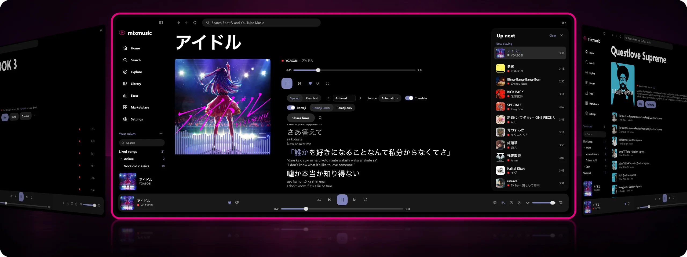

<p align="center"><a href="README.md">English</a> · <a href="README.hi.md">हिन्दी</a> · <a href="README.zh-CN.md">简体中文</a> · <a href="README.id.md">Bahasa Indonesia</a> · <a href="README.ur.md">اردو</a> · <a href="README.ha.md">Hausa</a> · <a href="README.pt-BR.md">Português (Brasil)</a> · <a href="README.bn.md">বাংলা</a> · <strong>Русский</strong> · <a href="README.am.md">አማርኛ</a></p>

<p align="center">
  
</p>

<h1 align="center">MixMusic</h1>

<p align="center"><strong>Один плеер для YouTube Music и Spotify.</strong></p>

<p align="center">Клиент YouTube Music и Spotify для macOS, Windows и Linux. YouTube Music работает без учётной записи. Один поиск, одна очередь, смешанные плейлисты, синхронизированные тексты песен, подкасты, ваши собственные музыкальные файлы, трансляция на другие устройства, темы и плагины.</p>

<p align="center"><sub>Это перевод <a href="README.md">английского README</a>. Если есть расхождения, верна актуальная английская версия.</sub></p>

<p align="center">
  <a href="https://github.com/fzn0x/mixmusic/actions/workflows/ci.yml"></a>
  <a href="https://github.com/fzn0x/mixmusic/actions/workflows/pages.yml"></a>
  <a href="https://github.com/fzn0x/mixmusic/releases/latest"></a>
  <a href="https://github.com/fzn0x/mixmusic/releases"></a>
  <a href="https://pkg.go.dev/github.com/fzn0x/mixmusic"></a>
  <a href="go.mod"></a>
  <a href="https://awesomemygo.dev/apps/mixmusic"></a>
  
  <a href="#лицензия"></a>
</p>

<p align="center">
  <a href="https://mixmusic.functionx.dev/">Сайт</a> ·
  <a href="https://github.com/fzn0x/mixmusic/releases/latest">Скачать</a> ·
  <a href="https://mixmusic.functionx.dev/docs/">Документация</a> ·
  <a href="docs/features.md">Все возможности</a> ·
  <a href="CHANGELOG.md">Список изменений</a>
</p>

<p align="center">
  
</p>

## Зачем нужен MixMusic

Если ваша музыка разбросана между YouTube Music и Spotify, обычно нужны
два приложения: два поиска, две очереди и две медиатеки. MixMusic
объединяет оба сервиса в одном плеере:

- **Один поиск.** Он ищет сразу в YouTube Music и Spotify и помечает
  каждый результат сервисом, откуда тот родом.
- **Одна очередь и одна медиатека.** Трек из Spotify может играть сразу
  после трека из YouTube Music, а в плейлисте могут лежать треки из обоих
  сервисов и музыкальные файлы с вашего компьютера.
- **Учётная запись не нужна.** YouTube Music играет, как только вы открыли
  приложение. Входите, только если хотите свою медиатеку. Spotify по
  желанию.
- **Небольшая программа.** MixMusic это одна программа на Go, которая сама
  рисует свои окна на GPU. Внутри нет браузера, который пришлось бы
  скачивать и держать в памяти.
- **Настраивайте под себя.** В комплекте четыре макета и четырнадцать тем,
  сообщество добавляет новые темы и плагины, а у любой команды может быть
  своя клавиша.
- **На вашем языке.** Окно переведено на 66 языков, кроме английского, а для
  арабского, иврита, персидского и урду оно строится справа налево.
- **Приватность.** У MixMusic нет своих учётных записей, сервера,
  аналитики и телеметрии.
- **Свободное ПО с открытым кодом** под лицензией MIT или GPL 3.0.

## Возможности

Что умеет MixMusic, по областям, и где это найти в приложении.
**Встроено** значит, что оно работает само. В списке
[Все возможности](docs/features.md) собраны все 363 возможности с 0.1.0 по
0.5.12, по одной строке, с версией, в которой каждая появилась.

### Поиск и воспроизведение

- **Один поиск по обоим сервисам.** Результаты YouTube Music и Spotify
  рядом, каждый с пометкой сервиса, а вместе с ними ваши собственные
  музыкальные файлы. Для результатов YouTube Music видно, сколько раз
  проигрывали каждый трек, так что оригинал заметен среди каверов.
  *Верхняя панель*
- **Любые результаты.** Песни, видео, альбомы, исполнители, плейлисты и
  подкасты, с сортировкой по совпадению, по числу прослушиваний или по
  новизне, а также сам YouTube, где есть живые выступления и загрузки,
  которых нет в каталоге музыки. Ссылка на YouTube или Spotify, вставленная
  в поиск, сразу включается. *Поиск*
- **Одна очередь.** Смешивайте треки обоих сервисов, включайте
  перемешивание и повтор сразу для всех, ставьте трек играть следующим, а
  когда очередь закончится, пусть продолжает радио. После перезапуска она
  возвращается такой, какой вы её оставили. *Панель плеера, Очередь*
- **Страница для всего.** Альбомы, исполнители и плейлисты с кнопками
  «Играть» и «Перемешать», все песни исполнителя и похожая музыка к тому,
  что играет. *Поиск, Главная*
- **Пропускайте ненужное.** Ставьте дизлайк песням, чтобы радио их обходило,
  пропускайте песни, сделанные с помощью ИИ, и части видео, которые
  отмечает SponsorBlock, скрывайте ненормативный контент или выбирайте
  чистые версии. *Панель плеера, Настройки › Воспроизведение*
- **Таймер сна и скорость.** Остановка через время, после трека или после
  очереди, с плавным затуханием или сама по ночам, а песни и подкасты можно
  слушать быстрее или медленнее с их собственной высотой тона. *Панель
  плеера*
- **Клипы и движущиеся обложки.** Клип песни вместо её обложки и короткие
  видео, которые крутятся у некоторых альбомов. *Сейчас играет, Настройки ›
  Воспроизведение*
- **Выбор, обмен и подробности.** Выделите несколько треков, чтобы сразу
  поставить в очередь, добавить или скачать, поделитесь песней или альбомом
  в виде карточки-изображения и узнайте, откуда трек и почему он не
  заиграл. *Меню трека*

### Главная и Обзор

- **Главная** с вашими полками, «Продолжить» и новыми релизами исполнителей,
  на которых вы подписаны, в нужном вам порядке. *Главная*
- **Обзор:** новые релизы, чарты, настроения и жанры. *Обзор*

### Тексты песен

- **Синхронизированные тексты,** которые идут за песней, по словам, если
  источник это умеет, в том числе на весь экран, или обычный текст, если вам
  так больше нравится. *Панель текста, Сейчас играет*
- **Перевод и латиница:** перевод под каждой строкой, ромадзи для японского
  и латиница для корейского, китайского, русского, арабского и многих других
  письменностей. *Панель текста*
- **Источники на ваш выбор:** Better Lyrics, Unison, LRCLIB, YouTube Music и
  субтитры YouTube, в заданном вами порядке, а другой источник, поиск,
  собственные правки и сдвиг по времени доступны в один клик. *Настройки ›
  Воспроизведение › Тексты песен, Панель текста*
- **Поиск по тексту,** отправка строк из него карточкой и тексты, которые
  хранятся в ваших собственных файлах песен. *Панель текста*

### Подкасты

- **Подкасты YouTube Music и Spotify.** Находите и отслеживайте
  передачи, начинайте каждый выпуск с того места, где остановились,
  отмечайте выпуски прослушанными, читайте их главы и расшифровки и
  задавайте им скорость отдельно от песен. *Поиск, Страница подкаста,
  Медиатека › Подкасты*

### Ваша медиатека

- **Миксы:** плейлисты, в которых лежат треки из любого сервиса, в вашем
  порядке, с поиском и сортировкой и с вашими собственными обложками.
  *Медиатека › Миксы, Боковая панель*
- **Понравившиеся песни** обоих сервисов в одном списке, а также ваши
  плейлисты, альбомы и исполнители из YouTube Music и Spotify, которые
  можно сохранять, создавать, отправлять другим и вести вместе. Лайки и
  сохранения доходят и до сервиса. *Медиатека*
- **Закрепления, папки и теги** помогают держать в порядке большую
  медиатеку, а ненужное можно скрыть. *Боковая панель, Меню плитки*
- **Подписывайтесь на исполнителей,** с учётной записью или без неё, и
  смотрите их новые релизы. *Страница исполнителя, Медиатека › Исполнители*
- **История, Статистика и «Ваш год»:** минуты по дням, ваши главные песни и
  исполнители и карточки с ними, чтобы поделиться. *Медиатека › История,
  Статистика*
- **Загрузки,** чтобы слушать без сети, и офлайн-кэш треков, которые вы
  слушали. *Меню трека, Медиатека › Загрузки*

### Музыка на этом компьютере

- **Ваши собственные музыкальные файлы** в медиатеке и в поиске, из папок,
  за которыми следит MixMusic: MP3, FLAC, WAV, M4A, Opus и Vorbis, с их
  тегами и обложками. *Настройки › Воспроизведение › Музыка на этом
  компьютере*
- **Правка тегов,** объединение копий одной песни, а также открытие и
  перетаскивание файлов, чтобы их проиграть. *Меню трека, Перетащить в окно*

### Учётные записи и сервисы

- **YouTube Music.** Войдите на странице самого Google, через браузер или
  сеансом браузера, от имени вашей учётной записи или одного из её
  брендовых каналов, чтобы получить домашнюю ленту, понравившиеся песни,
  плейлисты, альбомы и исполнителей. То, что вы слушаете, попадает в вашу
  историю YouTube Music, по которой строятся его рекомендации.
  *Настройки › Учётные записи*
- **Last.fm:** каждый трек, который вы дослушали до половины или четыре
  минуты, попадает в ваш профиль, а скробблы, сделанные офлайн,
  отправляются, как только вы снова онлайн. *Настройки › Учётные записи*
- **ListenBrainz:** то же самое, вместе с Last.fm или без него, в
  ListenBrainz или на ваш собственный сервер, например Maloja. Лайки могут
  уходить в любой из них как loves. *Настройки › Учётные записи*
- **Libre.fm:** то же самое, в Libre.fm или на другой сервер GNU FM, без
  создания учётной записи API. *Настройки › Учётные записи*
- **Discord:** в вашем профиле видно, что играет, с обложкой и временем,
  которое осталось, как вы выберете. *Настройки › Рабочий стол*

### Spotify, тремя способами

- **Прямо в MixMusic,** в качестве Spotify, без запущенного приложения
  Spotify (Premium, на Windows и macOS).
- **Через Spotify Connect:** в вашем приложении Spotify, на телефоне или
  колонке, в lossless, когда он включён в приложении Spotify.
- **Из YouTube Music:** MixMusic воспроизводит запись трека Spotify с
  YouTube Music, для чего Premium не нужен.

Выбор: Настройки › Воспроизведение › Треки Spotify.

### Звук

- **Десятиполосный эквалайзер** с 23 пресетами и вашими собственными,
  простой режим из низких, средних и высоких частот и коррекция более чем
  8800 наушников из AutoEq. *Настройки › Воспроизведение › Эквалайзер*
- **Кроссфейд, альбомы без пауз, одинаковая громкость и выравнивание
  громкости.** *Настройки › Воспроизведение › Звук*
- **Реверберация, эхо, кроссфид, баланс и ширина стерео.** *Настройки ›
  Воспроизведение*
- **Объёмный звук 5.1,** где он есть у трека, и устройство вывода на ваш
  выбор. *Панель плеера, Настройки › Воспроизведение › Звук*
- **Визуализатор,** который рисуется по звуку собственного аудиодвижка
  MixMusic. *Сейчас играет*

### Трансляция, друзья и другие компьютеры

- **Трансляция** на Chromecast, колонки Google Home и Nest и их группы,
  рендереры DLNA и UPnP и приёмники FCast, в том числе ваших собственных
  музыкальных файлов. *Панель плеера, Мини-плеер*
- **Слушайте с друзьями:** создайте комнату, которая играет синхронно на
  компьютерах ваших друзей, в вашей сети или где угодно по ссылке-
  приглашению. *Меню трансляции на панели плеера*
- **Удалённое управление:** управляйте MixMusic на другом компьютере вашей
  сети и переносите то, что играет, между ними. *Меню трансляции на панели
  плеера, Настройки › Рабочий стол*
- **ИИ-помощники** на вашем компьютере могут узнавать, что играет, искать,
  включать музыку и ставить таймер сна через Model Context Protocol.
  *Настройки › Рабочий стол › ИИ-помощники*

### На вашем рабочем столе

- **Мини-плеер,** который остаётся поверх других окон, с очередью и
  текстами в своей панели. *Панель плеера, <kbd>Ctrl</kbd> <kbd>M</kbd>*
- **Медиаклавиши** и системные элементы управления мультимедиа в Windows,
  macOS и Linux. *Встроено*
- **Свои глобальные сочетания клавиш:** воспроизвести, поставить на паузу,
  переключить трек, изменить громкость, выключить звук, поставить лайк или
  дизлайк текущему треку или показать MixMusic, какое бы окно ни было на
  переднем плане. *Настройки › Сочетания клавиш*
- **Кнопки плеера** на миниатюре на панели задач в Windows и плеер вокруг
  выреза на MacBook. *Встроено, Настройки › Рабочий стол*
- **Управление из трея,** уведомления о новых треках, показ поверх всех окон
  и запуск при входе в систему. *Настройки › Рабочий стол*
- **Ссылки `mixmusic://`** и флаги вроде `--next`, для клавиши Stream Deck
  или скрипта. *Командная строка*
- **Что играет, для оверлеев:** карточка с текущим треком для источника
  «браузер» в OBS и данные для вашей собственной страницы. *Настройки ›
  Рабочий стол*

### Настройте под себя

- **Макеты.** Blend, макет по умолчанию, это скруглённые формы и упругая
  анимация на плотных рядах крупных обложек. Expressive, по мотивам Material 3
  Expressive, игривый: тональные заливки, кнопки-таблетки и плавающая панель
  плеера. Crate сдержанный, чтобы работали обложки, а Tiles это первый вид
  MixMusic, с плоскими плитками и гигантскими словами строчными буквами.
  *Настройки › Оформление*
- **Темы.** Четырнадцать встроенных, каждая в любом макете, с эффектами,
  которые можно настроить, отдельной темой для светлого режима и для
  тёмного и акцентным цветом, своим или взятым из обложки играющего трека.
  Темы Material и Material Dark красят всё цветами обложки. *Настройки ›
  Оформление*
- **Темы и плагины сообщества** в маркетплейсе, в один клик.
  *Маркетплейс*
- **Плагины** добавляют страницы, команды, действия над треками и виджеты
  через типизированный API, оформленные вашей темой. *Настройки › Плагины*
- **В первую очередь клавиатура.** Сочетания клавиш для всего привычного,
  своя клавиша для любой команды, включая команды плагинов, клавиши,
  которые управляют музыкой из любого приложения, и палитра команд
  (<kbd>Ctrl</kbd> <kbd>K</kbd>) для остального.
- **Ваш язык.** 66 языков, кроме английского, справа налево там, где язык
  так читается, с датами и числами в том виде, как их пишут в вашем
  регионе. *Настройки › Оформление › Язык*
- **Для программ чтения с экрана и клавиатуры.** Названия и оповещения для
  программ чтения с экрана, каждый элемент доступен с клавиатуры, размер
  текста, масштаб и уменьшение анимации. *Встроено, Настройки › Оформление*
- **Файл настроек.** Ваши настройки лежат в `settings.json` в папке данных
  (`%AppData%\MixMusic` в Windows, `~/Library/Application Support/MixMusic`
  в macOS, `~/.config/MixMusic` в Linux), и его можно хранить вместе с
  dotfiles. Сохраните его, пока MixMusic работает, и он применится сразу.
  *Настройки › Рабочий стол › Файл настроек*

### Резервные копии, импорт и экспорт

- **Создавайте резервные копии и восстанавливайте** медиатеку, настройки и
  дополнения, вручную или автоматически, на этом компьютере или на другом.
  *Настройки › Рабочий стол › Резервные копии*
- **Импортируйте плейлисты** из файлов и из ваших данных Spotify и Google, а
  списки и медиатеку экспортируйте в файлы, которые читают другие плееры.
  *Медиатека › Миксы, Меню «Ещё» страницы*

### Обновления

- MixMusic проверяет, нет ли нового релиза, при запуске и каждые несколько
  часов, проверяет его подпись и ставит по вашей команде или сам, если вы
  так выбрали. *Настройки › О программе*

## Взгляд изнутри

<p align="center">
  
</p>

<p align="center"><sub><b>Слушайте.</b> В центре играет アイドル группы YOASOBI: каждая строка подсвечивается, пока её поют, а под ней ромадзи и перевод. Слева альбом, справа подкаст, на который вы подписаны.</sub></p>

<p align="center">
  
</p>

<p align="center"><sub><b>Настройте под себя.</b> В центре четыре макета: Blend, макет по умолчанию, Expressive, Crate и Tiles, под темами. Слева тема Material, которая берёт цвета из обложки играющего трека. Справа темы сообщества в маркетплейсе.</sub></p>

## Документация

Руководства лежат на сайте,
[mixmusic.functionx.dev/docs](https://mixmusic.functionx.dev/docs/), а также
на [fzn0x.github.io/mixmusic/docs](https://fzn0x.github.io/mixmusic/docs/),
где любое из них находит поиск, и здесь, в [`docs/`](docs).

- **Начало работы:** [Начало работы](docs/getting-started.md),
  [Возможности](docs/features.md), [Учётные записи](docs/accounts.md),
  [Spotify](docs/spotify.md), [Устранение неполадок](docs/troubleshooting.md)
- **Как пользоваться MixMusic:** [Воспроизведение музыки](docs/playing-music.md),
  [Главная](docs/home.md), [Ваша медиатека](docs/library.md),
  [Импорт и экспорт плейлистов](docs/import-export.md),
  [Музыка на этом компьютере](docs/local-music.md),
  [Тексты песен](docs/lyrics.md), [Подкасты](docs/podcasts.md),
  [Внешний вид и поведение](docs/look-and-feel.md),
  [На рабочем столе](docs/desktop.md),
  [Оверлеи для трансляций](docs/stream-overlay.md),
  [Трансляция на устройства](docs/casting.md),
  [Удалённое управление](docs/remote-control.md),
  [Слушайте с друзьями](docs/listen-with-friends.md),
  [ИИ-помощники](docs/ai-assistants.md),
  [Маркетплейс](docs/marketplace.md), [Настройки](docs/settings.md)
- **Как всё устроено:** [Как работает MixMusic](docs/how-it-works.md),
  [Аудиодвижок](docs/audio-engine.md),
  [Откуда берутся аудиопотоки](docs/streams.md),
  [Как играют треки Spotify](docs/spotify-playback.md),
  [Ваши данные и приватность](docs/data-and-privacy.md)
- **Сделайте своё:** [Темы](docs/themes.md), [Плагины](docs/plugins.md)
- **О проекте:** [Благодарности](docs/credits.md), [Лицензия](docs/license.md),
  [Архитектура](docs/architecture/README.md),
  [Участие в проекте](CONTRIBUTING.md), [Кодекс поведения](CODE_OF_CONDUCT.md),
  [Безопасность](SECURITY.md)

## Установка

Скачайте файл для вашей системы со страницы
[последнего релиза](https://github.com/fzn0x/mixmusic/releases/latest):

| Система | Загрузка |
|---|---|
| macOS 12 и новее (Apple silicon и Intel) | [`mixmusic-<version>-macos-universal.dmg`](https://github.com/fzn0x/mixmusic/releases/latest) |
| Windows 10 и 11 (x64, Arm), установщик | [`mixmusic-<version>-windows-<arch>-setup.exe`](https://github.com/fzn0x/mixmusic/releases/latest) |
| Windows, портативная версия, без установки | [`mixmusic-<version>-windows-<arch>-portable.zip`](https://github.com/fzn0x/mixmusic/releases/latest) |
| Debian, Ubuntu и производные | [`mixmusic-<version>-linux-<arch>.deb`](https://github.com/fzn0x/mixmusic/releases/latest) |
| Fedora, openSUSE и производные | [`mixmusic-<version>-linux-<arch>.rpm`](https://github.com/fzn0x/mixmusic/releases/latest) |
| Arch Linux и производные (скоро) | [`mixmusic-bin`](https://aur.archlinux.org/packages/mixmusic-bin) в AUR: `yay -S mixmusic-bin` |
| Любой Linux, один файл | [`mixmusic-<version>-linux-<arch>.AppImage`](https://github.com/fzn0x/mixmusic/releases/latest) |
| Любой Linux, в песочнице (Flatpak) | [`mixmusic-<version>-linux-<arch>.flatpak`](https://github.com/fzn0x/mixmusic/releases/latest) |
| Любой Linux, в вашей домашней папке | [`mixmusic-<version>-linux-<arch>.tar.gz`](https://github.com/fzn0x/mixmusic/releases/latest), с `install.sh` |

`<arch>` это `amd64` для x64 и `arm64` для Arm. В каждом релизе есть
`SHA256SUMS`, по которому можно проверить загрузки. Файлы с именами
`update-…`, `….delta`, `mixmusic-<version>-darwin-universal.tar.gz` и
`-windows-<arch>.tar.gz` вам не нужны: из них обновляются уже установленные
приложения.

Установщики, портативный zip и архив для Linux обновляются сами. `.deb`,
`.rpm`, AppImage и Flatpak не могут заменить собственные файлы, поэтому
MixMusic сообщает, что вышла новая версия, и скачивает её для вас. `mixmusic-bin`
из AUR обновляется вместе с остальной системой. Портативный zip распакуйте
где угодно и откройте `MixMusic.exe`. AppImage сделайте исполняемым
(`chmod +x`) и откройте. Flatpak откройте через центр приложений или
выполните `flatpak install ./mixmusic-<version>-linux-<arch>.flatpak`; в
первый раз Flatpak скачает среду выполнения GNOME с Flathub.

На Mac MixMusic ставит и [Homebrew](https://brew.sh), а `brew upgrade`
его обновляет:

```sh
brew install --cask fzn0x/tap/mixmusic
```

[Начало работы](docs/getting-started.md) проводит через установку и первый
запуск в каждой системе.

### Первый запуск

- **macOS:** приложение ещё не нотаризовано Apple, поэтому при первом
  открытии macOS сообщает, что не может его проверить. Откройте его всё
  равно через Системные настройки › Конфиденциальность и безопасность ›
  Всё равно открыть или один раз выполните в Терминале:

  ```sh
  xattr -dr com.apple.quarantine /Applications/MixMusic.app
  ```
- **Windows:** установщик ещё не подписан, поэтому SmartScreen может его
  предупредить: выберите «Подробнее», затем «Выполнить в любом случае». Для
  входа в YouTube Music и воспроизведения Spotify в MixMusic нужен WebView2
  Runtime, который есть в Windows 11.
- **Linux:** MixMusic нужны GTK 3 и PulseAudio (PipeWire тоже его
  обслуживает) или ALSA. Для входа в YouTube Music нужен WebKitGTK 4.1,
  для значка в трее нужен `libayatana-appindicator3`, а чтобы хранить ваши
  входы в системной связке ключей, нужен `libsecret`. `.deb` и `.rpm`
  ставят их, а Flatpak приносит их с собой; для AppImage и архива:

  ```sh
  # Debian and Ubuntu
  sudo apt install libgtk-3-0 libpulse0 libwebkit2gtk-4.1-0 libayatana-appindicator3-1 libsecret-1-0
  # Fedora
  sudo dnf install gtk3 pulseaudio-libs webkit2gtk4.1 libayatana-appindicator-gtk3 libsecret
  ```

  В MixMusic нет шрифта для китайских, японских и корейских букв, а в Linux
  буква, которой нет ни в одном установленном шрифте, выглядит пустым
  местом. `.deb` и `.rpm` запрашивают такой шрифт; с остальными
  установите его сами и перезапустите MixMusic:

  ```sh
  # Debian and Ubuntu
  sudo apt install fonts-noto-cjk
  # Fedora
  sudo dnf install google-noto-sans-cjk-vf-fonts
  # Arch
  sudo pacman -S noto-fonts-cjk
  ```
- **Любая система:** звук большинства треков YouTube Music MixMusic находит
  сам. Для остальных, например треков, сделанных для детей, он использует
  [yt-dlp](https://github.com/yt-dlp/yt-dlp), который сам устанавливает
  из Настройки › Воспроизведение и поддерживает в актуальном состоянии.
  yt-dlp нужна среда выполнения JavaScript: [Deno](https://deno.com),
  Node.js, Bun или QuickJS. В Flatpak есть Node.js.

### Flatpak

Flatpak запускает MixMusic в песочнице, которая видит сеть, звуковой
сервер, дисплей и GPU, но не видит вашу домашнюю папку, кроме профилей
браузеров, установленных с Flathub, только для чтения: из них можно
импортировать вход в YouTube Music. Он выпускается для x64 и для Arm64,
например для Raspberry Pi 5, Asahi Linux и ноутбуков на Snapdragon.
Пока MixMusic нет на Flathub: установите `.flatpak` из релиза.

Flatpak хранит настройки и медиатеку в `~/.var/app/io.github.fzn0x.mixmusic`,
отдельно от копии из `.deb`, `.rpm`, AppImage или архива, и обе могут
работать одновременно. Чтобы перенести настройки и медиатеку из такой
копии, создайте её резервную копию в Настройки › Рабочий стол › Резервные
копии и восстановите файл во Flatpak. Чтобы вместо этого скопировать файлы
вручную, закройте обе копии, затем скопируйте `settings.json`,
`library.json`, `plays.jsonl`, `local-copies.json`, `queue.json`,
`positions.json` и папки `addons` и `mix-covers` из `~/.config/MixMusic` в
`~/.var/app/io.github.fzn0x.mixmusic/config/MixMusic`. Сначала закройте
обе копии: работающий MixMusic держит `library.json` и большинство других
файлов в памяти и при следующем сохранении перезапишет скопированный. Затем
войдите в свои учётные записи заново: входы остаются в связке ключей другой
копии. [Страница о данных и приватности](docs/data-and-privacy.md#the-data-folder)
говорит, что хранит каждый файл.

Во Flatpak запуск при входе в систему идёт через ваш рабочий стол, который
может сначала спросить вас, а собственный yt-dlp должен лежать в
`~/.var/app/io.github.fzn0x.mixmusic`, поскольку другие папки песочнице
не видны. Приложение Discord, не установленное как Flatpak, показывает,
что играет, только если оно было запущено до MixMusic, а иначе до своего
перезапуска; Discord как Flatpak работает в любом случае. Flatpak новый:
расскажите нам в [issue](https://github.com/fzn0x/mixmusic/issues), как он
работает на вашем рабочем столе.

### Учётные записи (все необязательны)

- **YouTube Music:** выберите «Войти в YouTube Music» в Настройки › Учётные
  записи и войдите в Google в открывшемся окне. Всё, что вы вводите, уходит
  только в Google. MixMusic хранит сеанс в зашифрованном виде, а ключ держит
  в системной связке ключей, где она есть. Если это окно не открывается или
  Google его отклоняет, войдите через свой браузер: MixMusic откроет его с
  новым профилем и удалит профиль, когда вы войдёте; импортируйте сеанс
  браузера, в котором вы вошли (MixMusic читает его через свой yt-dlp и
  оставляет только cookie YouTube); или вставьте заголовок Cookie вкладки
  music.youtube.com, где вы вошли.
- **Spotify:** Spotify позволяет приложению обслуживать до пяти
  пользователей и только пока у его владельца есть Premium, поэтому вы
  входите через собственное приложение Spotify. Это занимает две минуты:
  [docs/spotify.md](docs/spotify.md) проведёт вас по шагам.
- **Last.fm:** создайте учётную запись API на
  [last.fm/api/account/create](https://www.last.fm/api/account/create)
  (любое имя, без callback URL), вставьте её API key и shared secret в
  Настройки › Учётные записи и подтвердите MixMusic в браузере.
- **ListenBrainz:** вставьте user token из ваших
  [настроек ListenBrainz](https://listenbrainz.org/settings/) или с вашего
  собственного сервера в Настройки › Учётные записи.
- **Libre.fm:** подключите в Настройки › Учётные записи и подтвердите
  MixMusic в браузере, на странице Libre.fm или другого сервера GNU FM.
- **Discord:** пока работает приложение Discord, в вашем профиле видно, что
  вы слушаете. Отключается в Настройки › Рабочий стол.

[Учётные записи](docs/accounts.md) описывают каждый вход по шагам.

### Известные ограничения

- **Windows на Arm** проверена меньше, чем x64, а портативный zip не
  регистрирует ссылки `mixmusic://`.
- **Приложения Spotify в режиме разработки,** как то, через которое вы
  входите, дают по десять результатов поиска каждого вида, а треки
  плейлистов, которыми вы не владеете, остаются скрытыми.
- **В Linux** Spotify по умолчанию играет через Spotify Connect, потому что
  WebKitGTK не умеет воспроизводить защищённый звук Spotify.
- **YouTube** может изменить свои интерфейсы и сломать поиск,
  воспроизведение или вход, пока MixMusic или yt-dlp не догонят его.

Что-то не работает? [Устранение неполадок](docs/troubleshooting.md)
описывает частые проблемы и известные неполадки.

## Сборка из исходников

Вам нужны [Go](https://go.dev/dl/) 1.27.3 или новее, [Bun](https://bun.sh)
1.4 или новее, на котором работает командная строка MyGo, и Git. MyGo не
нужен компилятор C, поэтому любая система собирает MixMusic для всех
систем.

### Windows

```powershell
winget install GoLang.Go
winget install Oven-sh.Bun
winget install Git.Git
```

Откройте новый терминал, затем:

```powershell
git clone https://github.com/fzn0x/mixmusic
cd mixmusic
bun install
bun run dev
```

Для входа и воспроизведения Spotify нужен WebView2 Runtime, который есть в
Windows 11. В Windows 10 установите его с сайта
[Microsoft](https://developer.microsoft.com/microsoft-edge/webview2/).

### macOS

С [Homebrew](https://brew.sh):

```sh
brew install go oven-sh/bun/bun
git clone https://github.com/fzn0x/mixmusic
cd mixmusic
bun install
bun run dev
```

### Linux

Установите Go с [go.dev/dl](https://go.dev/dl/) (пакеты дистрибутивов
часто старше 1.27.3), затем Bun и библиотеки, с которыми работает
MixMusic:

```sh
curl -fsSL https://bun.sh/install | bash
# Debian and Ubuntu
sudo apt install git libgtk-3-0 libpulse0 libwebkit2gtk-4.1-0 libayatana-appindicator3-1 libsecret-1-0
# Fedora
sudo dnf install git gtk3 pulseaudio-libs webkit2gtk4.1 libayatana-appindicator-gtk3 libsecret
```

Затем:

```sh
git clone https://github.com/fzn0x/mixmusic
cd mixmusic
bun install
bun run dev
```

### Nix

С [Nix](https://nixos.org) команда `nix develop` даёт инструменты, которыми
собирают релизы, тех версий, что закреплены в `flake.lock`: Go 1.27, Bun,
GoReleaser, jq, zip и Zola, а в Linux ещё NSIS, osslsigncode и binutils.
`nix build` собирает MixMusic для Linux из исходников в `result/`, а
`nix run github:fzn0x/mixmusic` запускает его.

### Разработка

`bun run dev` собирает приложение, запускает его и пересобирает, пока вы
правите код. Его данные хранятся отдельно от установленного MixMusic, под
именем `MixMusic Dev`.

```sh
bun run build:plugins          # the plugins' JavaScript, from their TypeScript
go test ./...                  # the app's tests
bun run typecheck              # the plugin SDK and the community's plugins
go run ./tools/registry -check # the community registry
bun run build                  # the packaged app for this system, in build/
bun run build -- -platform windows/amd64,linux/amd64,linux/arm64
```

В оболочке Nix загрузки для Linux собирайте так:
`.github/scripts/build.sh linux/amd64,linux/arm64`, как это делают релизы.
Обычный `bun run build` там создаёт программу для Linux, которой нужен
собственный загрузчик Nix, и она запускается только на NixOS.
`go run ./tools/elfloader build/linux-amd64` проверяет сборку.

[Сайт](https://mixmusic.functionx.dev/) лежит в `site/`, его собирает
[Zola](https://www.getzola.org), а руководства в `docs/` это его страницы
`/docs/`. `go run ./tools/sitedocs && zola --root site serve` показывает
его предварительно. Релизы собираются в оболочке Nix и публикуются
[GoReleaser](https://goreleaser.com) (`.goreleaser.yaml`).

[CONTRIBUTING.md](CONTRIBUTING.md) перечисляет проверки, которые нужно
выполнить перед pull request, а [docs/architecture](docs/architecture/README.md)
объясняет, как части устроены вместе, по странице на каждую.

### Структура

Приложение это корневой пакет, а под ним пакеты из `internal/`. Пакеты вне
`internal/` предназначены для импорта кем угодно и описаны на
[pkg.go.dev](https://pkg.go.dev/github.com/fzn0x/mixmusic).

```
*.go                 the app and its windows: the pages, the player bar, the
                     mini player, the tray, media keys, deep links
fonts/               the typefaces the windows draw with
locales/             the app's words, in English and 66 other languages
internal/app         the services the windows call, and the desktop integration
internal/player      the queue, played by the audio engine or on Spotify's devices
internal/audio       MixMusic's audio engine, and the system's audio output
internal/stream      audio streams, from YouTube or yt-dlp, opened for the engine
internal/youtube     YouTube Music's catalog, and your account there
internal/spotify     the Spotify Web API, its sign-in and Spotify Connect
internal/match       Spotify tracks matched to their YouTube Music recordings
internal/library     liked and disliked songs, mixes, history and stats
internal/localfiles  the music on this computer; tags and tagwrite, its tags
internal/romaji      Japanese lyrics in romaji, kanji read by kagome;
                     romanize, the Latin letters of other scripts
internal/cast        casting to Chromecasts; upnp, to DLNA renderers; fcast,
                     to FCast receivers; dnssd finds them on the network
internal/room        Listen with friends; remote, remote control; portmap,
                     the router's forwarded port
internal/mcp         AI assistants, over the Model Context Protocol
internal/lastfm      scrobbling to Last.fm; listenbrainz and librefm, to
                     theirs; scrobble, which plays count
internal/discord     what plays, on your Discord profile
internal/plugins     plugins, each in a JavaScript engine of its own
internal/addons      themes and plugins, and the community registry
internal/backup      backups and restores; playlistio and export, the files
                     of lists and tracks in and out
internal/diag        the log, without secrets, and the reports of crashes
internal/settings    your preferences and their defaults
builtin/themes       the themes MixMusic ships with
public/              the pages MyGo embeds: Spotify's player, on Windows and
                     macOS, and the picture of music videos
sdk/                 the types of the plugin API
community/           community themes and plugins, and their registry
docs/                the guides, the website's /docs/ pages
site/                the website, built with Zola
tools/               the commands that build and check the repository's parts
packaging/, nix/     the Flatpak, Flathub, AUR and Homebrew packages, and Nix
changelog.d/         the changelog entries of what isn't released yet
```

[docs/architecture](docs/architecture/README.md) рассказывает об остальных
пакетах `internal/`, по странице на каждую часть приложения.

Пакеты, которые можно импортировать:

```
opus/                an Opus decoder in pure Go, a port of libopus's
aac/                 an AAC-LC decoder in pure Go
ac3/                 an AC-3 and E-AC-3 decoder in pure Go, written from ATSC A/52
flac/                a FLAC decoder in pure Go, as RFC 9639 has it
ogg/                 the packets of Ogg files, as RFC 3533 has them
webm/                the audio of WebM files: packets, times and seeking
mp4/                 the audio of MP4 files: packets, times and seeking
resample/            sample rate conversion, with Kaiser-windowed sincs
lyrics/              synced lyrics from Better Lyrics, Unison and LRCLIB, and translations
brand/               MixMusic's logo, for code that draws it
```

## Сообщество

Любой может установить темы и плагины сообщества из маркетплейса, значка
магазина на боковой панели, и добавить свои.

### Сделайте тему

Тема это файл `theme.json`, который задаёт цвета, шрифты и скругления,
видимые в макете, выбранном пользователем.
[docs/themes.md](docs/themes.md) перечисляет все токены и показывает
полную тему. Чтобы попробовать свою, положите её папку в папку тем
(Настройки › Оформление › открыть папку тем) и выберите её в Настройки ›
Оформление.

### Сделайте плагин

Плагин это небольшой модуль на TypeScript или JavaScript, который
добавляет страницы, команды, действия над треками и виджеты.
[docs/plugins.md](docs/plugins.md) описывает API, а его
[типы](sdk/index.d.ts) помогут вашему редактору. Рабочие примеры из
сообщества: [таймер сна](community/plugins/sleep-timer) и
[спектр](community/plugins/spectrum).

### Поделитесь им

1. Сделайте форк этого репозитория.
2. Добавьте одну папку: `community/themes/<id>/` с её `theme.json` для
   темы или `community/plugins/<id>/` с её `plugin.json` и её `index.ts`
   для плагина.
3. Выполните `bun install`, `bun run build:plugins`, `go run ./tools/registry`
   и `go run ./tools/registry -check`.
4. Откройте pull request со скриншотом.

После слияния CI публикует его в
[ветке registry](https://github.com/fzn0x/mixmusic/tree/registry), и он
появляется в маркетплейсе у всех. Подробности в
[community/README.md](community/README.md).

## Конфиденциальность

У MixMusic нет своих учётных записей, сервера, аналитики и телеметрии. Он
обращается к:

- **YouTube и Google:** каталог YouTube Music, его потоки и громкость
  каждого трека запрашиваются без входа, а также обложки; часть потоков
  через yt-dlp. После входа добавляется ваша медиатека там и, если вы не
  отключите это в Настройки › Учётные записи, треки, которые вы слушаете и
  которые попадают в вашу историю YouTube Music. Сам YouTube, без входа и
  без cookie: для выбора поиска по YouTube, для проверки песен, сделанных с
  помощью ИИ, для субтитров в роли текстов и расшифровок и для текстов,
  синхронизированных с клипами.
- **Spotify,** после входа: ваша медиатека, ваши устройства Spotify
  Connect и плеер Spotify, который загружается с `sdk.scdn.co`, когда
  Spotify играет в MixMusic.
- **Better Lyrics:** название, первый исполнитель, альбом и длительность
  играющего трека, чтобы найти его текст, когда у трека есть альбом и
  длительность.
- **Unison:** ID видео играющего трека или, если его нет, название,
  исполнители, альбом и длительность, чтобы найти текст песни. И только
  пока вы включаете перевод или романизацию арабского рядом с текстом:
  текст играющего трека вместе с ID его видео, который Unison отдаёт на
  перевод или романизацию Google.
- **LRCLIB:** название, исполнители, альбом и длительность играющего
  трека, чтобы найти его текст.
- **SponsorBlock,** пока вы включаете «Пропускать части, отмеченные
  SponsorBlock»: первые 4 символа хеша ID каждого видео, но не сам ID,
  чтобы найти отмеченные им части.
- **GitHub:** проверка новой версии при запуске и каждые несколько часов,
  которую можно отключить в Настройки › О программе; реестр сообщества,
  когда вы открываете маркетплейс; загрузки yt-dlp; список наушников
  AutoEq и выбранный вами профиль; и, когда вы впервые включаете ромадзи
  рядом с японским текстом, словарь чтений кандзи (11,7 МБ). Ромадзи и
  латиница других письменностей, кроме арабской, делаются на вашем
  компьютере: тексты не отправляются.
- **Last.fm,** после подключения: то, что вы слушаете.
- **ListenBrainz,** или ваш собственный сервер с его API, после
  подключения: то, что вы слушаете.
- **Libre.fm,** или другой сервер GNU FM, после подключения: то, что вы
  слушаете.
- **Discord,** если вы не отключите: то, что играет, уходит в приложение
  Discord на вашем компьютере, которое показывает это в вашем профиле.
- **Устройства, на которые вы транслируете,** в вашей сети: название,
  исполнитель и обложка того, что играет. Звук они забирают у MixMusic.
- **Другие компьютеры с MixMusic,** для удалённого управления и «Слушайте с
  друзьями», в зашифрованном виде, в вашей сети или, пока вы разрешаете
  друзьям вне её присоединиться, через интернет. Тогда у вашего роутера
  просят пробросить один порт, а ваша ссылка-приглашение содержит ваш
  интернет-адрес.
- **ИИ-помощники** на вашем компьютере, пока вы им разрешаете: что играет,
  очередь, результаты их поиска и названия ваших плейлистов, которые
  помощник может передать ИИ-модели, которой пользуется.
- **YouTube и Spotify,** чтобы узнать, отвечает ли сеть: запрос по HTTPS
  с пустым ответом.

Плагины могут отправлять что угодно: разрешения плагина показываются вам, но
не применяются принудительно, поэтому MixMusic просит вас довериться
плагину, прежде чем включить его.
[Ваши данные и приватность](docs/data-and-privacy.md#what-each-feature-sends-where)
содержит таблицу того, что каждая функция куда отправляет.

Что он хранит на вашем компьютере:

- Ваши настройки и медиатеку (понравившиеся и не понравившиеся песни,
  миксы, каждое прослушивание, которое считает ваша статистика, исполнителей
  и подкасты, на которые вы подписаны, закрепления, папки и теги, историю,
  недавние поисковые запросы и индекс ваших музыкальных файлов) в папке,
  которую называет Настройки › О программе.
- Треки, которые вы слушали, в кэше, в объёме, который вы разрешаете в
  Настройки › Воспроизведение, и громкость, которую измерил YouTube. Песни,
  которые вы скачали, в папке загрузок.
- Обложки, которые вы видели, до 256 МБ.
- Переводы текстов, которые вы включали, по трекам и языкам, и словарь, по
  которому ромадзи читает кандзи, после того как вы его включили.
- Ваши входы, включая сеанс YouTube Music, в системной связке ключей. В
  Windows, если Credential Manager не может сохранить вход, он попадает в
  файл, зашифрованный для вашей учётной записи Windows; в Linux без связки
  ключей это файлы, которые может читать только ваш пользователь.
- Журнал, без ваших входов.

Страница истории в медиатеке стирает то, что вы слушали, Настройки ›
Воспроизведение очищает кэш и обложки, а выход из сервиса удаляет его вход.
[Очистить, перенести или сбросить](docs/data-and-privacy.md#clear-move-or-reset)
рассказывает, как перенести ваши данные, держать переносную копию с
`MIXMUSIC_DATA_DIR` или начать с чистого листа.

В Windows визуализатор слышит звук Spotify, играющего на этом компьютере, в
MixMusic или в приложении Spotify, через process loopback Windows, который
слышит только это приложение. В macOS 14.2 и новее он слышит Spotify,
играющий в MixMusic, через process tap, когда вы это разрешите, как просит
macOS. Он анализирует звук в памяти и никогда не записывает и не
отправляет его.

## Благодарности

MixMusic построен на этих проектах:

- **[MyGo](https://github.com/egoist/mygo)**, фреймворк для десктопа, на
  котором построен MixMusic. MixMusic использует нативный UI MyGo: MyGo сам
  рисует каждое окно на Go, без webview, от страниц и панели плеера до
  мини-плеера. Его командная строка упаковывает приложение вместе с
  установщиками и подписанными обновлениями, из которых оно обновляется.
- **[Go](https://go.dev)**, язык приложения, вместе с
  [purego](https://github.com/ebitengine/purego), который вызывает
  системные библиотеки без cgo, а также
  [golang.org/x/image](https://pkg.go.dev/golang.org/x/image)
  и [golang.org/x/text](https://pkg.go.dev/golang.org/x/text).
- **[Sobek](https://github.com/grafana/sobek)**, движок JavaScript, в
  котором работает каждый плагин.
- **[Nix](https://nixos.org)**, который закрепляет инструменты, которыми
  собирают релизы, и собирает MixMusic для Linux из исходников.
- **[GoReleaser](https://goreleaser.com)**, который публикует релизы, и его
  [nFPM](https://nfpm.goreleaser.com), который делает пакеты RPM.
- **[Bun](https://bun.sh)**, который запускает сборку, и
  **[TypeScript](https://www.typescriptlang.org)**, который компилирует
  плагины и проверяет типы SDK плагинов.
- **[Zola](https://www.getzola.org)**, который собирает сайт.
- **[NSIS](https://nsis.sourceforge.io)**, который делает установщики для
  Windows, и [appimagetool](https://github.com/AppImage/appimagetool),
  который делает AppImage.
- **[yt-dlp](https://github.com/yt-dlp/yt-dlp)**, который находит звук
  треков, которые MixMusic не может найти сам.
- **[SponsorBlock](https://sponsor.ajay.app)**, открытая база частей
  видео YouTube, собираемая сообществом, от Ajay Ramachandran и её
  участников, чьи части MixMusic пропускает, пока вы об этом просите. Uses
  SponsorBlock data licensed under
  [CC BY-NC-SA 4.0](https://creativecommons.org/licenses/by-nc-sa/4.0/)
  from https://sponsor.ajay.app/.
- **[Better Lyrics](https://betterlyrics.org)**, сервис с текстами, синхронизированными по словам.
- **[Unison](https://unison.betterlyrics.org)**, открытая база текстов
  песен, собираемая сообществом, под Unison Community License, и **[LRCLIB](https://lrclib.net)**,
  открытая база синхронизированных текстов песен.
- **[kagome](https://github.com/ikawaha/kagome)**, японский
  морфологический анализатор, который читает кандзи в текстах для их
  ромадзи, со словарём IPA из
  [kagome-dict](https://github.com/ikawaha/kagome-dict), сделанным из
  mecab-ipadic, который MixMusic скачивает, когда ромадзи включают в
  первый раз.
- **[libopus](https://opus-codec.org)**, портом чьего декодера является
  наш декодер Opus, и **[SharpJaad](https://github.com/jimm98y/SharpJaad)**,
  порт [JAAD](https://sourceforge.net/projects/jaadec/) на C#, от которого
  происходит декодер AAC.
- **[Chromium](https://www.chromium.org)** и его Web Audio, портами чьих
  biquad, DynamicsCompressor и AnalyserNode являются фильтры эквалайзера,
  выравнивание громкости и визуализатор.
- **[AutoEq](https://github.com/jaakkopasanen/AutoEq)**, от Jaakko Pasanen
  и его участников, чьи профили корректируют звук наушников, в формате
  [Equalizer APO](https://sourceforge.net/projects/equalizerapo/).
- **[go-mp3](https://github.com/hajimehoshi/go-mp3)** и
  **[jfreymuth/vorbis](https://github.com/jfreymuth/vorbis)**, которые
  декодируют файлы MP3 и Vorbis на вашем компьютере, и
  **[Xiph.Org](https://xiph.org)**, чьи FLAC и Ogg читают `flac` и `ogg`.
- **[FFmpeg](https://ffmpeg.org)**, с которым сравниваются тесты
  декодеров.
- **[Selawik](https://github.com/microsoft/Selawik)**,
  **[Quicksand](https://github.com/andrew-paglinawan/QuicksandFamily)**,
  **[Roboto Flex](https://github.com/googlefonts/roboto-flex)** и
  **[Archivo](https://github.com/Omnibus-Type/Archivo)**, шрифты окон.
- **[Material Color Utilities](https://github.com/material-foundation/material-color-utilities)**,
  портом чьей цветовой науки HCT являются цвета тем Material.
- **[FCast](https://docs.fcast.org)**, открытый протокол, по которому MixMusic
  играет на приёмниках FCast. MixMusic является его независимой реализацией и не
  связан с FUTO; FCast является зарегистрированным товарным знаком FUTO.
- **[Kevin MacLeod](https://incompetech.com)**, чья музыка под лицензией
  [CC BY 4.0](https://creativecommons.org/licenses/by/4.0/) играет на
  сайте.

[Благодарности](docs/credits.md) называют каждый проект, статью и стандарт,
на которых построен MixMusic.

## Участие в проекте

Исправления, новые функции, темы, плагины и сообщения об ошибках, всё
это приветствуется.

- **Сообщите о проблеме** через Настройки › О программе › сообщить о
  проблеме. Откроется новый issue на GitHub с уже заполненными версией,
  системой, темой и плагинами. Или
  [откройте issue](https://github.com/fzn0x/mixmusic/issues/new) сами.
- **Отправьте изменение** как pull request. [CONTRIBUTING.md](CONTRIBUTING.md)
  объясняет, какие проверки запускать, какой стиль коммитов принят и какая
  запись в списке изменений нужна изменению, которое заметят люди.
- **Поделитесь темой или плагином:** см. [Сообщество](#сообщество).
- **Сообщите об уязвимости** в частном порядке, как говорит
  [SECURITY.md](SECURITY.md).

Все участники следуют [кодексу поведения](CODE_OF_CONDUCT.md).
[CONTRIBUTORS.md](CONTRIBUTORS.md) благодарит людей, чьи код, идеи и
сообщения сформировали MixMusic.

## Лицензия

MixMusic распространяется под двумя лицензиями: используйте его по
[лицензии MIT](LICENSE-MIT) или по [Стандартной общественной лицензии GNU,
версии 3](LICENSE-GPL), как вам больше нравится. Вклады принимаются под
обеими. Шрифты в `fonts` распространяются под SIL Open Font License:
[Selawik](fonts/OFL.txt), [Quicksand](fonts/quicksand-OFL.txt),
[Roboto Flex](fonts/robotoflex-OFL.txt) и
[Archivo](fonts/archivo-OFL.txt). Декодер Opus это порт libopus под
[её лицензией BSD](opus/LICENSE.libopus), декодер AAC происходит от
SharpJaad под [его лицензией MIT](aac/LICENSE.sharpjaad), а цветовая
наука HCT это порт Material Color Utilities под
[его лицензией Apache](internal/hct/LICENSE.material-color-utilities).
Остальные части сохраняют лицензии того, от чего они происходят, например
фильтры Web Audio в Chromium, go-mp3, jfreymuth/vorbis, kagome и данные
Unihan: [Лицензия](docs/license.md) перечисляет каждую.

MixMusic не связан со Spotify и Google, не одобрен и не спонсируется ими.
Он воспроизводит то, что эти сервисы предлагают своим пользователям, через
их собственные интерфейсы; пользуйтесь им так, как позволяют их условия.
Spotify и YouTube Music это товарные знаки их владельцев.
