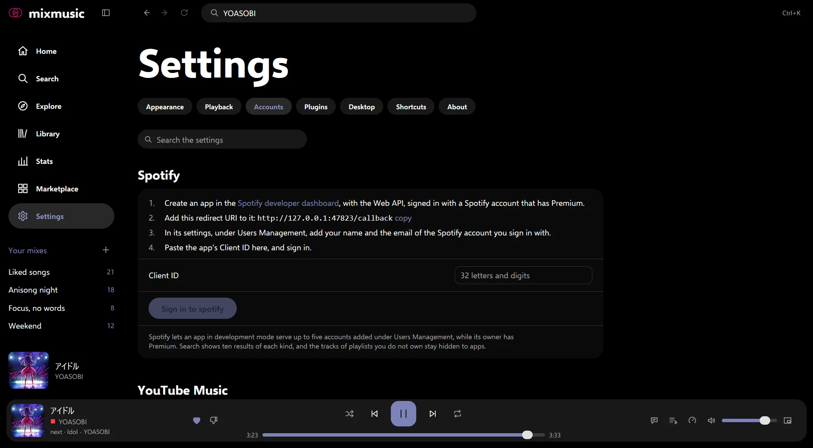
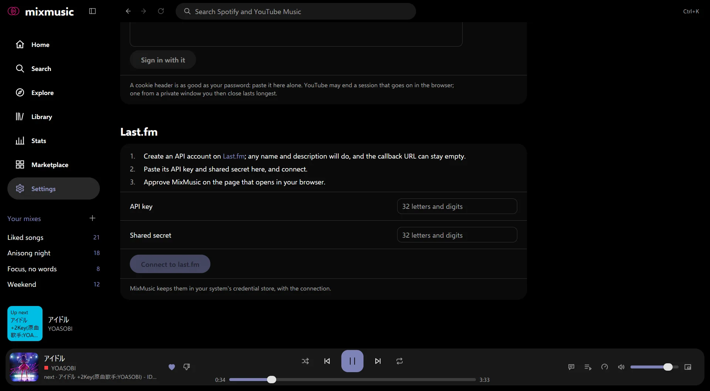

# Accounts
<!-- docs: group=start order=20 -->

Sign in to YouTube Music, Spotify and Last.fm in MixMusic, all optional:
the sign-in window, your own browser, a browser's session, brand channels, scrobbling and signing out.

MixMusic needs no account: YouTube Music's search, artists, albums,
playlists and radios work signed out, as soon as you open it. Sign in for
your own library and recommendations. All three accounts are in Settings ›
Accounts, and MixMusic keeps each sign-in in your system's
[credential store](data-and-privacy.md#sign-ins) (the keyring on Linux): on
Windows, one the Credential Manager can't keep goes in a file encrypted for
your Windows account.

## YouTube Music

Settings › Accounts › YouTube Music offers four ways to sign in. The
first is the simplest; the others are for when it can't open, or Google
refuses it.

### The sign-in window

Choose **sign in to youtube music**. A window of MixMusic opens on Google's
own sign-in page: sign in there as you would in a browser. What you type
goes to Google only, so MixMusic never sees your password, and it keeps
the session encrypted on your computer. The window closes once you're in.

The window needs the system's web view: WebView2 on Windows, which Windows
11 includes, and WebKitGTK 4.1 on Linux. Google sometimes refuses it with
"This browser or app may not be secure". That's Google's decision: try
again later or from another network, or use one of the ways below.

### Sign in with your browser

**Sign in with your browser** lists the browsers MixMusic finds on your
computer: Firefox and Zen. Choose one, then **sign in with** it:

1. The browser opens with a new, empty profile of its own, made for this
   sign-in alone, at YouTube Music's sign-in. Your own profiles, with
   their tabs, bookmarks and sign-ins, stay as they are: MixMusic neither
   opens nor reads them.
2. Sign in there, as in any browser. Google knows the browser, so it
   doesn't refuse it as it may refuse the window.
3. Once YouTube Music is signed in, MixMusic takes the session from the new
   profile, keeps YouTube's cookies alone, encrypted on your computer, as
   the window does, closes the browser and deletes the profile.

Closing the browser, or **cancel** beside the button, ends the sign-in, as
do 10 minutes without one; the profile is deleted then too. On macOS,
Firefox and Zen go on running once you close their last window: quit them
to end it.

Chrome, Edge and the other browsers made from Chromium aren't offered.
One that another program opens tells the pages so, and Google then refuses
the sign-in with "This browser or app may not be secure". To sign in with
one of them, use **Import from a browser**, below.

- **Where MixMusic looks.** On Windows, where each browser installs, and
  the browsers Windows knows from the registry; on macOS, in Applications
  and the Applications folder of your home; on Linux, the browsers'
  commands, as `firefox` or `zen-browser`, and the folders their packages
  install to. Snaps work, as Ubuntu's Firefox is.
  Browsers installed from Flathub, and MixMusic's own Flatpak, which sees
  none of your programs, aren't offered: use one of the ways below there.
- **How it reads the session.** Firefox and Zen keep the cookies in the
  profile's own cookie store, which MixMusic reads. Nothing listens on the
  network.
- If MixMusic quits while you sign in, it closes the browser, and deletes
  what's left of the profile at its next start.

### Import from a browser

If you're signed in to music.youtube.com in a browser, MixMusic can take
that session:

1. Sign in to music.youtube.com in the browser, if you aren't.
2. **Close the browser.** While it runs, it may hold its cookies, or not
   have saved a new sign-in yet.
3. In Settings › Accounts › YouTube Music, choose the browser under
   **Import from a browser**. For a profile other than the browser's own,
   type its name or its folder under **Profile**.
4. Choose **import**.

MixMusic reads the browser's cookies with its yt-dlp, keeps YouTube's
alone, encrypted on your computer, and deletes the rest at once.

| System | Browsers |
|---|---|
| Windows | Firefox, Chrome, Chromium, Edge, Brave, Opera, Vivaldi, Helium, Zen |
| macOS | the same, and Safari |
| Linux | the same as Windows, and Firefox, Chrome, Chromium, Edge and Brave installed from Flathub |

- **Chrome on Windows.** Recent versions of Chrome on Windows seal their
  cookies against other programs, so MixMusic can't read them. Import from
  Firefox there, or paste a cookie header.
- **Safari** on macOS needs Full Disk Access for MixMusic, in System
  Settings › Privacy & Security, for its cookies to be read.
- **Zen and Helium** are read from their profile folders. When MixMusic
  doesn't find them, give the folder of a profile under Profile.
- **Flatpak browsers on Linux.** A browser installed from Flathub keeps its
  profiles in `~/.var/app`, so it shows in the list apart from the same
  browser installed otherwise, as "Chrome (Flatpak)", once its folder is
  there. MixMusic's own Flatpak may read those folders, read-only, and
  imports only from them, as its sandbox sees no other folder of yours.

### Paste a cookie header

Where neither of the ways above works, paste the session yourself:

1. In a browser tab signed in to music.youtube.com, open the developer
   tools and their Network panel.
2. Reload the page, choose a request to music.youtube.com, and copy its
   **Cookie** request header. The text of a `cookies.txt` file works too.
3. Paste it under **Paste a cookie header** in Settings › Accounts ›
   YouTube Music, and choose **sign in with it**.

A cookie header is as good as your password: paste it there and nowhere
else. YouTube may end a session that goes on being used in the browser;
one copied from a private window that you then close lasts longest.

### Several Google accounts and brand channels

A session can reach more than one Google account, when you signed in to
several in the browser or the window, and an account can have brand
channels, each with its own home feed, library and likes. When yours
does, Settings › Accounts shows an **Account and channel** row (or
**Channel**, for one account with brand channels), which lists each by
name, with its handle and, for several accounts, its email. MixMusic uses
the first account until you choose another there.

- A brand channel that YouTube lists without the ID MixMusic needs shows in
  the list, but can't be chosen, and says so.
- If YouTube Music still answers as the account itself after you choose a
  brand channel, MixMusic goes back to the one it used before, and tells
  you.

### What signing in adds

| | Signed out | Signed in |
|---|---|---|
| Home | YouTube Music's home, as it shows signed out | your own home feed and recommendations |
| Library | [MixMusic's own](library.md): liked songs, mixes, podcasts, artists, downloads and history | also [Library › YouTube Music](library.md#youtube-music-playlists-albums-and-artists): your liked songs, the songs in your library, playlists, albums and artists there, in full |
| Likes and dislikes | kept in MixMusic | kept in MixMusic, and they reach YouTube Music |
| Albums, playlists, artists | [follow artists](library.md#artists-you-follow) in MixMusic, and see their new releases | save albums and playlists, and follow artists, on YouTube Music, from their pages |
| Playlists | | make playlists on YouTube Music, add tracks of either service to them, take tracks out, and delete the ones you made |
| Podcasts | | the shows you follow are saved on YouTube Music, and episodes [start where you left them](podcasts.md#with-youtube-music) on another device |
| History | | what you play joins your YouTube Music history |

Tracks play the same signed in or out: your session never goes to
[yt-dlp](streams.md#when-yt-dlp-is-needed), which finds some tracks' audio.
So tracks YouTube keeps for signed-in adults, or for a channel's members,
don't play either way. Only
[Play audio as your account](playing-music.md#play-audio-as-your-account),
off at first, hands yt-dlp your session, for YouTube Music Premium's
higher bitrate; when MixMusic sees your account has Premium, it offers it
once.

### Your YouTube Music history

**Add what you play to your history**, in Settings › Accounts › YouTube
Music and on by default, adds the tracks you play to your history on
YouTube Music, which its home and its radios are made from. A track joins
it once it [played a while](library.md#history-and-recently-played), as it
does on Last.fm, not as soon as it starts. The switch also lets MixMusic
tell YouTube Music how far you got in an episode, as its own player does,
so that YouTube Music on your phone
[goes on from there](podcasts.md#with-youtube-music). Turn it off to keep
what you play in MixMusic.

### When YouTube ends the session

YouTube ends a session when you sign out of Google everywhere or change
your password. Settings › Accounts then says that YouTube Music refused
the sign-in: sign out there, then sign in again.

## Spotify

Spotify lets an app in development mode serve up to five accounts, and
only while the app's owner has Spotify Premium, so you sign in with a
Spotify app of your own. It takes a few minutes, once:

1. Create an app in the Spotify developer dashboard, with the Web API,
   signed in with a Spotify account that has Premium.
2. Add the redirect URI that Settings › Accounts › Spotify shows (its
   **copy** link copies it).
3. In the app's settings, under Users Management, add your name and the
   email of the Spotify account you sign in with.
4. Paste the app's **Client ID** in Settings › Accounts › Spotify, choose
   **sign in to spotify**, and finish in your browser.

[Spotify](spotify.md) walks through each step, says what to do when
Spotify refuses the sign-in, and explains the three ways Spotify tracks
play: in MixMusic itself (Premium, on Windows and macOS), on Spotify
Connect, or from their recording on YouTube Music, which needs no Premium.

Signed in, MixMusic searches Spotify beside YouTube Music, and shows your
Spotify library in
[Library › Spotify](library.md#spotify-playlists-albums-and-artists);
likes, saved albums and playlists, followed artists and followed shows
reach Spotify. [Dislikes](playing-music.md#dislikes-and-skipping) stay in
MixMusic, as Spotify takes none.

## Last.fm

MixMusic scrobbles what you listen to to your Last.fm profile, with a
Last.fm API account of your own:

1. Create an API account at
   [last.fm/api/account/create](https://www.last.fm/api/account/create).
   Any name and description will do, and the callback URL can stay empty.
2. Paste its **API key** and **shared secret** in Settings › Accounts ›
   Last.fm, and choose **connect to last.fm**.
3. Approve MixMusic on the page that opens in your browser.

Settings › Accounts then says **Scrobbling as** your name, with a switch
that pauses scrobbling and starts it again. A track counts once half of it
played, or four minutes, and scrobbles made offline are sent once you're
back online. Last.fm hears that a [live stream](playing-music.md#live-streams)
plays, but it isn't scrobbled, and [podcasts' episodes](podcasts.md#not-counted)
aren't either.

When Last.fm no longer accepts the connection, Settings › Accounts says so:
disconnect, then connect again.

## Signing out

Each account has its button in Settings › Accounts, which asks first:

- **YouTube Music: sign out.** MixMusic forgets your session; your library
  stays on YouTube Music.
- **Spotify: sign out.** MixMusic forgets your Spotify sign-in.
- **Last.fm: disconnect.** MixMusic forgets the connection; your scrobbles
  stay on Last.fm.

Signing out deletes the sign-in from your computer. What MixMusic keeps
itself, your [liked songs, mixes and history](library.md), stays. The YouTube Music
session is a browser session, which can do with your account what YouTube
Music can: treat it like a password, and sign out to delete it.
