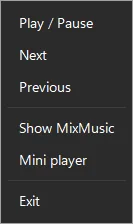
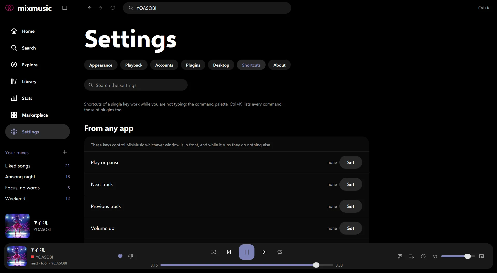

# On the desktop
<!-- docs: group=using order=60 -->

MixMusic on your desktop: the mini player, the MacBook notch player, the tray,
media keys and media controls, global shortcuts, notifications and Discord.

Most of what this page covers is in [Settings › Desktop](settings.md#desktop),
and the global shortcuts are in [Settings › Shortcuts](settings.md#shortcuts).
All of it works on Windows, macOS and Linux unless a section says otherwise.

## The mini player

The mini player is a small window that stays on top of your other
windows, with what plays and the buttons to control it. Open it with:

- the mini player button at the end of the player bar;
- <kbd>Ctrl</kbd> <kbd>M</kbd> (<kbd>⌘</kbd> <kbd>M</kbd> on macOS), or
  **Mini player** in the command palette;
- **Mini player** in the tray icon's menu.

It shows the cover, the title, the artists with the mark of their service,
and the time and the length ("live" for a live stream), with a line of the
accent along its foot for the progress. Its buttons:

- at the top right, one button that opens MixMusic's main window and one
  that closes the mini player;
- beside the time, the buttons of its [panel](#its-panel): the queue, the
  lyrics and the output device, and, after a track couldn't play, a red
  warning sign;
- [shuffle and repeat](playing-music.md#shuffle-and-repeat), in the accent
  while they're on, around previous, play or pause, and next;
- the heart, which [likes](library.md#liked-songs) what plays, and the
  thumbs-down, which [dislikes](playing-music.md#dislikes-and-skipping) it;
- the volume: a click mutes and unmutes, the mouse wheel over it turns the
  volume up and down, and a small slider shows above it while the pointer
  is over it. <kbd>Tab</kbd> reaches the button and then the slider, whose
  arrow keys set the volume; <kbd>Escape</kbd> closes it.

The line along its foot seeks: click it or drag it, or reach it with
<kbd>Tab</kbd> and use the arrow keys. Under the pointer it thickens, and
the time there shows above it.

Drag the mini player anywhere but its buttons to move it, and drag its
edges to resize it: the cover takes its height, and grows up to 180 px at
100% zoom. It opens where you left it. A right click opens a menu of
[speeds](playing-music.md#speed) for what plays. The mini player takes no
keyboard shortcuts but the zoom's, and <kbd>Escape</kbd>, which closes its
panel. It [zooms](look-and-feel.md#density-text-size-and-zoom) with the
main window, and its window grows and shrinks with it.

### Its panel

The buttons beside the time open a panel under the mini player, or above
it when it's at the foot of the screen, one at a time:

- **Queue:** the track playing and what plays after it, with your place in
  the queue, as "3 of 24". Click a track to play it, and right-click it
  for its menu, as in [Up next](playing-music.md#the-queue-and-up-next).
  A page its menu goes to, as Go to album, opens in the main window.
- **Lyrics:** the line sung now, which lights up word by word where the
  [lyrics](lyrics.md) have the words' times, and the line after it, in
  Latin letters where the lyrics panel shows them so. Lyrics without times
  show whole. For a podcast's episode, the chapter that plays, and the
  next.
- **Output device:** the [output devices](playing-music.md#the-output-device)
  of your computer, and the [cast devices](casting.md) on your network and
  your Spotify Connect devices, while the player bar shows their buttons.
  Click one to play there.
- **The red warning sign,** after a track couldn't play since the mini
  player opened: why, as its toast's
  [details](troubleshooting.md#tracks-that-fail-to-play) tell, with
  **copy**. Once you close it, the sign goes until another track fails.

The window grows to show the panel, and shrinks back as it closes, the
mini player staying where it is. Its button again, the × at the panel's
top, or <kbd>Escape</kbd> closes it. The mini player opens with the panel
it showed as it closed, but the warning sign's.

## The player around the notch

On a MacBook whose screen has a notch, MixMusic widens the black around the
camera while a track is loaded: the cover on the left, and bars that move
while it plays on the right.

- **Click either side** for a panel that grows down from the notch, with
  the player, the progress bar, and the line of the [lyrics](lyrics.md)
  sung now, with the lines before and after it. For a podcast's episode,
  it shows the [chapter](podcasts.md#episode-details-and-chapters) that
  plays instead. The panel shows the lyrics in
  [Latin letters](lyrics.md#other-scripts-in-latin-letters) when the lyrics
  panel does.
- **The cover** in the panel opens MixMusic on the now playing page.
- **To close it**, press <kbd>Escape</kbd>, click either side of the notch
  again, or move the pointer away for two seconds.

The player shows over every app and on every Space, in full screen too,
and stays while MixMusic is in the tray. It leaves the keyboard in the app
you were using until you open the panel, and gives it back when the panel
closes. It is black with white text whatever your theme, as it extends the
notch.

It is on by default. Turn it off with **Player around the notch** in
Settings › Desktop, a switch that shows only on Macs with a notch, or with
`"notchPlayer": false` in `settings.json`. Other Macs, external displays, a
MacBook with its lid closed, Windows and Linux show nothing of it.
[The notch's part of the architecture](architecture/notch.md) tells how
it's drawn.

## The tray

MixMusic puts an icon in the tray (the menu bar on macOS). Its menu has
**Play / Pause**, **Next**, **Previous**, **Show MixMusic**, **Mini player**,
and the item that quits MixMusic. On Windows and macOS, a click on the icon
shows the main window and a right click opens the menu; on Linux, a click
opens the menu.

### Close to the tray

With **Close to the tray** on, in Settings › Desktop, closing the main
window keeps the music playing: MixMusic hides in the tray until you show
it again from the tray icon, by starting MixMusic again, or with a global
shortcut of your own for **Show MixMusic**. It is off on a new install, so
closing the window quits MixMusic.

- To quit with Close to the tray on, choose the quit item of the tray
  icon's menu, or <kbd>⌘</kbd> <kbd>Q</kbd> on macOS.
- On macOS, a click on MixMusic's icon in the Dock shows the window again.
  A window closed in full screen leaves full screen first, then hides, and
  comes back in full screen.
- In the Flatpak, MixMusic asks your desktop's background portal to let it
  play on with the window closed.
- On Linux, the tray needs `libayatana-appindicator3` and a desktop that
  shows AppIndicator icons; GNOME needs its AppIndicator extension. Without
  a tray icon, closing the window quits MixMusic.

## Media keys and the system's media controls

MixMusic shows what plays in your system's own media controls, with the
cover, the title and the artists, and takes their buttons:

- **Windows**: the media flyout, which shows with the volume keys and in
  Quick Settings, with the cover, play or pause, previous, next and a seek
  bar.
- **macOS**: Now Playing, in Control Center, which the media keys and the
  buttons of headphones reach too.
- **Linux**: an MPRIS player, which your desktop shows in its media
  controls and passes its media keys to. In the Flatpak, it shows under the
  Flatpak's name. Setting the speed (rate) over MPRIS sets MixMusic's
  [speed](playing-music.md#speed).

The covers there come from the
[covers MixMusic keeps](library.md#the-offline-cache) on disk, so a cover
you saw in the window shows there at once, and offline too. A track [on
this computer](local-music.md) shows the cover its file holds, or the one
beside it, from MixMusic's copy in its cache.

**Media keys**, in Settings › Desktop and on by default, has the keyboard's
play or pause, next and previous keys control MixMusic, and its stop key
pause it. While a track loads, they and the system's controls do nothing:
a track can't be paused or moved until you hear it.

### The taskbar thumbnail on Windows

On Windows, the thumbnail that shows while the pointer rests on MixMusic's
taskbar button has three buttons: previous, play or pause, and next. They
are off while there's no track to play.

### The window title

The main window's title names the track that plays, for the taskbar, the
window switcher and screen readers, and starts with "Paused:" while it's
paused. Turn off **Show what plays in the window title** in Settings ›
Desktop to keep it to MixMusic's name.

## Keep the window on top

**Keep on top**, in Settings › Desktop and off at first, keeps MixMusic's
main window above your other windows, for when you work beside it.
MixMusic remembers it between starts. Turn it on or off with:

- the **Keep on top** switch in Settings › Desktop;
- **Keep the window on top, or not** in the command palette, which has no
  keys at first: Settings › Shortcuts can give it some. A toast says
  which it did;
- **Keep on Top** in macOS's Window menu, checked while it's on;
- `"keepOnTop": true` in `settings.json`.

The [mini player](#the-mini-player) stays on top either way. On Linux,
your desktop decides: one on Wayland may keep no window above the others,
the mini player included.

## Global shortcuts

Global shortcuts are keys of your own that control MixMusic whichever
window is in front, even with its window closed to the tray. Record them in
the **From any app** group at the top of
[Settings › Shortcuts](settings.md#change-a-shortcut), for:

- Play or pause
- Next track and Previous track
- Volume up, Volume down and Mute
- Like what plays and Dislike what plays
- Show MixMusic

A new install has none. To set one, choose **set** on its row and press
the keys; <kbd>Escape</kbd> cancels and <kbd>Backspace</kbd> removes it.

- A global shortcut needs <kbd>Ctrl</kbd>, <kbd>Alt</kbd> or the Windows
  key on Windows, <kbd>Ctrl</kbd>, <kbd>Alt</kbd> or <kbd>Super</kbd> on
  Linux, and <kbd>⌘</kbd> or <kbd>⌃</kbd> on macOS. <kbd>F1</kbd> to
  <kbd>F12</kbd> may stand alone, but <kbd>F12</kbd> on Windows, which
  keeps it for itself.
- While MixMusic runs, those keys do nothing else, in MixMusic's own window
  too: a command of the window that had them gives them up.
- Keys the system refuses, as when another app has them, stay yours: the
  row says why, with **try again**, and MixMusic tries again at each
  start.
- On Wayland, your desktop asks you to confirm them, and its keyboard
  settings can change them. On macOS, a letter is the key in its place on
  a US keyboard.
- Liking or disliking from another window shows a notification, while
  notifications are on and neither MixMusic's window nor the mini player
  is in front.

The media keys work as they do without any global shortcut.

## Notifications

With **Notifications** on, in Settings › Desktop and on by default,
MixMusic shows a notification when a track starts while its window isn't
in front: the title, the artists and the album, with the cover. A click
on it shows MixMusic. None shows while the mini player is in front, or on
a MacBook while the player around the notch is open: they show the track
already. The tray icon's tip names what plays too.

- The cover is its centre square, as the player bar shows it: the middle
  of a music video's thumbnail. On Windows it takes the place of the tray
  icon; on macOS it is attached, a thumbnail that grows as you expand the
  notification; on Linux it is the notification's image, where your
  desktop shows one.
- It is the cover the system's media controls show, from the covers
  MixMusic keeps: a track on this computer shows the cover its file holds,
  or the one beside it.
- MixMusic waits up to 2 seconds for a cover it hasn't downloaded yet:
  without one by then, the notification shows without it. When the next
  track starts meanwhile, only the next one's shows.

## Discord

While the Discord app runs on your computer, your Discord profile shows
what you listen to: the title, the artists, the cover and the time left.
Pausing clears it, and a live stream shows how long it has played. You
can [choose what it shows](#what-your-discord-status-shows). Discord's
member list says "Listening to MixMusic". There's nothing to set up: turn
it off with **Show what plays on Discord** in Settings › Desktop.

- **Discord application ID**, under the switch, shows the name of a Discord
  application of your own in place of MixMusic's: create one in Discord's
  [developer portal](https://discord.com/developers/applications) and paste
  its application ID.
- Under them, a **preview** shows your status as Discord's card does, of
  what plays, or of a song while nothing does, and follows what you choose
  below it, the lines as you type them.
- Discord's own Spotify status comes from your Discord account's link to
  Spotify. To show only MixMusic, turn off "Display Spotify as your status"
  in Discord's Connections.
- MixMusic finds Discord's Canary build too, and Vesktop installed with
  Flatpak. In MixMusic's Flatpak, a Discord app that isn't a Flatpak shows
  what plays only if it was running when MixMusic started.

### What your Discord status shows

The rows under the preview choose what your profile says. At first it
says what it always did: the title, the artists, the cover and the time
left, and a pause clears it.

| Row | What it does |
|---|---|
| First line, Second line | What the two lines say. Type text and placeholders: `{title}`, `{artist}`, `{album}` and `{service}` (YouTube Music, Spotify or my computer), as `{artist} · {album}`. A placeholder at a line's start or end with nothing to show, as the album of a single, takes the separator beside it along. Anything else in braces shows as typed, and the row says so in red. A line holds 128 characters, as many as Discord shows; an empty one shows nothing. **reset** puts back `{title}` or `{artist}`. |
| Cover | The track's cover, where its service has one online. A file on your computer has none Discord can read. On at first. |
| Service badge | A small round mark at the cover's corner: a green disc for Spotify, a red square for YouTube Music, a record for a file on your computer. Without a cover, the badge takes its place. Off at first. |
| Time left | How long the track has played and how long it has left, as a bar; a live stream, how long it has played. On at first. |
| Listen button | A **Listen on Spotify** or **Listen on YouTube Music** button that opens the track there. Discord shows it to the others who see your profile, not always to you. A file on your computer has none. Off at first. |
| Keep while paused | A paused track stays, marked with a pause badge, whose tip says Paused, and without its time. Off, a pause clears your status, as before. |

Discord reads the badges from MixMusic's GitHub repository, and an
application of your own shows them as MixMusic's does.

## Start at login

**Start at login**, in Settings › Desktop, starts MixMusic when you sign in
to your computer, with its window hidden in the tray, from where the tray
icon shows it. In the Flatpak, it goes through your desktop's background
portal, which may ask you first.

## Sleep

MixMusic pauses as the computer goes to sleep, and stays paused when it
wakes, ready where it was. A Spotify Connect device elsewhere plays on.

## mixmusic:// links

Links that start with `mixmusic://` open a page of MixMusic, or play a
track, from a browser or another app:

| Link | What it does |
|---|---|
| `mixmusic://search?q=lofi+piano` | searches for "lofi piano" |
| `mixmusic://album/<id>`, `mixmusic://artist/<id>`, `mixmusic://playlist/<id>` | opens an album, an artist or a playlist |
| `mixmusic://library`, `mixmusic://explore`, `mixmusic://stats`, `mixmusic://marketplace`, `mixmusic://settings` | opens that page |
| `mixmusic://play/<track id>` | plays a track |

An ID is MixMusic's own: the service's ID after `yt:` for YouTube Music or
`sp:` for Spotify. Opening MixMusic a second time, or a link while it runs,
opens the page in the window that's there.
