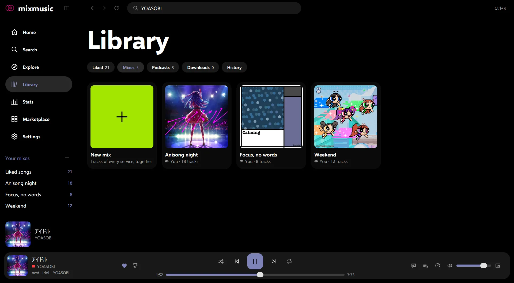
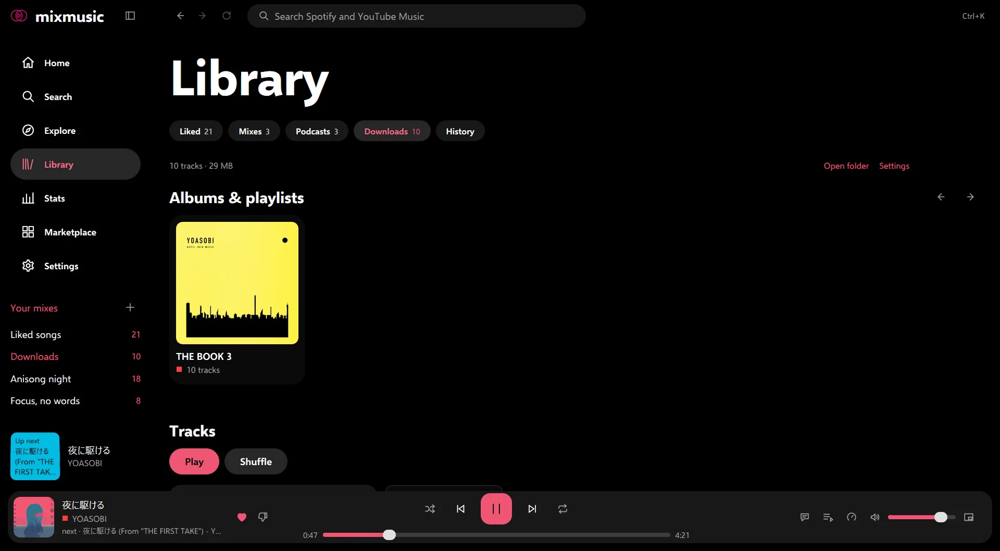

# Your library
<!-- docs: group=using order=20 -->

MixMusic keeps your liked songs, mixes, downloads, history and stats for Spotify and YouTube Music tracks together, beside each service's own library.

What MixMusic keeps itself, as your liked and disliked songs, your mixes, the artists you follow without an account and your history, is in `library.json` in your [data folder](data-and-privacy.md#the-data-folder), and works with no account. What you keep on a service, as its playlists and saved albums, shows once you [sign in](accounts.md) to it, and the changes you make in MixMusic reach it.

## The Library page

Library, in the sidebar or with Alt+2 (⌥2 on macOS), has these pivots, each with how many it holds:

- **Liked:** the songs you liked, of every service.
- **Mixes:** the playlists you make in MixMusic.
- **Tags:** your mixes, playlists and albums [by their tags](#tags), together, once you made a tag.
- **Podcasts:** the episodes you're listening to and the shows you follow: see [Podcasts](podcasts.md#following-shows).
- **Artists:** the new releases of the artists you follow, and the artists themselves: see [Artists you follow](#artists-you-follow).
- **Downloads:** what plays without the network.
- **On this computer:** the music files of the folders you add, which play from your computer: see [Music on this computer](local-music.md).
- **History:** what you played.
- **Disliked:** the songs you disliked, once there are any.
- **Spotify** and **YouTube Music:** your library on each service you signed in to.

**Edit tabs**, the pencil at the end of the pivots, lists them to put in your own order: drag one onto another, or press <kbd>Alt</kbd> <kbd>↑</kbd> and <kbd>Alt</kbd> <kbd>↓</kbd> (<kbd>⌥</kbd> on macOS) on it. Its × hides a pivot you don't use, which waits under Hidden with Show; a hidden pivot still opens from a link or a command that leads to it, as Liked songs does from the sidebar. Reset puts them back as they come. `settings.json` keeps them as `libraryTabs`. Pivots that don't apply stay out, as they do anyway: Spotify and YouTube Music while you're signed out, Disliked while it's empty.

## Liked songs

Like a track with the heart in the player bar, on the now playing page, in the [mini player](desktop.md#the-mini-player) or on its row, with Add to liked songs in its menu, or with Ctrl+L (⌘L on macOS) for the track playing. The heart again, or Remove from liked songs, takes it back.

- **One list for both services.** Library › Liked, Liked songs in the sidebar, Home's Liked songs tile and Alt+3 open it.
- **Signed in, a like reaches the service too:** a Spotify track is saved to your Spotify library, and a YouTube Music track is liked on YouTube Music.
- **Liking a song you disliked** takes the dislike back.
- **The list** has Play, Shuffle and Download, a box that searches it and a Sort menu: the list's own order, Title, Artist, Length or Plays. What you search shows how many tracks of the list match.
- **Plays** puts the songs you played most in MixMusic first, as the [stats](#stats) count them, every play; songs played as often, and those not played, keep the list's order. The list follows the plays as they're counted.

The songs you liked on a service before, or in its own app, are in that service's pivot of the library: Liked on Spotify, in pages that Load more adds to, and Liked on YouTube Music.

## Disliked songs

Library › Disliked lists the songs you disliked, newest first, with the same search and Sort. Remove the dislike, in a song's menu, or its thumbs-down, takes one back. [Playing music](playing-music.md#dislikes-and-skipping) tells what a dislike does to the queue and to radios.

## Mixes

A mix is a playlist of MixMusic's own, which holds tracks of every service.

- **Make one** with the New mix tile in Library › Mixes, the + beside Your mixes in the sidebar, Add to mix › New mix… in a track's menu, or Save as a new mix in the More menu of an album or a playlist, which copies its tracks.
- **Add tracks** with Add to mix in a track's menu, then the mix's name. A track the mix holds already stays out, and the toast says Already in, with Add anyway, which adds it a second time.
- **Copy a service's playlist** with Copy into a mix you can extend, in the playlist's More menu: the mix keeps its tracks, and any track can join them. A long playlist is read whole first, which can take a while.
- **Import a playlist** from a CSV, M3U or JSON file, from text, or from your data from Spotify or Google, with the Import a playlist tile beside New mix: see [Import and export playlists](import-export.md), which tells how to export a list too.
- **Share a mix** with Share › As a YouTube Music playlist…, in its More menu, signed in to YouTube Music: it becomes a playlist there that anyone with its link can open, as [Collaborating on playlists](#collaborating-on-playlists) tells.
- **A mix's page** has Play, Shuffle and Download, the search and Sort of its tracks, and in its More menu Rename and Delete. Deleting asks first; the tracks stay where they came from. Remove from this mix, in a track's menu there, takes it out.
- **Put a mix in order** by dragging a track onto another, which it takes the place of: a line shows where it goes. From the keyboard, <kbd>Tab</kbd> to a track's play button, then <kbd>Alt</kbd> <kbd>↑</kbd> and <kbd>Alt</kbd> <kbd>↓</kbd> (<kbd>⌥</kbd> <kbd>↑</kbd> and <kbd>⌥</kbd> <kbd>↓</kbd> on macOS) move it a place up or down, and the focus goes with it. The mix keeps its new order at once. While its tracks show sorted or searched, they don't move: choose the mix's own order in Sort and clear the search first.

Your mixes show in the sidebar under Your mixes, with how many tracks each holds, [in folders](#folders) if you group them, and on Home's Your mixes tile and shelf.

### The order of your mixes

Your mixes keep the order you put them in. A new mix goes first, and changing one doesn't move it: a rename, a new cover, adding, removing or moving its tracks only make it the latest in Recently changed. Updating from a version before 0.5.12, they start in the order they had, the last changed first, so nothing moves.

- **Move a mix** by dragging it onto another, in Library › Mixes or in the sidebar's Your mixes: it takes that one's place. From the keyboard, <kbd>Tab</kbd> to it, then <kbd>Alt</kbd> with the arrows (<kbd>⌥</kbd> on macOS) moves it a place, and the focus goes with it. A move works while the mixes show in Your order, searched or not: a move made while you search keeps the place of every mix the search hides.
- **Sort** them above Library › Mixes: Your order, Recently changed, Recently added, Title or Track count. The button beside it turns the last four the other way, as Newest first and Oldest first, or A to Z and Z to A. `settings.json` keeps the choice as `mixesSort` and `mixesDescending`.
- **That order holds** wherever mixes are listed: the sidebar, Add to mix, Home's Your mixes shelf, Edit home's One of your mixes, the assistants, and `api.library.mixes()` for [plugins](plugins.md).
- **Search** them with the box above Library › Mixes, or the one above the sidebar's Your mixes: it keeps the mixes whose names hold every word you type, regardless of case and accents. <kbd>Esc</kbd> clears it.

### Pin to top

**Pin to top**, in the menu of a mix, of a playlist of Spotify or YouTube Music in your library (yours, saved or one you collaborate on), of an album you saved and of an artist you follow, or in the More menu of its page, puts it first in every list it's in, in any sort: in the Library, in the sidebar and in Add to mix, with a pin by its name. **Unpin**, in the same menus, puts it back in its place.

- **In the sidebar,** the playlists, albums and artists you pin show under Liked songs and Downloads, before your mixes, and open their pages. Pins move among themselves by drag, or with <kbd>Alt</kbd> and the arrows, in any sort.
- **Liked songs and Downloads** drag anywhere among the pins and the mixes of the sidebar too. **Hide from the sidebar**, in their menu, takes them out of it; the menu of the Your mixes title shows them again. `settings.json` keeps where they are as `sidebarPlaces`.
- **As many as you like:** pins have no cap, and keep their order.

### Hide from library

**Hide from library**, in the menu of a playlist or a saved album in Library › Spotify or Library › YouTube Music, takes it out of MixMusic's library, and changes nothing on the service: unlike Remove from library on a saved YouTube Music playlist, which takes it out of your library on YouTube Music. **Hidden**, at the foot of the page, lists what you hid, with **Show again**.

MixMusic keeps your pins and what you hid in `library.json` in your [data folder](data-and-privacy.md#the-data-folder), by ID. One of a service goes only once that service listed your whole library without it, under the account or [brand channel](accounts.md#several-google-accounts-and-brand-channels) you pinned or hid it under: never while the list loads, fails, comes in part or you're signed out, nor while another brand channel is chosen. An artist you follow in MixMusic keeps their pin while you do. Deleting a mix takes its pin with it.

### Folders

Group your mixes, and the playlists of Spotify and YouTube Music in your library, in folders of the sidebar's Your mixes, one level deep: by mood, by person or by season. The folders show after Liked songs, Downloads and the pins in no folder, and before the mixes in none.

- **Put one in a folder** with **Move to folder** in its menu: on its tile, in the More menu of its page, or with a right click on it in the sidebar. It lists every folder, then **New folder…**, which asks for a name. Or drag it in the sidebar onto a folder's header. A mix or a playlist is in one folder at most.
- **Take it out** with **Remove from folder**, in the same menus, or drag it onto an entry of the sidebar outside the folders. A folder with nothing left goes away.
- **Names** hold up to 64 characters. The spaces around a name go, and each run of spaces in it becomes one. Names that differ only in case or spacing are one folder: a new folder of a name taken is that folder, and a rename to it makes the two one.
- **The header** shows the folder's name and how many playlists it holds. A click on it, or <kbd>Enter</kbd>, closes the folder or opens it again; `settings.json` keeps the folders you closed as `collapsedFolders`. A closed folder opens by itself while the sidebar's search finds what it holds, and once the page open is one of its playlists.
- **Their order:** folders show by name until you drag one onto another, or press <kbd>Alt</kbd> <kbd>↑</kbd> or <kbd>Alt</kbd> <kbd>↓</kbd> (<kbd>⌥</kbd> on macOS) on a header; then they keep your order, and a new folder goes first. In a folder, the pinned playlists come first, then the others in the order they came in, which you change the same way.
- **The header's menu** has **Play folder**, which plays all its playlists one after another, each track once: a playlist that doesn't load is left out, and a toast names it. **Rename folder…** names it anew, and **Ungroup folder** takes the folder away and keeps its playlists.
- **The sidebar's search** finds a folder by its name, and shows all it holds, and by the names of its playlists, and shows those.

MixMusic keeps your folders in `library.json`, by the playlists' IDs, and they never reach a service. Spotify's Web API neither gives apps playlist folders nor makes them ([Spotify's playlists guide](https://developer.spotify.com/documentation/web-api/concepts/playlists)), so folders made in Spotify's app don't show. A playlist of a service keeps its folder as it keeps its pin: until that service listed your whole library without it. Hiding a playlist, or deleting a mix, takes it out of its folder.

### Tags

Tag your mixes, the playlists and saved albums of Spotify and YouTube Music in your library, and the albums [on this computer](local-music.md), to find them by tag together: every "workout" playlist of both services and your mixes, or the albums of one mood from everywhere. An item takes as many tags as you like, and an album's tags hold for all the versions its tile groups.

- **Tags…**, in the menu of its tile or in the More menu of its page, lists your tags with a check box each: a check puts the tag on, and clearing it takes the tag off, at once. The field under them names a new tag, which <kbd>Enter</kbd> or **Add tag** makes and puts on.
- **Manage tags** lists your tags. Drag one onto another, or press <kbd>Alt</kbd> <kbd>↑</kbd> or <kbd>Alt</kbd> <kbd>↓</kbd> (<kbd>⌥</kbd> on macOS) on it, to put them in the order the chips show them. Choose a tag to rename it, which takes effect on <kbd>Enter</kbd>, Back or Done, to give it another colour, or to delete it, which asks first and takes it off all it's on: the items stay. **Choose items…** lists every playlist and album with a check box, and a search, to tag many at once.
- **Colours:** 25, made to read on every theme, light and dark: each shows a little lighter on a dark theme and a little darker on a light one. A new tag takes a colour no tag has yet.
- **Names** hold up to 64 characters. The spaces around a name go, and each run of spaces in it becomes one. Names that differ only in case or spacing are one tag: a new tag of a name taken is that tag, and a rename to it makes the two one. You can have up to 200 tags.
- **The row of chips**, above Library › Mixes and in Library › Tags once a tag exists: **All**, each tag in your order, and **Manage tags**. Choose one tag or several: **Match any**, the default, shows what has any of them, and **Match all** only what has every one. `settings.json` keeps the choice as `tagFilter` and `tagsMatchAll`, by the tags' IDs; a tag you delete leaves the choice at once.
- **Library › Tags** shows your mixes, both services' playlists and albums, and the albums on this computer, together in one grid: those with the tags chosen, or, with All, all that has a tag, the pinned ones first.
- **Show tag filters**, in Settings › Appearance › Colour and type, on at first, hides the row above Library › Mixes when you turn it off, and the mixes all show; the choice waits for it to come back (`tagFilters`). Library › Tags keeps its row.

MixMusic keeps your tags in `library.json`, by the items' IDs, and they never reach a service. A playlist or an album of a service keeps its tags as it keeps its pin: until that service listed your whole library without it, under the account or brand channel you tagged it under, never while the list loads, fails, comes in part or you're signed out. Hiding a playlist or an album, or deleting a mix, takes its tags off.

### A mix's cover

A mix shows the cover of its first song that has one, until you choose another.

- **Change cover…**, in the More menu of the mix's page, or in the menu of its tile in Library › Mixes and on Home, opens a dialog: **choose an image…** opens a PNG, JPEG, GIF or WebP file of yours, and the covers of the mix's songs below are a click away.
- **The cover** shows cut to a centred square, on the mix's page and its tiles. MixMusic keeps a copy of it, at most 600 pixels across, in `mix-covers` in your [data folder](data-and-privacy.md#the-data-folder): the file you chose can move or go.
- **A GIF that moves** is kept so too, every frame of it, beside a still of its first frame, which the tiles show. With [Show moving covers](playing-music.md#moving-covers) on, it moves in the head of the mix's page.
- **Use the songs' covers**, in the same dialog, goes back to them. Deleting the mix deletes its cover too.

## Artists you follow

Follow an artist with Follow on their page, with Follow in the page's More menu (⋯), or with Follow in the menu of their tile, a right click on it in the search, on Home or in the library. Following, or Unfollow in those menus, stops.

- **Signed in to the artist's service,** you follow them there: you subscribe on YouTube Music, or follow on Spotify, as in the service's own app.
- **Signed out,** MixMusic keeps them itself, in `library.json`, as it keeps the podcasts you follow, and the toast says "following in MixMusic". Signing in later doesn't follow them on the service: MixMusic never writes to your account on its own. Their page still says Following, and stopping stops in MixMusic, and on the service too where you follow them there.
- **Library › Artists** has their new releases first, then Followed in MixMusic, the artists MixMusic keeps, then Followed on Spotify and Followed on YouTube Music, the artists you follow on each service you signed in to, past those MixMusic keeps. The pivot counts the artists MixMusic keeps.

### New releases

Home shows "New from artists you follow" after your own shelves, and Library › Artists shows it first, once there are any: the albums, singles and EPs of the artists you follow, in MixMusic and on the services you signed in to, newest first. Home's Spotify and YouTube Music pivots keep that service's.

- **New** is out in the last 8 weeks. Spotify tells the day a release came out, which its tile shows, as Nov 1. YouTube Music tells only the year, which its tile shows: a release of this year counts as new all year, and last year's in the first 8 weeks of the new one.
- **Newest first:** a release known by its year alone counts from the first day of its year, so this year's come after those of the last weeks. Of one day, or one year, an artist's newest come first.
- **At most** an artist's four newest show, and 30 in all.
- **Where they come from:** the artist's page on YouTube Music, which lists their latest albums and singles, or Spotify's list of their albums and singles, the 10 newest of each. Neither service gives apps a feed of the new releases of the artists you follow: YouTube Music's New releases are everyone's, and Spotify took its own list from apps in February 2026. Spotify's artists need you signed in to Spotify.
- **How often:** MixMusic asks for an artist's releases at most every 12 hours, and an hour after their service failed, as Home or Library › Artists shows and when you [refresh](settings.md#refresh-a-page) them: up to 30 artists in one go, 3 at a time, those never asked first, and the rest the next time. An artist whose service fails shows what was read before. What it read is kept in `releases.json` in the [cache folder](data-and-privacy.md#the-cache-folder), so that Home shows it at once at the next start, then what's new once it's read.

## YouTube Music playlists, albums and artists

Signed in to YouTube Music, Library › YouTube Music has your Playlists, with a new playlist link, the Playlists you collaborate on, your Albums, the Artists you follow, the Songs in your library, and Liked on YouTube Music. A [brand channel](accounts.md#several-google-accounts-and-brand-channels) of your account, chosen in Settings › Accounts, has a library of its own.

- **Save** an album or a playlist with Save on its page, which then says Saved; pressing it again takes it out of your library. **Follow** an artist with Follow on their page, which subscribes on YouTube Music.
- **Make a playlist** with new playlist in Library › YouTube Music, with Add to YouTube Music playlist › New playlist… in a track's menu, or with Save as a YouTube Music playlist in an album's or a playlist's More menu. Spotify tracks are found on YouTube Music first.
- **Add a track** with Add to YouTube Music playlist in its menu, then one of your playlists, or one you collaborate on, which names who made it: it lists those you can add to. Tracks of either service go in. A song the playlist holds already YouTube Music doesn't add again: the toast says Already in, with Add anyway, which adds it a second time, as YouTube Music's own Add anyway does. Other refusals say what they are, as a playlist that may be another account's, or a sign-in YouTube Music no longer accepts.
- **All of them show,** however many playlists, albums, artists, songs and podcasts you keep on YouTube Music, up to 1,000 pages of each list, some 24,000 items: MixMusic reads them a page at a time and shows what it has read as the pages come, with "Loading more…" under the list until it ends, so you can browse the first pages of a large library while the rest is read. Add to YouTube Music playlist lists the playlists read so far, with "Loading more…" as its last item. New releases wait for the whole list of the artists you follow. MixMusic tries a page that fails again a few times. YouTube Music doesn't say how long a list is, so a list that still came in part shows what came and says how much, as "Showing the first 1,200 songs", with Try again; so does Add to YouTube Music playlist. A list longer than 1,000 pages says it shows as far as MixMusic reads a list. While Songs in your library is still coming, or came in part, a song's menu asks YouTube Music whether you keep it, so that a song saved long ago offers Remove from library.
- **Take a track out** of a playlist of yours with Remove from this playlist, in its menu on the playlist's page. Of one you collaborate on, YouTube Music lets you take out the tracks you added alone, which have it.
- **Put a playlist of yours in order**, or one you collaborate on, as you do a mix, once its tracks are all read: it changes on YouTube Music too. When YouTube Music refuses a move, a toast says so and the playlist shows as YouTube keeps it.
- **Delete a playlist you made** with Delete from YouTube Music…, in the More menu of its page or of its tile in Library › YouTube Music. It asks first, since the playlist goes from YouTube too and can't come back: to keep its tracks, copy it into a mix first. Mixes copied from it, and the queue, keep their tracks.
- **A playlist you saved** has Remove from library on its tile instead, which takes it out of your library without asking: saving it again undoes it. To keep it on YouTube Music and out of MixMusic's library, [Hide from library](#hide-from-library) instead.
- **Search and sort** your playlists with the box and Sort above them: YouTube Music's order, Title or Track count, each way. They search and sort the Playlists you collaborate on too, and `settings.json` keeps the sort, for Spotify's as well, as `playlistsSort` and `playlistsDescending`.
- **Suggestions:** below the tracks of a playlist of yours, once they're all loaded, Suggestions has five songs YouTube Music suggests adding to it, leaving out those you dislike. Each plays alone from its cover, and Add puts it at the playlist's end at once; Refresh shows five more, and adding the last brings them too. They aren't the playlist's: Play and Shuffle leave them out. While you search the playlist's tracks, they hide.
- **Keep a song without liking it** with Add to library in its menu: it goes to Songs in your library, as YouTube Music's own Save to library does, and stays out of your likes, which shape what YouTube Music recommends. Remove from library in its menu takes it out. Spotify keeps no such songs apart from those you like.

## Spotify playlists, albums and artists

Signed in to Spotify, Library › Spotify has your Playlists, the Playlists you collaborate on, your Albums, the Artists you follow, and Liked on Spotify.

- **Save** an album or a playlist, and **follow** an artist, from their pages, as for YouTube Music: it happens on Spotify.
- **Search and sort** your playlists, and those you collaborate on, as in Library › YouTube Music: Spotify's order, Title or Track count. [Pin](#pin-to-top) and [hide](#hide-from-library) them, and your albums, from their menus.
- **Add a track** of Spotify's with Add to Spotify playlist in its menu, then one of your playlists, or one you collaborate on, which names who made it. Spotify's playlists hold Spotify's tracks alone: to mix in YouTube Music's, copy the playlist into a mix.
- **All of them show,** however many playlists, albums, artists and podcasts you keep on Spotify: MixMusic reads every page of each list, and tries a page that fails again a few times. A list that still came in part shows what came, and says how much, as "Showing 200 of 250 playlists", with Try again; so do Add to Spotify playlist and Add a shelf. Home's Spotify shelves show your first 50 playlists and albums, so that Home doesn't wait.
- **Put a playlist in order** as you do a mix, your own or one you collaborate on, once its tracks are all read: it changes on Spotify too, one move at a time. A playlist that holds what MixMusic doesn't show, as podcast episodes or the local files of Spotify's app, doesn't move. When Spotify refuses a move, a toast says so and the playlist shows as Spotify keeps it.
- Spotify shows an app in development mode, as your Spotify app is, the tracks of the playlists you own or collaborate on, not of playlists others made: a search leaves those out, and one you follow shows what Spotify tells of it, with a way to play it on Spotify. [Spotify](spotify.md#what-spotify-allows-apps) lists the other limits.

## Collaborating on playlists

Others can add to a playlist of yours on YouTube Music or Spotify, from their own apps, once you let them.

- **On YouTube Music,** Invite collaborators, in the More menu of a playlist of yours, turns YouTube Music's collaboration on and copies its invite link: whoever opens it can join the playlist and add to it. Collaborators can't open a private playlist, as the playlists MixMusic makes are at first: MixMusic asks first, then makes it unlisted, which anyone with its link can open, and which shows on none of your pages. Each invite makes a new link. **Stop collaboration**, in the same menu once the playlist has collaborators, or once you invited, turns it off, once you agree: YouTube Music takes the collaborators off the playlist, and its invite links stop working. What they added stays.
- **On Spotify,** Make collaborative, in the More menu of a playlist of yours, makes it collaborative, as Spotify's own apps do, and copies its link, for those who'll add to it. Spotify keeps collaborative playlists off your profile: for a playlist on it, MixMusic asks first. **Stop collaboration**, in the same menu, makes it yours alone again.
- **Playlists others made that you collaborate on** have a shelf of their own in Library › YouTube Music and Library › Spotify, Playlists you collaborate on, with who made each. Their pages say collaborative, Add to YouTube Music playlist or Add to Spotify playlist in a track's menu lists them, and they're put in order as yours are. On YouTube Music, you join one by opening its invite link there, which puts it in your library; MixMusic tells it from a playlist you saved as YouTube Music offers it to add to. Of its tracks, you take out those you added alone.
- **A mix** becomes a playlist on YouTube Music to share it with Share › As a YouTube Music playlist…, in its More menu: name it, and MixMusic makes it, unlisted, with the mix's tracks, Spotify's found on YouTube Music first, copies its link and opens its page, where Invite collaborators lets others add to it. Save as a YouTube Music playlist, in the same menu, makes a private one instead.
- **When a service refuses,** the toast says why: Spotify, for instance, lets only a playlist's owner make it collaborative, and an app in development mode, as yours is, only the accounts added to it.

## Long playlists

MixMusic reads playlists of up to 20,000 tracks, and the songs you liked on YouTube Music as far.

- The first hundred tracks or so show at once on YouTube Music, and the first 50 on Spotify, and the rest load beside them, as "Loading tracks" above the list says, with how many came.
- Play and Shuffle, pressed meanwhile, wait for all of them. The menu's queue items and the download show once they're read.
- A page of the playlist that fails is tried again a few times. Then the playlist says how many of its tracks loaded, with Try again. One past 20,000 tracks says where it was cut.
- Once all of it is read, a muted line under the header says why its count may be above the rows: how many of its items can't play here, of what kind (on Spotify, local files, podcast episodes, and removed or unavailable items), and how many songs Hide explicit content leaves out of a playlist of someone else's. The count shown equals the rows plus what the line names.
- A YouTube Music playlist whose header counts more than 100 songs, but that ended with fewer than 90% of them, says "Only 100 of this playlist's 1,527 tracks came from YouTube Music." under the header, with Try again, which loads it again from its first page. A smaller gap stays quiet, since YouTube Music's count may hold videos that are hidden or no longer available.
- Playing a long playlist from its tile, downloading it or copying it into a mix reads all of it first, which can take a while.

## The header that stays

Scrolled down a playlist, an album, an artist or your liked songs, the top bar shows what you're in: its cover, its name, and Play, Shuffle and Download, which fade in as the page's head scrolls away. An artist's has no Download, and a Spotify artist's, whose Play plays their top songs, no Shuffle. In a narrow window, the name shortens, and Download moves into the bar's menu.

The search and Sort of a playlist's tracks, and of your liked and disliked songs, stay pinned under the top bar while the list scrolls, and what you search or sort there shows from the list's start.

## History and Recently played

A track counts as played once it played for 30 seconds, or half of a shorter one: a track you skip sooner, or that fails to load, doesn't count.

- **Library › History** lists your last 300 plays, the latest first. Clear history forgets every track you played, after asking, and your stats start over.
- **Home** shows the track you played last in its Jump back in tile, and the tracks you played lately in its Recently played shelf.
- **YouTube Music's history.** Signed in to YouTube Music, the songs you play also join your history there, so that YouTube Music's home and its radios learn from them. ["Add what you play to your history"](accounts.md#your-youtube-music-history), in Settings › Accounts, turns it off.

## Stats

The Stats page, in the sidebar, shows what you listened to, This week, This month or All time:

- how many tracks you played and for how long, and how many of them came from Spotify and how many from YouTube Music;
- the minutes you listened each day, as a chart: the pointer on a day, or the arrow keys while the chart has the focus, show its minutes and plays, and a table of the days follows it, the newest first;
- The mix, two rings of each service's share;
- your top artists, as circles, and your top tracks.

Tracks count as in the history, every play: MixMusic keeps each in `plays.jsonl` in your [data folder](data-and-privacy.md#the-data-folder), which grows by about 1 MB a year at 10 plays a day. Of the plays before MixMusic kept them all, the stats count the last 1,000, which the history held. Podcast episodes stay out of the stats, and clearing the history starts them over.

### Your year

Next to Stats' ranges, Your year looks back at one calendar year of your history. It shows for past years that have plays, and for the current year from December; with several years, a row of years above it chooses one. It tells:

- how many tracks you played and the minutes you listened;
- your top five songs, artists and albums;
- the month you listened most, the song the year began with, the song you played most often in one day, and how many new artists you found, which are those you hadn't played before the year, when your plays reach back that far.

**Save image** saves a card of the year as a PNG, a square for a chat or a feed, and **Save image for a story** a tall one, with your top artists and albums too. Both are in your theme's colours. Your year counts every play of the year, as the stats do; a year before MixMusic kept every play shows what the last 1,000 plays of the history held of it.

## Downloads

Download tracks, albums, playlists, mixes and your liked songs, and they play without the network. They stay until you remove them, apart from the offline cache.

### What you can download

- **Download** in a track's menu downloads it. The download button of an album's, a playlist's or a mix's page, or of your liked songs, downloads it whole, as Download in its More menu does.
- **YouTube Music tracks** download as they are. **Spotify tracks** download as their [recording on YouTube Music](playing-music.md#how-spotify-tracks-play).
- **[Live streams](playing-music.md#live-streams)** don't download: a playlist holding one downloads the rest, and once MixMusic has found a stream live, its menu offers no Download. **Podcast episodes** don't download.
- **Many at once:** over a hundred tracks, or about a gigabyte, asks first, with the size.

### Following a download

- **Track rows** show a mark after the service's: downloaded, a ring while it waits, a ring that fills as it downloads, or a warning when it failed, whose tip tells why. The track's menu then has Remove download, Cancel download or Download again.
- **The download button** of a page says downloading 3 of 12 while it downloads, download 2 more when the page holds tracks its download doesn't, or downloaded. Remove download, in its More menu, asks first; tracks that another download holds stay.
- **Library › Downloads** says how many tracks the downloads hold, their size and their folder, with links to open the folder and to the settings. While tracks download, it shows how far they came, with pause or resume, cancel all, and retry failed, and each track's state, with why one failed. Then come your downloaded albums, playlists and mixes, whose tracks show below when you choose one, and every downloaded track, with Play, Shuffle, search and Sort. Remove all downloads, at its foot, asks first.
- **The sidebar** lists Downloads under Your mixes once you have some, and the command palette's Downloads opens them.

### How they download

- Two tracks download at a time, in the quality of Settings › Playback › Sound › Quality: best or [data saver](playing-music.md#data-saver).
- They wait while you're offline, on a metered connection unless you allow it, and when YouTube turns requests down, then go on where they stopped, after a restart too.
- Downloads keep the stereo audio of a track. A 5.1 surround mix plays from the offline cache or YouTube, and offline the stereo audio plays.

### Songs added later

A playlist, an album, a mix or your liked songs that you downloaded download the songs added to them since on their own, as you open their page or refresh it.

- Over a hundred songs at once, or a gigabyte, wait for you to choose Download more, as a notice tells.
- A song that failed isn't tried again, and one whose download you removed isn't downloaded again: Download more still offers them.
- Songs taken out of a playlist stay downloaded with it until you remove its download, which removes them too.
- "Download songs added later", in Settings › Playback › Downloads, turns it off.

### Export to a folder

Take your downloads, and the music on this computer, to a phone or another player: **Export…** in a track's menu, or **export** in the bar of the [tracks you selected](playing-music.md#selecting-tracks), asks for a folder and writes a copy of each track there.

- Each copy is named "Artist - Title", made safe for file names on Windows, macOS and Linux. A name that's taken gets a number, as "Artist - Title (2)", so that nothing in the folder is written over.
- A download's copy holds its title, artists and album, the cover the downloads keep, and, from its album's page, the year, the album's artists and its track number, which need the network. Spotify songs from a playlist, your liked songs or a search also carry their ISRC.
- A download keeps its format: an M4A file stays M4A, and Opus, which YouTube serves in WebM, a container few players read tags from, becomes an Ogg Opus file (`.opus`), with the same audio, packet for packet.
- With [Leave marked parts out of exports](playing-music.md#skipping-parts-of-videos) on, an Opus copy leaves out the parts SponsorBlock marks that the player skips: one at the start or the end to the sample, one between to the nearest 10 ms, without changing the sound. An export asks SponsorBlock of the downloads whose parts MixMusic doesn't know yet, as playing them would, and a copy whose parts can't be found goes whole. M4A copies keep their parts.
- A song on this computer is copied as it is, with its own tags and cover; of a song with copies, its best copy.
- The downloads and your files stay as they are. A toast tells when the copies are written, with show, which shows them in their folder.

### Where they are

Settings › Playback › Downloads shows how many tracks the downloads hold and their size, with Show, which opens Library › Downloads, and:

- **Folder:** where they are, with open, change and, once you moved it, use the default. Moving the downloads asks first, and they wait meanwhile. By default, the folder is `%LocalAppData%\MixMusic\downloads` on Windows, `~/Library/Application Support/MixMusic/downloads` on macOS and `~/.local/share/MixMusic/downloads` on Linux: never a folder the system treats as a cache, whose files cleaning tools delete.
- **Download on metered connections:** off by default, so that downloads wait on a phone's hotspot and the like.
- **Download songs added later:** on by default.

The folder holds the tracks' audio as WebM or M4A files, their covers and an index of what it holds, which MixMusic reads. It moves whole. [Where the audio streams come from](streams.md#downloads-and-the-cache) tells what a download fetches, and [the library's part of the architecture](architecture/library.md) how the folder is kept.

When the network goes while you have downloads, a toast says that they still play, with a link to them, and Home offers to open them when it can't load.

## The offline cache

Apart from downloads, MixMusic keeps the tracks you played, so that they play again without the network. Settings › Playback › Offline cache shows it:

- **Tracks kept:** how many tracks the cache holds and their size, with Clear. Clearing the cache leaves your downloads.
- **Covers kept:** the covers you saw, up to 256 MB, which show again without the network, with Clear.
- **Size:** Off, 512 MB, 1 GB (the default), 4 GB or 16 GB. Off keeps no tracks.
- **Moving covers kept**, once albums' [moving covers](playing-music.md#moving-covers) come: the clips that played, which loop again without the network, with Clear, in a store of their own, so that they never push covers out. Each album's clip is looked for once, and so is an album found to have none. Their **Size** is Off, 64, 128, 256 (the default) or 512 MB, 1, 2, 4 or 8 GB, or Unlimited; Off keeps only the clip that plays.

The cache keeps how loud YouTube measured each track too, for [Even loudness](playing-music.md#even-loudness-volume-levelling-and-the-volume) offline. Live streams aren't kept in it, and a track's 5.1 surround mix is kept beside its stereo audio. [The audio engine](audio-engine.md#the-offline-cache) tells how it fills and empties.
