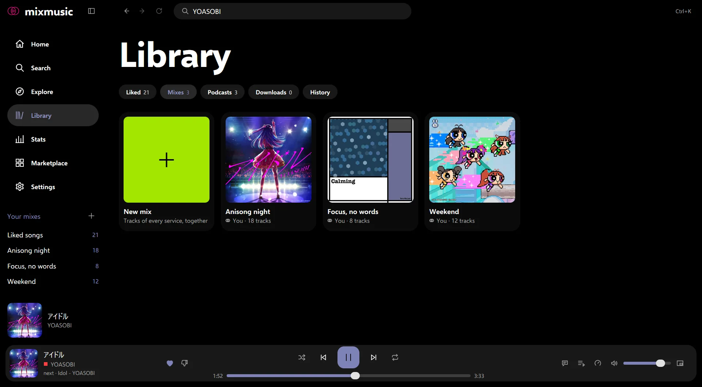
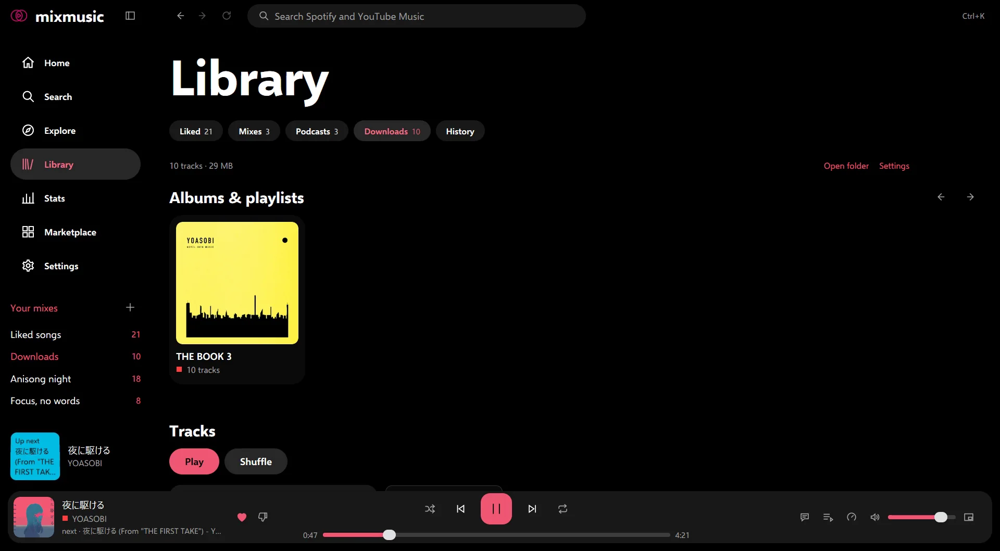

# Your library
<!-- docs: group=using order=20 -->

MixMusic keeps your liked songs, mixes, downloads, history and stats for Spotify and YouTube Music tracks together, beside each service's own library.

What MixMusic keeps itself, as your liked and disliked songs, your mixes, the artists you follow without an account and your history, is in `library.json` in your [data folder](data-and-privacy.md#the-data-folder), and works with no account. What you keep on a service, as its playlists and saved albums, shows once you [sign in](accounts.md) to it, and the changes you make in MixMusic reach it.

## The Library page

Library, in the sidebar or with Alt+2 (⌥2 on macOS), has these pivots, each with how many it holds:

- **Liked:** the songs you liked, of every service.
- **Mixes:** the playlists you make in MixMusic.
- **Podcasts:** the episodes you're listening to and the shows you follow: see [Podcasts](podcasts.md#following-shows).
- **Artists:** the new releases of the artists you follow, and the artists themselves: see [Artists you follow](#artists-you-follow).
- **Downloads:** what plays without the network.
- **On this computer:** the music files of the folders you add, which play from your computer: see [Music on this computer](local-music.md).
- **History:** what you played.
- **Disliked:** the songs you disliked, once there are any.
- **Spotify** and **YouTube Music:** your library on each service you signed in to.

## Liked songs

Like a track with the heart in the player bar, on the now playing page, in the [mini player](desktop.md#the-mini-player) or on its row, with Add to liked songs in its menu, or with Ctrl+L (⌘L on macOS) for the track playing. The heart again, or Remove from liked songs, takes it back.

- **One list for both services.** Library › Liked, Liked songs in the sidebar, Home's Liked songs tile and Alt+3 open it.
- **Signed in, a like reaches the service too:** a Spotify track is saved to your Spotify library, and a YouTube Music track is liked on YouTube Music.
- **Liking a song you disliked** takes the dislike back.
- **The list** has Play, Shuffle and Download, a box that searches it and a Sort menu: the list's own order, Title, Artist, Length or Plays. What you search shows how many tracks of the list match.
- **Plays** puts the songs you played most in MixMusic first, as your [history](#history-and-recently-played) counts them, over its last 1,000 plays; songs played as often, and those not played, keep the list's order. The list follows the plays as they're counted.

The songs you liked on a service before, or in its own app, are in that service's pivot of the library: Liked on Spotify, in pages that Load more adds to, and Liked on YouTube Music.

## Disliked songs

Library › Disliked lists the songs you disliked, newest first, with the same search and Sort. Remove the dislike, in a song's menu, or its thumbs-down, takes one back. [Playing music](playing-music.md#dislikes-and-skipping) tells what a dislike does to the queue and to radios.

## Mixes

A mix is a playlist of MixMusic's own, which holds tracks of every service.

- **Make one** with the New mix tile in Library › Mixes, the + beside Your mixes in the sidebar, Add to mix › New mix… in a track's menu, or Save as a new mix in the More menu of an album or a playlist, which copies its tracks.
- **Add tracks** with Add to mix in a track's menu, then the mix's name.
- **Copy a service's playlist** with Copy into a mix you can extend, in the playlist's More menu: the mix keeps its tracks, and any track can join them. A long playlist is read whole first, which can take a while.
- **A mix's page** has Play, Shuffle and Download, the search and Sort of its tracks, and in its More menu Rename and Delete. Deleting asks first; the tracks stay where they came from. Remove from this mix, in a track's menu there, takes it out.
- **Put a mix in order** by dragging a track onto another, which it takes the place of: a line shows where it goes. From the keyboard, <kbd>Tab</kbd> to a track's play button, then <kbd>Alt</kbd> <kbd>↑</kbd> and <kbd>Alt</kbd> <kbd>↓</kbd> (<kbd>⌥</kbd> <kbd>↑</kbd> and <kbd>⌥</kbd> <kbd>↓</kbd> on macOS) move it a place up or down, and the focus goes with it. The mix keeps its new order at once. While its tracks show sorted or searched, they don't move: choose the mix's own order in Sort and clear the search first.

Your mixes show in the sidebar under Your mixes, with how many tracks each holds, and on Home's Your mixes tile and shelf.

### A mix's cover

A mix shows the cover of its first song that has one, until you choose another.

- **Change cover…**, in the More menu of the mix's page, or in the menu of its tile in Library › Mixes and on Home, opens a dialog: **choose an image…** opens a PNG, JPEG or WebP file of yours, and the covers of the mix's songs below are a click away.
- **The cover** shows cut to a centred square, on the mix's page and its tiles. MixMusic keeps a copy of it, at most 600 pixels across, in `mix-covers` in your [data folder](data-and-privacy.md#the-data-folder): the file you chose can move or go.
- **Use the songs' covers**, in the same dialog, goes back to them. Deleting the mix deletes its cover too.

## Artists you follow

Follow an artist with Follow on their page, with Follow in the page's More menu (⋯), or with Follow in the menu of their tile, a right click on it in the search, on Home or in the library. Following, or Unfollow in those menus, stops.

- **Signed in to the artist's service,** you follow them there: you subscribe on YouTube Music, or follow on Spotify, as in the service's own app.
- **Signed out,** MixMusic keeps them itself, in `library.json`, as it keeps the podcasts you follow, and the toast says "following in MixMusic". Signing in later doesn't follow them on the service: MixMusic never writes to your account on its own. Their page still says Following, and stopping stops in MixMusic, and on the service too where you follow them there.
- **Library › Artists** has their new releases first, then Followed in MixMusic, the artists MixMusic keeps, then Followed on Spotify and Followed on YouTube Music, the artists you follow on each service you signed in to, past those MixMusic keeps. The pivot counts the artists MixMusic keeps.

### New releases

Home shows "New from artists you follow" after your own shelves, and Library › Artists shows it first, once there are any: the albums, singles and EPs of the artists you follow, in MixMusic and on the services you signed in to, newest first. Home's Spotify and YouTube Music pivots keep that service's.

- **New** is out in the last 8 weeks. Spotify tells the day a release came out, which its tile shows, as Nov 1. YouTube Music tells only the year, which its tile shows: a release of this year counts as new all year, and last year's in the first 8 weeks of the new one.
- **Newest first:** a release known by its year alone counts from the first day of its year, so this year's come after those of the last weeks. Of one day, or one year, an artist's newest come first.
- **At most** an artist's four newest show, and 30 in all.
- **Where they come from:** the artist's page on YouTube Music, which lists their latest albums and singles, or Spotify's list of their albums and singles, the 10 newest of each. Neither service gives apps a feed of the new releases of the artists you follow: YouTube Music's New releases are everyone's, and Spotify took its own list from apps in February 2026. Spotify's artists need you signed in to Spotify.
- **How often:** MixMusic asks for an artist's releases at most every 12 hours, and an hour after their service failed, as Home or Library › Artists shows and when you [refresh](settings.md#refresh-a-page) them: up to 30 artists in one go, 3 at a time, those never asked first, and the rest the next time. An artist whose service fails shows what was read before. What it read is kept in `releases.json` in the [cache folder](data-and-privacy.md#the-cache-folder), so that Home shows it at once at the next start, then what's new once it's read.

## YouTube Music playlists, albums and artists

Signed in to YouTube Music, Library › YouTube Music has your Playlists, with a new playlist link, your Albums, the Artists you follow, the Songs in your library, and Liked on YouTube Music. A [brand channel](accounts.md#several-google-accounts-and-brand-channels) of your account, chosen in Settings › Accounts, has a library of its own.

- **Save** an album or a playlist with Save on its page, which then says Saved; pressing it again takes it out of your library. **Follow** an artist with Follow on their page, which subscribes on YouTube Music.
- **Make a playlist** with new playlist in Library › YouTube Music, with Add to YouTube Music playlist › New playlist… in a track's menu, or with Save as a YouTube Music playlist in an album's or a playlist's More menu. Spotify tracks are found on YouTube Music first.
- **Add a track** with Add to YouTube Music playlist in its menu, then one of your playlists: it lists those you can add to. Tracks of either service go in.
- **Take a track out** of a playlist of yours with Remove from this playlist, in its menu on the playlist's page.
- **Put a playlist of yours in order** as you do a mix, once its tracks are all read: it changes on YouTube Music too. When YouTube Music refuses a move, a toast says so and the playlist shows as YouTube keeps it.
- **Delete a playlist you made** with Delete from YouTube Music…, in the More menu of its page or of its tile in Library › YouTube Music. It asks first, since the playlist goes from YouTube too and can't come back: to keep its tracks, copy it into a mix first. Mixes copied from it, and the queue, keep their tracks.
- **A playlist you saved** has Remove from library on its tile instead, which takes it out of your library without asking: saving it again undoes it.
- **Suggestions:** below the tracks of a playlist of yours, once they're all loaded, Suggestions has five songs YouTube Music suggests adding to it, leaving out those you dislike. Each plays alone from its cover, and Add puts it at the playlist's end at once; Refresh shows five more, and adding the last brings them too. They aren't the playlist's: Play and Shuffle leave them out. While you search the playlist's tracks, they hide.
- **Keep a song without liking it** with Add to library in its menu: it goes to Songs in your library, as YouTube Music's own Save to library does, and stays out of your likes, which shape what YouTube Music recommends. Remove from library in its menu takes it out. Spotify keeps no such songs apart from those you like.

## Spotify playlists, albums and artists

Signed in to Spotify, Library › Spotify has your Playlists, your Albums, the Artists you follow, and Liked on Spotify.

- **Save** an album or a playlist, and **follow** an artist, from their pages, as for YouTube Music: it happens on Spotify.
- **Spotify playlists** don't change from MixMusic. To add to one, copy it into a mix.
- Spotify shows an app in development mode, as your Spotify app is, the tracks of the playlists you own or collaborate on, not of playlists others made: MixMusic tells you when a playlist is one of those. [Spotify](spotify.md#what-spotify-allows-apps) lists the other limits.

## Long playlists

MixMusic reads playlists of up to 20,000 tracks, and the songs you liked on YouTube Music as far.

- The first hundred tracks or so show at once, and the rest load beside them, as "Loading tracks" above the list says, with how many came.
- Play and Shuffle, pressed meanwhile, wait for all of them. The menu's queue items and the download show once they're read.
- A page of the playlist that fails is tried again a few times. Then the playlist says how many of its tracks loaded, with Try again. One past 20,000 tracks says where it was cut.
- Playing a long playlist from its tile, downloading it or copying it into a mix reads all of it first, which can take a while.

## The header that stays

Scrolled down a playlist, an album, an artist or your liked songs, the top bar shows what you're in: its cover, its name, and Play, Shuffle and Download, which fade in as the page's head scrolls away. In a narrow window, the name shortens, and Download moves into the bar's menu.

The search and Sort of a playlist's tracks, and of your liked and disliked songs, stay pinned under the top bar while the list scrolls, and what you search or sort there shows from the list's start.

## History and Recently played

A track counts as played once it played for 30 seconds, or half of a shorter one: a track you skip sooner, or that fails to load, doesn't count.

- **Library › History** lists your last 300 plays, the latest first. Clear history forgets every track you played, after asking, and your stats start over.
- **Home** shows the track you played last in its Jump back in tile, and the tracks you played lately in its Recently played shelf.
- **YouTube Music's history.** Signed in to YouTube Music, the songs you play also join your history there, so that YouTube Music's home and its radios learn from them. ["Add what you play to your history"](accounts.md#your-youtube-music-history), in Settings › Accounts, turns it off.

## Stats

The Stats page, in the sidebar, shows what you listened to, This week, This month or All time:

- how many tracks you played and for how long, and how many of them came from Spotify and how many from YouTube Music;
- the minutes you listened each day, as a chart: the pointer on a day, or the arrow keys while the chart has the focus, show its minutes and plays, and a table of the days follows it, the newest first;
- The mix, two rings of each service's share;
- your top artists, as circles, and your top tracks.

Tracks count as in the history. Podcast episodes stay out of the stats, and clearing the history starts them over.

## Downloads

Download tracks, albums, playlists, mixes and your liked songs, and they play without the network. They stay until you remove them, apart from the offline cache.

### What you can download

- **Download** in a track's menu downloads it. The download button of an album's, a playlist's or a mix's page, or of your liked songs, downloads it whole, as Download in its More menu does.
- **YouTube Music tracks** download as they are. **Spotify tracks** download as their [recording on YouTube Music](playing-music.md#how-spotify-tracks-play).
- **[Live streams](playing-music.md#live-streams)** don't download: a playlist holding one downloads the rest, and once MixMusic has found a stream live, its menu offers no Download. **Podcast episodes** don't download.
- **Many at once:** over a hundred tracks, or about a gigabyte, asks first, with the size.

### Following a download

- **Track rows** show a mark after the service's: downloaded, a ring while it waits, a ring that fills as it downloads, or a warning when it failed, whose tip tells why. The track's menu then has Remove download, Cancel download or Download again.
- **The download button** of a page says downloading 3 of 12 while it downloads, download 2 more when the page holds tracks its download doesn't, or downloaded. Remove download, in its More menu, asks first; tracks that another download holds stay.
- **Library › Downloads** says how many tracks the downloads hold, their size and their folder, with links to open the folder and to the settings. While tracks download, it shows how far they came, with pause or resume, cancel all, and retry failed, and each track's state, with why one failed. Then come your downloaded albums, playlists and mixes, whose tracks show below when you choose one, and every downloaded track, with Play, Shuffle, search and Sort. Remove all downloads, at its foot, asks first.
- **The sidebar** lists Downloads under Your mixes once you have some, and the command palette's Downloads opens them.

### How they download

- Two tracks download at a time, in the quality of Settings › Playback › Sound › Quality: best or [data saver](playing-music.md#data-saver).
- They wait while you're offline, on a metered connection unless you allow it, and when YouTube turns requests down, then go on where they stopped, after a restart too.
- Downloads keep the stereo audio of a track. A 5.1 surround mix plays from the offline cache or YouTube, and offline the stereo audio plays.

### Songs added later

A playlist, an album, a mix or your liked songs that you downloaded download the songs added to them since on their own, as you open their page or refresh it.

- Over a hundred songs at once, or a gigabyte, wait for you to choose Download more, as a notice tells.
- A song that failed isn't tried again, and one whose download you removed isn't downloaded again: Download more still offers them.
- Songs taken out of a playlist stay downloaded with it until you remove its download, which removes them too.
- "Download songs added later", in Settings › Playback › Downloads, turns it off.

### Where they are

Settings › Playback › Downloads shows how many tracks the downloads hold and their size, with Show, which opens Library › Downloads, and:

- **Folder:** where they are, with open, change and, once you moved it, use the default. Moving the downloads asks first, and they wait meanwhile. By default, the folder is `%LocalAppData%\MixMusic\downloads` on Windows, `~/Library/Application Support/MixMusic/downloads` on macOS and `~/.local/share/MixMusic/downloads` on Linux: never a folder the system treats as a cache, whose files cleaning tools delete.
- **Download on metered connections:** off by default, so that downloads wait on a phone's hotspot and the like.
- **Download songs added later:** on by default.

The folder holds the tracks' audio as WebM or M4A files, their covers and an index of what it holds, which MixMusic reads. It moves whole. [Where the audio streams come from](streams.md#downloads-and-the-cache) tells what a download fetches, and [the library's part of the architecture](architecture/library.md) how the folder is kept.

When the network goes while you have downloads, a toast says that they still play, with a link to them, and Home offers to open them when it can't load.

## The offline cache

Apart from downloads, MixMusic keeps the tracks you played, so that they play again without the network. Settings › Playback › Offline cache shows it:

- **Tracks kept:** how many tracks the cache holds and their size, with Clear. Clearing the cache leaves your downloads.
- **Covers kept:** the covers you saw, up to 256 MB, which show again without the network, with Clear.
- **Size:** Off, 512 MB, 1 GB (the default), 4 GB or 16 GB. Off keeps no tracks.

The cache keeps how loud YouTube measured each track too, for [Even loudness](playing-music.md#even-loudness-volume-levelling-and-the-volume) offline. Live streams aren't kept in it, and a track's 5.1 surround mix is kept beside its stereo audio. [The audio engine](audio-engine.md#the-offline-cache) tells how it fills and empties.
