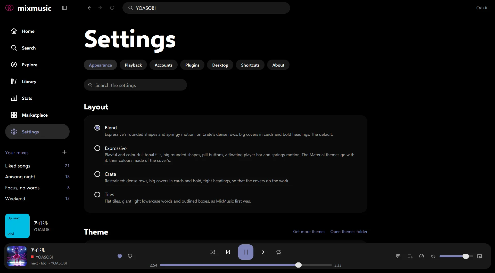
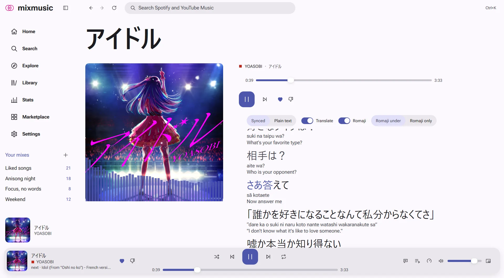

# Look and feel
<!-- docs: group=using order=50 -->

MixMusic's look is a layout and a theme: four layouts, fourteen built-in
themes, light and dark, and colours from the artwork or from pywal and matugen.

Everything on this page is in [Settings › Appearance](settings.md#appearance).
The layout sets the shapes, the density, the player bar, the headings and
the motion; the theme sets the colours, the typefaces and the corners.
Every theme works in every layout, and each change shows at once, with
nothing to restart.

## Layouts

Choose one in Settings › Appearance › Layout.

| Layout | What it looks like |
|---|---|
| **Blend**, the default | Expressive's rounded shapes and springy motion on Crate's dense rows: big covers in cards, bold headings, pill buttons and a floating player bar. |
| **Expressive** | After Material 3 Expressive: tonal fills, large rounded cards, pill buttons and chips, a floating player bar, and springs that overshoot a little. The Material themes are made for it. |
| **Crate** | Restrained: dense rows, big covers in cards, bold and tight headings and small corners, so that the covers do the work. Its player bar stays at the foot of the window. |
| **Tiles** | MixMusic's look before 0.5.9: flat tiles, giant light lowercase words and outlined boxes, and presses that show at once. |

Tiles is the only layout that rounds with the theme's own corner radius;
the others have corners of their own. The layouts set the theme's heading
face at their own weight: light in Tiles, regular in Expressive, heavy in
Blend and Crate.

### After the update to 0.5.9

MixMusic opens in Blend after the update to 0.5.9, whatever it looked like
before. Your theme, your accent and your other settings stay. To keep the
look you had, choose **Tiles**.

In `settings.json`, the layout is `"layout"`: `"blend"`, `"expressive"`,
`"crate"` or `"tiles"`.

## Themes

Settings › Appearance › Theme shows a card for every theme you have, drawn
in its own colours, with its name, its four tile colours, and "built in" or
the name of who made it. Click a card to wear its theme; the theme you wear
has an outline in the accent. The
[command palette](settings.md#the-command-palette)
(<kbd>Ctrl</kbd> <kbd>K</kbd>, <kbd>⌘</kbd> <kbd>K</kbd> on macOS) lists
every theme too, as "Theme: Aurora" and so on.

The title bar of the window is light or dark as the theme is.

### The built-in themes

| Theme | Light or dark | What it is | Options |
|---|---|---|---|
| **Mix**, the default | dark | True black, with cyan, magenta, lime and amber tiles and a cyan accent. | Tile texture (dot matrix, pinstripes, slashes or none), White text on tiles |
| **Daylight** | light | Black ink and deep tiles on white, for bright rooms. | |
| **Midnight** | dark | True black for OLED screens, with a coral accent. | |
| **Aurora** | dark | Frosted glass panels over slowly drifting northern lights. | Drifting lights, Glass blur (0 to 48 px), Light color |
| **Sakura** | light | Cherry blossom pinks on paper white, with serif headings and a petal pattern. | Petal pattern |
| **Terminal** | dark | Green phosphor on black, in a monospaced face, with phosphor-green artwork. | Scanlines, Text glow (0 to 16 px) |
| **Greenroom** | dark | Charcoal lit by one jade light, washed down from the top in the colour of the cover that plays. | Colour of the cover |
| **Glasshouse** | light | White glass and a rose-red accent over the colours of the cover. | Colours of the cover, Glass blur (0 to 48 px) |
| **Anime** | light | Summer-sky blues and cel colours, with manga screentone and speed lines that burst as each track starts. | Speed lines, Screentone |
| **Mochi** | light | Candy pastels, set in the round Quicksand, with sparkles drifting up while music plays. | Drifting sparkles |
| **Material** | light | Every colour made of the cover that plays, in Roboto Flex. | |
| **Material Dark** | dark | The same, in its dark colours. | |
| **Walnut** | dark | Walnut-dark neutrals lit by tangerine, with heavy condensed headings. | |
| **Walnut Light** | light | Walnut by day: warm paper lit by tangerine, with heavy condensed headings. | |

### Theme options

A built-in theme with options shows them in a group under the theme cards,
named after it, as **Aurora options**: switches for its effects, sliders
for its blur or glow, and Aurora's colour of light. Each theme keeps its
own options.

While your system asks for less motion, Aurora's lights, Anime's speed
lines and Mochi's sparkles hold still (see
[Reduced motion](#reduced-motion)).

### Follow the computer's light or dark mode

Turn on **Follow the computer** in Settings › Appearance › Theme, and two
more rows show: **In light mode** and **In dark mode**, each with a list of
your themes, light ones first. MixMusic then wears one theme while your
computer is in light mode and the other while it is in dark mode, and
switches as the computer does. They start as Daylight and Mix.

While Follow the computer is on, clicking a theme card, or "use it" in the
[marketplace](marketplace.md#install-a-theme), sets the theme of the mode
the computer is in now.

## The accent and the artwork

Two rows of Settings › Appearance › Colour and type set the accent, the
colour of what is chosen, of links and of the progress bars:

- **Follow the artwork**, on by default, takes the accent from the cover of
  what plays, and changes it with each track.
- **Accent colour** is a colour of your own, which replaces the theme's when
  the artwork doesn't set it: while nothing plays, or with Follow the
  artwork off. "use the theme's" beside it puts the theme's back.

## The Material themes

Material and Material Dark make every colour they have, the ground, the
surfaces, the text and the tiles, of one colour, as Material's dynamic
colour does: the cover's while a track plays and Follow the artwork is on,
else your Accent colour, else MixMusic's pink. So the whole window changes
colour with each cover. They are set in Roboto Flex, which MixMusic brings
with it, and are made for the Expressive layout, though they work in any.

To keep their colours from changing with each track, turn off Follow the
artwork, and choose an Accent colour for them to start from.

## Colours from a file

MixMusic can wear the colours that [pywal](https://github.com/dylanaraps/pywal)
or [matugen](https://github.com/InioX/matugen) make of your wallpaper, or the
colours of a file of your own, and change colour as the file changes, with
nothing to reload. In Settings › Appearance › Colour and type, set
**Colours from a file** to pywal, matugen, or "A file of your own".

- The **Colour file** row under it shows the file MixMusic reads, and when
  it last read it, or why it can't. "how to set it up" opens the steps;
  with matugen, "copy the template" copies MixMusic's matugen template; with
  a file of your own, type its path or choose it.
- The theme keeps its type, corners and effects: Mochi's round face or
  Terminal's scanlines can wear your wallpaper's colours. The theme cards
  keep each theme's own colours.
- Colours that wouldn't read are changed, keeping their hue, so text stays
  readable on any wallpaper.
- A file with one set of colours, as pywal's, decides whether MixMusic is
  light or dark, title bar included.
- While Follow the artwork is on, the cover still sets the accent. Turn it
  off to keep the file's.

[Themes: Colours from a file](themes.md#colours-from-a-file) has the
setup for pywal and matugen, the files MixMusic reads, and how each colour
maps.

## Density, text size and zoom

The other rows of Settings › Appearance › Colour and type:

| Setting | What it does |
|---|---|
| **Zoom** | Makes everything larger or smaller at once, text, icons, buttons, rows and artwork, drawn sharp at each size: 80%, 90%, 100%, 110%, 125%, 150%, 175% or 200%. |
| **Text size** | Makes the text alone larger or smaller, from 85% to 130%. |
| **Density** | Comfortable, or compact, which fits more rows on the screen: rows, the sidebar and the player bar take less room. |
| **Icons only in the sidebar** | Shows the sidebar's pages as icons. A narrow window does this too, until you unfold the sidebar there. |

The zoom has keys of its own:

| | Windows and Linux | macOS |
|---|---|---|
| Zoom in | <kbd>Ctrl</kbd> <kbd>=</kbd>, <kbd>Ctrl</kbd> <kbd>Shift</kbd> <kbd>=</kbd> or <kbd>Ctrl</kbd> and the keypad's <kbd>+</kbd> | <kbd>⌘</kbd> <kbd>=</kbd>, <kbd>⌘</kbd> <kbd>⇧</kbd> <kbd>=</kbd> or <kbd>⌘</kbd> and the keypad's <kbd>+</kbd> |
| Zoom out | <kbd>Ctrl</kbd> <kbd>-</kbd> | <kbd>⌘</kbd> <kbd>-</kbd> |
| Back to 100% | <kbd>Ctrl</kbd> <kbd>0</kbd> | <kbd>⌘</kbd> <kbd>0</kbd> |

macOS's View menu has Zoom In, Zoom Out and Actual Size. Each change shows
a toast with a button that resets it. The
[mini player](desktop.md#the-mini-player) zooms too, and its window grows
and shrinks with it. A window too small for the zoom you chose zooms only
as far as it has room for, and Settings says so.
[Settings › Shortcuts](settings.md#change-a-shortcut) changes these keys,
as it does every other.

<kbd>Ctrl</kbd> <kbd>B</kbd> (<kbd>⌘</kbd> <kbd>B</kbd> on macOS) folds and
unfolds the sidebar.

## Reduced motion

MixMusic has no motion setting of its own: it follows your system's. While
the system asks for less motion (Reduce motion in macOS's accessibility
settings, Animation effects turned off in Windows' accessibility settings,
or animations turned off on a Linux desktop), MixMusic moves less:

- Aurora's lights, Anime's speed lines and Mochi's sparkles hold still.
- Lyrics timed [word by word](lyrics.md#word-by-word) light each word
  whole as it starts, rather than filling it as it's sung.
- What moves on springs, as a button you press or the mark of the page
  you're on, goes where it goes at once, and the head of a playlist or an
  album shows in the top bar at once as you scroll.
- The strip of [pull to refresh](settings.md#pull-to-refresh) opens and
  closes at once.
- The [picture of a music video](playing-music.md#the-picture-of-music-videos)
  waits for you to press play on the cover.
- On a [MacBook's notch](desktop.md#the-player-around-the-notch), the
  player's panel fades in place rather than growing, and its bars rest.

## Marketplace themes

The community makes more themes, which you install from the marketplace:
the Marketplace in the sidebar, or "get more themes" in Settings ›
Appearance › Theme. A theme you install joins the theme cards; "use it",
on its card in the marketplace or in the toast after the install, wears
it. [Marketplace](marketplace.md) tells more.

To make a theme of your own, start from [Themes](themes.md): it lists
every colour, font and corner a theme sets, and shows a complete one. Put
its folder in the themes folder ("open themes folder" in Settings ›
Appearance › Theme), and run
**[Reload add-ons](marketplace.md#reload-add-ons)** from the command
palette. A theme that fails to load is listed under the theme cards, with
the reason.
