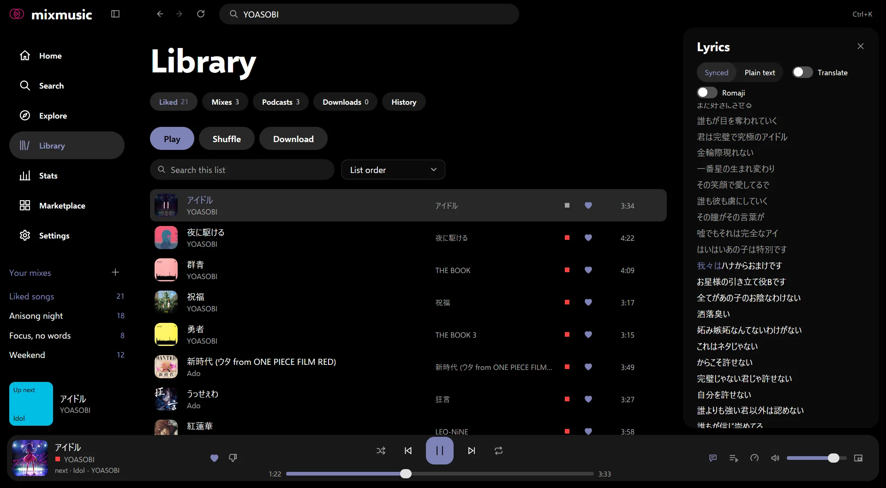
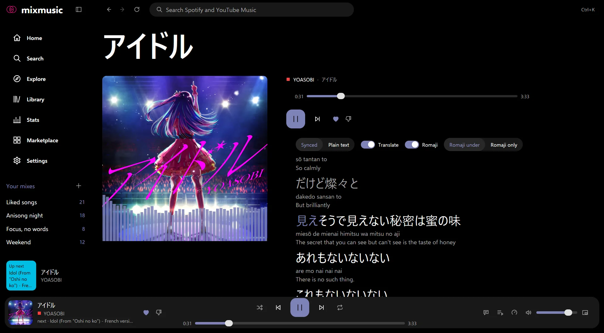

# Lyrics
<!-- docs: group=using order=30 -->

MixMusic shows synced and word-by-word lyrics for Spotify and YouTube Music tracks, and can translate them or show them in Latin letters.

Lyrics come from Unison, LRCLIB and YouTube Music, for the track that plays, whichever service it's from. Nothing needs setting up. The lyrics themselves go to Unison, for their translation or for the romanization of Arabic, only while you turn those on.

## Where lyrics show

- **The lyrics panel** opens at the right of the window, beside the page you're on, from the Lyrics button by the player (beside Queue), or with Ctrl+Shift+L (⇧⌘L on macOS). The same keys or button close it.
- **The now playing page** shows them larger, under the player: open it from the cover in the player bar, the card at the foot of the sidebar, or Alt+4 (⌥4).
- **The [notch player](desktop.md#the-player-around-the-notch),** on a MacBook with a notch, shows the line sung now, with the line before and the line after, in Latin letters when you show the lyrics so.



The panel and the page show the same lyrics, with the same switches above them, and each keeps where it was scrolled. Synced lyrics follow the song; scroll them to read back, and they stay where you put them for a few seconds before they follow again. Click a line of synced lyrics to play the song from there, once it plays.

The panel says what it found:

- "Looking for the lyrics…" while it looks;
- "No lyrics found for this track." when none of the sources has any;
- "Lyrics can't be loaded right now. Check your connection, or try again in a moment.", with try again, when a source is out of reach;
- "This track is instrumental." for a track whose lyrics source says so.

Refresh this page (F5, or ⇧⌘R on macOS) asks again. For a podcast episode, the panel says Details, and shows the episode's description and chapters in place of lyrics: see [Podcasts](podcasts.md#episode-details-and-chapters).

## Where they come from

MixMusic asks, in order:

1. **[Better Lyrics](https://betterlyrics.org),** whose service keeps lyrics timed word by word, by the track's title, artists, album and length: only for lyrics timed word by word, and only for tracks that have an album and a length, which it needs to find a song. It keeps the songs people have played with Better Lyrics, so it has some that Unison doesn't. When it has none, is busy or can't be reached, MixMusic goes on to Unison after a wait of 3 seconds at most.
2. **[Unison](https://unison.betterlyrics.org),** an open, crowdsourced database of lyrics, by the track's video ID, or by its title, artists, album and length. Unison has many lyrics timed word by word. While it's out of reach, MixMusic goes on to LRCLIB after a wait of 3 seconds at most.
3. **[LRCLIB](https://lrclib.net),** the open database of synced lyrics, by the track's title, artists, album and length: when Unison has no lyrics, can't be reached, or has only plain lyrics where LRCLIB has synced ones.
4. **YouTube Music:** when neither has any lyrics, or both have only plain ones and YouTube Music's are longer.

A Spotify track is looked up by the video ID of its [recording on YouTube Music](playing-music.md#how-spotify-tracks-play) once MixMusic has matched one, and by its title, artists, album and length before. The line at the end of the lyrics names where they came from: "lyrics from Better Lyrics", "lyrics from Unison" and so on, with the address of Better Lyrics and Unison.

## Synced and plain lyrics

Synced lyrics have a time for each line. The line sung now lights in the accent colour, the lines sung before it dim, and the view keeps it in the middle.

- **Synced or Plain text:** above synced lyrics, this choice shows them as plain text instead, without following the song. MixMusic remembers it for every track.
- **When "synced" is offered:** only for lyrics whose lines can be followed in time. Lyrics of one timed line, or whose lines all have one time, count as plain, and another source's lyrics take their place when it has more of them.
- **At another [speed](playing-music.md#speed),** synced lyrics keep the track's own time, so they still light as the words are sung.

Plain lyrics show as they are, with no choice above them.

## Word by word

Lyrics timed word by word, as Unison has many, light each word of the line sung now as it's sung, in the panel and on the now playing page:

- each word fills with the accent from its start to its end;
- words sung stay lit, and words to come keep the colour of the lines to come;
- background vocals light the same way.

Lines shown in Latin letters made on your computer light word by word too. Romaji, and Arabic's romanization from Unison, don't: shown in place of the line, they light a whole line at a time, as lyrics timed line by line do. While your system asks for [less motion](look-and-feel.md#reduced-motion), each word lights whole as it starts.

## Translate

Lyrics in another language can show their translation: turn on Translate above them, in the panel or on the now playing page. Each line then shows its translation under it, smaller, moving with it in synced lyrics.

- **When the switch shows:** for lyrics in another language than the one they translate to. That's your system's language by default; "Translate lyrics to", in [Settings › Playback](settings.md#playback) › Lyrics, chooses another, among 47.
- **It's remembered** for the next song in the same language: turned on for Korean lyrics, it stays on for Korean lyrics.
- **What is sent:** while Translate is on, the lyrics of the track playing and its video ID go to Unison, which has Google translate them. Nothing is sent while it's off, as it is by default. [Your data and privacy](data-and-privacy.md#what-each-feature-sends-where) lists what every feature sends.
- **Once per song:** each translation is kept on disk, by track and language, so a song is translated once.
- **While it comes,** the panel says "Translation is on its way…". When the service is busy, the lyrics show untranslated, with "Translation isn't available right now." and try again.

With romaji or Latin letters on too, each line shows the original, then its Latin letters, then its translation, as screen readers read them:

```
今日はいい天気
kyō wa ii tenki
The weather is nice today.
```



## Japanese lyrics in romaji

Japanese lyrics can show in romaji, Japanese in Latin letters by the Hepburn system: turn on Romaji above them, then choose:

- **Romaji under:** each line with its romaji under it;
- **Romaji only:** the romaji in place of the line.

For 今日はいい天気, the romaji is "kyō wa ii tenki".

- **Made on your computer.** MixMusic reads the kanji with kagome, a Japanese morphological analyser, and its IPA dictionary. The lyrics aren't sent anywhere for it.
- **The dictionary.** The first time you turn romaji on, MixMusic downloads the dictionary of the readings of kanji, 11.7 MB, from GitHub, and keeps it in its cache folder. Until it's there, or while it can't be downloaded, kana show in romaji and kanji as they are: the panel says "The readings of kanji are downloading: kanji show as they are until then.", or that they couldn't be downloaded, with try again.
- **Memory.** While Japanese lyrics show in romaji, MixMusic uses some 90 MB more memory, which it gives back a few minutes after.
- **It's remembered** for the next Japanese song.

## Other scripts in Latin letters

Lyrics in the other scripts can show in Latin letters too: turn on Romanize above them, then choose Romanized under, each line with its romanization under it, or Romanized only, in place of the line. The switch shows as soon as the lyrics show, and the choice is remembered for the next song in the same language.

These are romanized on your computer, and nothing of them is sent, each by the official or the most used standard of its language:

| Language or script | How it's written in Latin letters |
|---|---|
| Korean | The Revised Romanization of Korean (2000), with its sound changes within a word: 한국어 is "hangugeo" |
| Chinese, simplified and traditional | Hanyu Pinyin with tone marks, a character of several readings read by its word: 银行 is "yín háng" |
| Russian | BGN/PCGN |
| Ukrainian | Ukraine's national system of 2010 |
| Belarusian | Belarus's national system of 2007 |
| Bulgarian | The Streamlined System |
| Serbian | Gaj's Latin alphabet |
| Macedonian | The official system of 2008 |
| Kazakh and Kyrgyz | BGN/PCGN (1979) |
| Mongolian | MNS 5217:2012 |
| Greek | ELOT 743, as the UN adopted it |
| Armenian | BGN/PCGN (1981) |
| Georgian | Georgia's national system of 2002 |
| Hindi, Bengali, Punjabi, Gujarati, Odia, Tamil, Telugu, Kannada, Malayalam, Sinhala, and the other languages of their scripts | Hunterian, India's national system, with its long vowels marked |
| Thai | The Royal Thai General System, a syllable apart |
| Lao | BGN/PCGN (1966), a syllable apart: ຫຼວງພະບາງ is "louang pha bang" |
| Khmer | The UN's system of 1972, its vowels read by their consonants, a syllable apart: ភ្នំពេញ is "phnum pénh" |
| Burmese | BGN/PCGN (1970), its sounds voiced as said, a syllable apart: မင်္ဂလာပါ is "min ga la ba" |
| Tibetan | Extended Wylie |
| Hebrew | The rules of the Academy of the Hebrew Language (2006) |
| Persian and Urdu | The plain form of ALA-LC's romanization |
| Amharic | BGN/PCGN (1967), for its Ethiopic script |

- **The Latin letters of a line,** as the English in a K-pop song, stay as they are.
- **Lyrics said to be in another language,** as English lyrics with lines in Hangul, are romanized as the language of their script.

### Arabic

Arabic doesn't write its short vowels, which no rule can tell, so Arabic's romanization comes from Unison, which has Google romanize the lyrics with them. While Romanize is on, the lyrics of the track playing and its video ID go to Unison. Until its romanization comes, and when it can't, Arabic shows in Latin letters made on your computer, by ALA-LC's plain form.

For lyrics in another script that MixMusic doesn't romanize itself, the Romanize switch shows once you turn on Translate and their translation from Unison comes with Latin letters.

## Share lines

Share lines, above the lyrics, saves lines you choose as an image card. Click Share lines, then click each line to choose it: it shows tinted, and a second click lets it go. Up to 12 lines fit a card. While you choose, a click on a line doesn't play the song from there. Save image saves a square card and Save for a story a tall one, as a PNG, where the system's dialog says. The card sets the lines large, with the song's cover, title and artist at its foot, in the colours of your theme, and ends with where the lyrics come from, as their licence asks. MixMusic's logo and name sit at its bottom right. Done stops choosing. What a line shows, in Latin letters or translated, is what the card holds: the line as the lyrics show it, with no line under it.

## The notch player's line

On a MacBook with a notch, the [notch player's](desktop.md#the-player-around-the-notch) panel shows the lyrics beside the player: the line sung now, larger, the line before and the line after it, following the music. It shows them in Latin letters as you chose for their language in the panel, with the line in Latin letters under the line sung now when you show them under. Plain lyrics say "No timed lyrics.", and a podcast episode shows its chapter instead, with those before and after it.

## Credits

Lyrics from [Unison](https://unison.betterlyrics.org), an open, crowdsourced database of lyrics, under the Open Database License (ODbL). As Unison asks, the lyrics panel ends Unison's lyrics with "lyrics from Unison · submitted by <name>": Unison links to the song's page there, and the name to the page of the person who submitted the lyrics. A lyrics card made from them names both too. Synced lyrics also come from [LRCLIB](https://lrclib.net), the open database of synced lyrics. Romaji reads kanji with [kagome](https://github.com/ikawaha/kagome) and the IPA dictionary of [kagome-dict](https://github.com/ikawaha/kagome-dict), made from mecab-ipadic.
