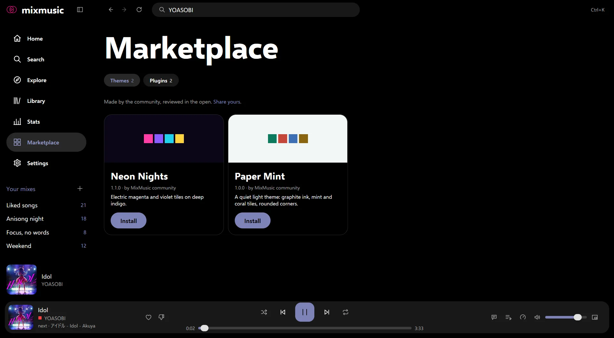
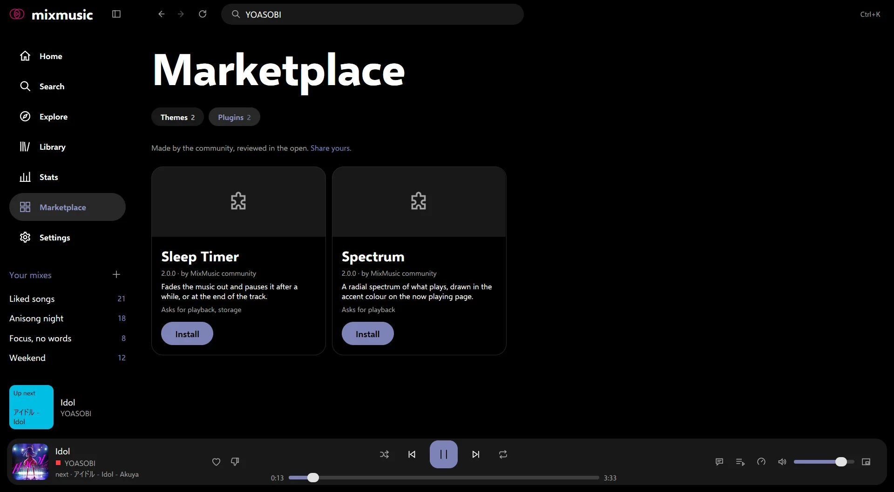

# Marketplace
<!-- docs: group=using order=80 -->

The MixMusic marketplace has community themes and plugins: install them,
enable plugins, see what a plugin can do and asks for, and reload add-ons.

Themes and plugins are add-ons: a theme sets MixMusic's colours, typefaces
and corners, and a plugin adds pages, commands and more. The community
makes them, and the ones in the marketplace were reviewed in the open, in
MixMusic's repository on GitHub.

## Open the marketplace

- **Marketplace** in the sidebar, the store icon;
- **get more themes** in [Settings › Appearance](look-and-feel.md#themes) ›
  Theme, or **get plugins** in [Settings › Plugins](settings.md#plugins);
- **Marketplace** in the [command palette](settings.md#the-command-palette)
  (<kbd>Ctrl</kbd> <kbd>K</kbd>, <kbd>⌘</kbd> <kbd>K</kbd> on macOS).

Its two pivots, **themes** and **plugins**, say how many of each there
are. Each add-on has a card: a preview (a theme's own ground and tile
colours, or its picture), its name, version and author, what it is in one
sentence, and for a plugin, what it asks for.

The marketplace reads the community registry from GitHub when you open it,
and keeps it for ten minutes. Refresh the page (<kbd>F5</kbd>,
<kbd>⇧</kbd> <kbd>⌘</kbd> <kbd>R</kbd> on macOS) to read it again sooner.

## Install a theme

Choose **install** on its card. Once it's installed, a toast says so, with
**use it**, which wears the theme; the card has **use it** too, while you
wear another theme. An installed theme joins the
[theme cards](look-and-feel.md#themes) of Settings › Appearance, and works
with every [layout](look-and-feel.md#layouts) and option there.

While your themes follow the computer's light or dark mode, "use it" makes
it the theme of the mode the computer is in now.

## Install and enable a plugin

1. Choose **install** on the plugin's card. MixMusic asks first:

   > Plugins can control the player, change your library and reach the
   > internet, whatever they ask for. Install plugins from authors you
   > trust.

   followed by what the plugin asks for.
2. Once it's installed, the toast offers **enable**. A plugin doesn't run
   until you enable it.
3. To enable it later, or turn it off, use its switch in Settings ›
   Plugins › Installed plugins. Enabling it there asks you to trust it
   first, as installing does.

A plugin that fails to start says why, in a notice and on its row in
Settings › Plugins ("failed:" and the reason); **reload** tries it again. A
card that says "made for an older MixMusic" is a plugin written for the
web interface of MixMusic 0.4 and before, which doesn't run until its
author moves it to the plugin API of MixMusic's own interface.

## What a plugin can do

A plugin runs in a JavaScript engine of MixMusic's own, inside MixMusic,
not in a browser. Through the [plugin API](plugins.md#the-api), it can:

- add **pages**, with an item of their own in the sidebar;
- add **commands** to the command palette, with keys you can change in
  Settings › Shortcuts, under "plugins";
- add **actions** to the menu of every track;
- add **widgets** to the now playing page, under the lyrics;
- control the **player** and the queue, and read what plays, and the
  spectrum of its sound;
- search YouTube Music and Spotify, and read albums, artists, playlists,
  radios and lyrics;
- read and change your **liked and disliked songs** and your mixes;
- read your **settings**, but not change them;
- show toasts and **desktop notifications**, open web pages in your browser,
  reach the **internet**, and keep up to 1 MB of its own **storage**.

What it draws, it draws in your theme's colours and type. Everything it
added goes when you turn it off.
[How MixMusic works](how-it-works.md#themes-plugins-and-the-marketplace)
tells how plugins run, and
[the add-ons' part of the architecture](architecture/addons.md) shows the
code.

### What it asks for

A plugin's card and the question before you enable it list what it asks
for:

| It asks for | What it does |
|---|---|
| `playback` | controls the player |
| `network` | talks to the internet |
| `notifications` | shows desktop notifications |
| `storage` | keeps values between runs |

These tell you what the plugin does. They aren't enforced: every plugin can
use the whole API, which is why MixMusic asks you to trust it, and why the
community's reviewers read every line of it before it reaches the
marketplace.

## Update and remove

- When the marketplace has a newer version of an add-on you have, its card
  says **update to** and the version.
- **remove**, on a card, removes the add-on. If it was your theme,
  [Mix](look-and-feel.md#the-built-in-themes) takes its place; a plugin
  stops first.
- In Settings › Plugins, the trash button beside a plugin removes it, after
  asking.
  The plugin and its files are deleted; what it stored stays.
- Built-in themes say "built in", and can't be removed.

## Reload add-ons

**Reload add-ons**, in the command palette, finds the themes and plugins
in your add-ons folders again, reads your
[colour file](look-and-feel.md#colours-from-a-file) again, and starts
again the plugins that failed. **reload** in Settings › Plugins does the
same. Run it after you put an add-on in a folder yourself, or change one.

The folders are in MixMusic's
[data folder](data-and-privacy.md#the-data-folder), `addons/themes` and
`addons/plugins`: **open themes folder** in Settings › Appearance › Theme
and **open plugins folder** in Settings › Plugins open them.

## Make your own, and share it

- [Themes](themes.md) lists every colour, font and corner a theme sets,
  and shows a complete one.
- [Plugins](plugins.md) documents the plugin API, with its types, and how
  to try a plugin from the plugins folder.
- [community/README.md](../community/README.md) tells how to share yours:
  you add its folder to the repository in a pull request, and once it's
  merged, it shows in everyone's marketplace.
