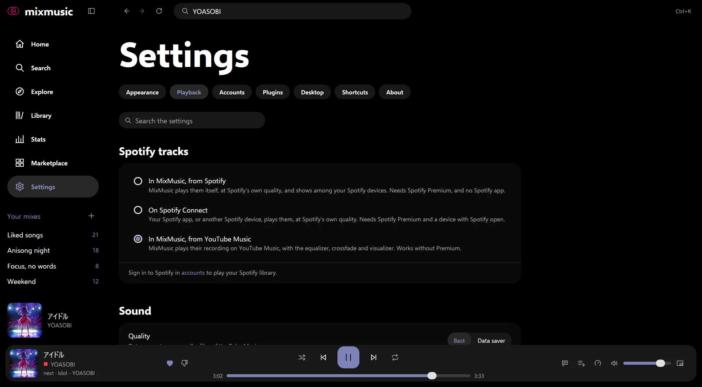
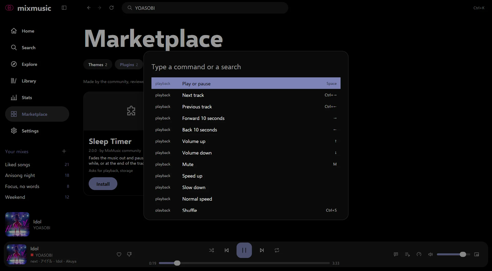

# Settings
<!-- docs: group=using order=90 -->

MixMusic's settings page by page, finding a setting by typing, settings.json,
the command palette, refreshing a page and the keyboard shortcuts.

Open Settings with the gear in the sidebar,
<kbd>Ctrl</kbd> <kbd>,</kbd> (<kbd>⌘</kbd> <kbd>,</kbd> on macOS), or
**Settings** in the command palette. What you change applies at once:
there's nothing to save.

## The pages of Settings

Settings has seven sections, named across its top: Appearance, Playback,
Accounts, Plugins, Desktop, Shortcuts and About. Each is a list of groups,
and each group a list of rows.



### Appearance

How MixMusic looks; [Look and feel](look-and-feel.md) tells all of it.

| Group | What's there |
|---|---|
| [Layout](look-and-feel.md#layouts) | Blend, Expressive, Crate or Tiles. |
| [Theme](look-and-feel.md#themes) | **Follow the computer**, with **In light mode** and **In dark mode**; a card for each theme; **get more themes**, which opens the marketplace, and **open themes folder**. Themes that didn't load are listed with the reason. |
| [*Theme* options](look-and-feel.md#theme-options) | The options of a built-in theme that has some, as Aurora's drifting lights and glass blur. |
| Colour and type | **[Colours from a file](look-and-feel.md#colours-from-a-file)** (pywal, matugen or a file of your own) and its **Colour file**, **[Follow the artwork](look-and-feel.md#the-accent-and-the-artwork)**, **Accent colour**, **[Zoom](look-and-feel.md#density-text-size-and-zoom)**, **Text size**, **Density**, **Icons only in the sidebar** and **Wavy progress bar**. |

### Playback

How MixMusic plays; [Playing music](playing-music.md) tells all of it.

| Group | What's there |
|---|---|
| [Spotify tracks](playing-music.md#how-spotify-tracks-play) | How Spotify tracks play: **In MixMusic, from Spotify** (Premium, on Windows and macOS), **On Spotify Connect**, with the **Device** that plays them, or **In MixMusic, from YouTube Music**. See [Spotify](spotify.md). |
| Sound | **[Output device](playing-music.md#the-output-device)** (System default, or a device by name), **[Quality](playing-music.md#data-saver)** (best, or data saver), **[Crossfade](playing-music.md#crossfade-and-gapless-playback)** (off, or 1 to 12 seconds), **[Even loudness](playing-music.md#even-loudness-volume-levelling-and-the-volume)**, **Volume levelling**, **Play 5.1 surround when a track has it**, **[Autoplay](playing-music.md#autoplay-and-radios)**, **[Skip songs made with AI](playing-music.md#skipping-songs-made-with-ai)** and **[Skip songs you dislike](playing-music.md#dislikes-and-skipping)**. |
| [Speed](playing-music.md#speed) | **Songs** and **Podcasts**, each from 0.5× to 3×, at the tracks' own pitch, with **normal** to go back to 1×. |
| [Music videos](playing-music.md#the-picture-of-music-videos) | **Show the video of music videos**, on the now playing page. |
| [Equalizer](playing-music.md#the-equalizer) | The **Equalizer** switch, a **Preset** (Flat, Bass boost, Treble boost, Vocal, Electronic, Rock, Acoustic, Late night or Lo-fi), and the preamp and ten bands, from −12 to +12 dB. |
| [Volume](playing-music.md#even-loudness-volume-levelling-and-the-volume) | **Volume curve**: Natural, even steps of loudness, or Linear, where the level grows evenly along the slider. |
| [Lyrics](lyrics.md#translate) | **Translate lyrics to**: the language the translate switch beside the lyrics shows them in. |
| [Offline cache](library.md#the-offline-cache) | **Tracks kept** and **Covers kept**, each with **clear**, and the cache's **Size**: off, 512 MB, 1 GB, 4 GB or 16 GB. |
| [Downloads](library.md#where-they-are) | How many tracks are downloaded and how much room they take, with **show**; their **Folder**, with **open** and **change**; **Download on metered connections** and **Download songs added later**. |
| [Music on this computer](local-music.md#add-a-folder) | **Folders**, with **add a folder** and **rescan**, then each folder of music, with how many tracks it holds, how many files were skipped and how many folders in it can't be read, and **remove**. Under the folders, each one MixMusic can't watch for changes, as one on a network drive, says why: its changes show after a **rescan**. |
| [Tools](how-it-works.md#yt-dlp-and-the-javascript-runtime) | **yt-dlp**, which MixMusic installs and keeps up to date, the **JavaScript runtime** it runs with (found by itself, or Deno, Node.js, Bun or QuickJS), and **Own yt-dlp**, the path to one of yours. |

### Accounts

Your YouTube Music, Spotify and Last.fm accounts: signing in and out, the
YouTube Music channel you use, the switch that adds what you play to your
YouTube Music history, and the switch that pauses scrobbling.
[Accounts](accounts.md) tells each step.

### Plugins

**Installed plugins**: each plugin you have, with what it is, who made it,
a switch that enables it, and a button that removes it. **get plugins**
opens the marketplace, **open plugins folder** opens the folder of your
own, and **reload** finds them again. Plugins that didn't load are listed
with the reason. [Marketplace](marketplace.md) tells more.

### Desktop

The **On the desktop** group:

| Row | What it does |
|---|---|
| [Close to the tray](desktop.md#close-to-the-tray) | Closing the window keeps the music playing; quit from the tray icon. Off at first. |
| Media keys | The keyboard's play, next and previous keys control MixMusic. On at first. |
| [Notifications](desktop.md#notifications) | Tells what starts playing while neither MixMusic's window nor the mini player is in front. On at first. |
| [Show what plays in the window title](desktop.md#the-window-title) | The window's title names the track that plays. On at first. |
| [Show what plays on Discord](desktop.md#discord) | Your Discord profile shows what you listen to. On at first. Under it, **Discord application ID**, to show another application's name, a preview of your status, and [what it shows](desktop.md#what-your-discord-status-shows): its two lines, the cover, the service's badge, the time left, a Listen button, and whether it stays while paused. |
| [Player around the notch](desktop.md#the-player-around-the-notch) | The player around a MacBook's notch. On at first, and shown only on Macs with a notch. |
| [Keep on top](desktop.md#keep-the-window-on-top) | MixMusic's window stays above your other windows. Off at first. |
| [Start at login](desktop.md#start-at-login) | Starts MixMusic, hidden, when you sign in to your computer. |
| Settings file | **open** opens `settings.json`, **show in folder** shows it in its folder. |
| Reset settings | Puts back the settings of a new install, after asking. Your accounts, library and add-ons stay. |

[On the desktop](desktop.md) tells what each does.

### Shortcuts

Every command, by group, with its keys: **From any app** first, the global
shortcuts, then playback, go to, view, add-ons and settings, then the
themes and the plugins' commands. See
[Keyboard shortcuts](#keyboard-shortcuts) below.

### About

| Group | What's there |
|---|---|
| MixMusic | The **Version**, with the system and how this copy was [installed](getting-started.md#install); whether a newer version is out, with **what's new** and **install** (or its download, for a copy that can't replace itself); the folder your [data](data-and-privacy.md#where-mixmusic-keeps-its-data) lives in; and **source code**, **contribute**, **report a problem** and **open logs folder** (see [Troubleshooting](troubleshooting.md)). |
| Memory use | **Record memory use**, for a report of MixMusic taking too much memory: while it's on, MixMusic writes how it uses its memory to `memory.log` in [the logs folder](data-and-privacy.md#the-logs-folder) each minute, and saves a heap profile there once it passes 1 GB, and **save a heap profile** saves one at once. It's off again at the next start. |
| [Updates](how-it-works.md#mixmusic-itself) | **Check for updates**, at start and every few hours, and **Install updates without asking**, which downloads them in the background for the next launch. |
| [Recent playback errors](troubleshooting.md#tracks-that-fail-to-play) | The last 10 tracks that couldn't play since MixMusic started, the latest first, with the time and why, each with **details**: what was tried, and **copy**. |
| Licenses | The licenses of the code and the typefaces MixMusic includes, each with **show**: see [License](license.md) and [Credits](credits.md). |


Without Install updates without asking, a new version asks in a pop-up:
**install** it, **later**, which asks again at the next start, or **skip
this version**. The `.deb`, the `.rpm`, the AppImage and the Flatpak can't
replace their own files, so they offer the new version's download instead.
**report a problem** opens a new issue on GitHub with your version,
system, theme and plugins filled in.

## Find a setting by typing

The **search the settings** box, under the sections' names, finds settings
as you type: by their name, their description, their group or their
section, regardless of case, accents or spelling, so "color" finds Accent
colour. Each setting found keeps its control, so you change it right there.

- Each group found has a link to its own section, which shows the group
  there.
- The search is part of the page's location: Back returns to it.
- It finds a shortcut by its keys too, as "ctrl+k", and a theme by its name.
- Whenever you type in the command palette, its last item is **Search the
  settings for** what you typed. The command **Search the settings** opens
  the box; it has no key at first, which Settings › Shortcuts can give it.
- The box doesn't take the keyboard's focus when Settings opens.

## settings.json

MixMusic keeps your settings in `settings.json`, in its
[data folder](data-and-privacy.md#the-data-folder):

| System | settings.json |
|---|---|
| Windows | `%AppData%\MixMusic\settings.json` |
| macOS | `~/Library/Application Support/MixMusic/settings.json` |
| Linux | `~/.config/MixMusic/settings.json` |
| Linux, the Flatpak | `~/.var/app/io.github.fzn0x.mixmusic/config/MixMusic/settings.json` |

Settings › Desktop › Settings file opens it, or shows it in its folder, and
so does **Open the settings file** in the command palette. Settings › About
names the data folder. You can keep the file with your dotfiles: a
`settings.json` that is a link to another file stays a link.

### Edit it while MixMusic runs

Save the file, and what you changed applies at once, as if you had changed
it in Settings; a toast says "Applied settings.json". MixMusic reads the
file again before it saves to it, so it doesn't write over an edit it
hasn't read: [the settings' part of the architecture](architecture/settings.md)
tells how.

- **A key you take out** goes back to its default, as at a new install.
  Taking out `spotifyClientId` signs you out of Spotify, and plugins you
  add to `enabledPlugins` start without asking.
- **A key MixMusic doesn't know** stays until its next save, which drops
  it, and the toast says so. A value out of its range goes back into it,
  and the toast says that too.
- **Encodings.** Save it as UTF-8. A file with a byte order mark, or in
  UTF-16, as Windows PowerShell 5.1 writes it, reads too.
- **Names that aren't UTF-8.** A folder or a file whose name isn't valid
  UTF-8, as on some Linux drives, is written in base64 after `base64:`, as
  `"base64:L2hvbWUvYWRhL2NhZuk="`, so that it names the same folder when
  MixMusic reads the file again. Every other path is written as it is.

Its keys are short names of the settings, as `theme`, `layout`, `zoom`,
`closeToTray`, `notchPlayer`, `shortcuts` and `globalShortcuts`. Open the
file to see them all, each with its value: MixMusic writes every one.

### When it has a mistake

A file that isn't valid JSON, as one with a comma before a `}`, is told a
moment after you save it: a toast says "settings.json has a mistake" with
the line and the column, as "line 4, column 1: a comma before } has nothing
after it", and a panel at the top of Settings says it too, with **open
settings.json**. Meanwhile:

- MixMusic goes on with the settings it had, and doesn't save to the file
  until it reads again. What you change in Settings is saved once it does.
- If MixMusic quits first, it keeps your text as `settings.json.broken`
  beside it, and saves its settings in its place.
- A file that doesn't read as MixMusic starts is kept the same way, as
  `settings.json.broken`, and MixMusic starts with the settings of a new
  install; a toast says so, with **show**.

## The command palette

<kbd>Ctrl</kbd> <kbd>K</kbd> (<kbd>⌘</kbd> <kbd>K</kbd> on macOS) opens the
command palette, which lists every command: MixMusic's, a "Theme:" command
for each [theme](look-and-feel.md#themes), and those of your
[plugins](marketplace.md#what-a-plugin-can-do), each with its group and its
keys.

- Type to keep the commands whose name or group holds what you typed.
- <kbd>↑</kbd> and <kbd>↓</kbd> move through the list, and
  <kbd>Enter</kbd> runs the command chosen.
- Once you type, the first item is **Search for** what you typed, which
  [searches](playing-music.md#search) YouTube Music and Spotify, and the
  last is **Search the settings for** it.



## Refresh a page

**Refresh this page** asks the services again for what the page shows,
without restarting MixMusic: press <kbd>F5</kbd> (<kbd>⇧</kbd>
<kbd>⌘</kbd> <kbd>R</kbd> on macOS), or the refresh button after the back
and forward arrows. It's in the command palette and macOS's View menu too.

- The page keeps showing what it has until the answers come, with a spinner
  in the button meanwhile. If the refresh fails, as offline, the page keeps
  what it showed, and a toast says why.
- Home, searches, albums, artists, playlists, Explore, your Spotify and
  YouTube Music libraries, the lyrics, the marketplace and Settings' checks
  refresh. Plugins' pages and widgets render again.
- A playlist, an album or a mix you downloaded downloads the
  [songs added to it since](library.md#songs-added-later), as you refresh
  it.
- The button is dimmed on pages that always show what is current, as your
  liked songs and the stats.
- <kbd>Ctrl</kbd> <kbd>R</kbd> (<kbd>⌘</kbd> <kbd>R</kbd>) stays Repeat.

### Pull to refresh

Pull a page down past its top to refresh it: with two fingers on a
touchpad, a finger on a touchscreen, or the mouse wheel turned up three
notches or more while the page is at its top. A strip above the page grows
as you pull and says when letting go refreshes.

Scrolling that carries the page up to its top never pulls, a fling's
momentum included, and neither does scrolling sideways, Shift and the
wheel over a shelf, or scrolling the lyrics on the now playing page. Pages
whose refresh button is dimmed don't pull. While your system asks for less
motion, the strip opens and closes at once.

## Keyboard shortcuts

These are the keys of a new install. <kbd>Ctrl</kbd> on Windows and Linux
is <kbd>⌘</kbd> on macOS, and <kbd>Alt</kbd> is <kbd>⌥</kbd> there. Shortcuts of
a single key, as <kbd>Space</kbd>, <kbd>M</kbd> and the arrows, work
while you're not typing in a text field. The ID is the command's name in
`settings.json`.

### Playback

| Command | Windows and Linux | macOS | ID |
|---|---|---|---|
| Play or pause | <kbd>Space</kbd> | <kbd>Space</kbd> | `player.toggle` |
| Next track | <kbd>Ctrl</kbd> <kbd>→</kbd> | <kbd>⌘</kbd> <kbd>→</kbd> | `player.next` |
| Previous track | <kbd>Ctrl</kbd> <kbd>←</kbd> | <kbd>⌘</kbd> <kbd>←</kbd> | `player.previous` |
| Forward 10 seconds | <kbd>→</kbd> | <kbd>→</kbd> | `player.forward` |
| Back 10 seconds | <kbd>←</kbd> | <kbd>←</kbd> | `player.back` |
| Volume up | <kbd>↑</kbd> | <kbd>↑</kbd> | `player.volumeUp` |
| Volume down | <kbd>↓</kbd> | <kbd>↓</kbd> | `player.volumeDown` |
| Mute | <kbd>M</kbd> | <kbd>M</kbd> | `player.mute` |
| Shuffle | <kbd>Ctrl</kbd> <kbd>S</kbd> | <kbd>⌘</kbd> <kbd>S</kbd> | `player.shuffle` |
| Repeat | <kbd>Ctrl</kbd> <kbd>R</kbd> | <kbd>⌘</kbd> <kbd>R</kbd> | `player.repeat` |
| Like what plays | <kbd>Ctrl</kbd> <kbd>L</kbd> | <kbd>⌘</kbd> <kbd>L</kbd> | `player.like` |
| Dislike what plays | <kbd>Ctrl</kbd> <kbd>D</kbd> | <kbd>⌘</kbd> <kbd>D</kbd> | `player.dislike` |
| Speed up | none | none | `player.faster` |
| Slow down | none | none | `player.slower` |
| Normal speed | none | none | `player.normalSpeed` |
| Start a radio of what plays | none | none | `player.radio` |
| [Open music files…](local-music.md#open-files-without-a-folder) | <kbd>Ctrl</kbd> <kbd>O</kbd> | <kbd>⌘</kbd> <kbd>O</kbd> | `player.openFiles` |

### Go to

| Command | Windows and Linux | macOS | ID |
|---|---|---|---|
| Go home | <kbd>Alt</kbd> <kbd>1</kbd> | <kbd>⌥</kbd> <kbd>1</kbd> | `go.home` |
| Library | <kbd>Alt</kbd> <kbd>2</kbd> | <kbd>⌥</kbd> <kbd>2</kbd> | `go.library` |
| Liked songs | <kbd>Alt</kbd> <kbd>3</kbd> | <kbd>⌥</kbd> <kbd>3</kbd> | `go.liked` |
| Now playing | <kbd>Alt</kbd> <kbd>4</kbd> | <kbd>⌥</kbd> <kbd>4</kbd> | `go.nowPlaying` |
| Explore | <kbd>Alt</kbd> <kbd>5</kbd> | <kbd>⌥</kbd> <kbd>5</kbd> | `go.explore` |
| Search | <kbd>Ctrl</kbd> <kbd>F</kbd> | <kbd>⌘</kbd> <kbd>F</kbd> | `go.search` |
| Settings | <kbd>Ctrl</kbd> <kbd>,</kbd> | <kbd>⌘</kbd> <kbd>,</kbd> | `go.settings` |
| Downloads | none | none | `go.downloads` |
| On this computer | none | none | `go.computer` |
| Stats | none | none | `go.stats` |
| Marketplace | none | none | `go.marketplace` |
| Search the settings | none | none | `go.settingsSearch` |

### View

| Command | Windows and Linux | macOS | ID |
|---|---|---|---|
| Command palette | <kbd>Ctrl</kbd> <kbd>K</kbd> | <kbd>⌘</kbd> <kbd>K</kbd> | `view.palette` |
| Show or hide the queue | <kbd>Ctrl</kbd> <kbd>J</kbd> | <kbd>⌘</kbd> <kbd>J</kbd> | `view.queue` |
| Show or hide the lyrics | <kbd>Ctrl</kbd> <kbd>Shift</kbd> <kbd>L</kbd> | <kbd>⇧</kbd> <kbd>⌘</kbd> <kbd>L</kbd> | `view.lyrics` |
| Mini player | <kbd>Ctrl</kbd> <kbd>M</kbd> | <kbd>⌘</kbd> <kbd>M</kbd> | `view.mini` |
| [Keep the window on top, or not](desktop.md#keep-the-window-on-top) | none | none | `view.keepOnTop` |
| Collapse or expand the sidebar | <kbd>Ctrl</kbd> <kbd>B</kbd> | <kbd>⌘</kbd> <kbd>B</kbd> | `view.sidebar` |
| Refresh this page | <kbd>F5</kbd> | <kbd>⇧</kbd> <kbd>⌘</kbd> <kbd>R</kbd> | `view.refresh` |
| Zoom in | <kbd>Ctrl</kbd> <kbd>=</kbd>, also <kbd>Ctrl</kbd> <kbd>Shift</kbd> <kbd>=</kbd> and <kbd>Ctrl</kbd> with the keypad's <kbd>+</kbd> | <kbd>⌘</kbd> <kbd>=</kbd>, also <kbd>⇧</kbd> <kbd>⌘</kbd> <kbd>=</kbd> and <kbd>⌘</kbd> with the keypad's <kbd>+</kbd> | `view.zoomIn` |
| Zoom out | <kbd>Ctrl</kbd> <kbd>-</kbd> | <kbd>⌘</kbd> <kbd>-</kbd> | `view.zoomOut` |
| Reset zoom | <kbd>Ctrl</kbd> <kbd>0</kbd> | <kbd>⌘</kbd> <kbd>0</kbd> | `view.zoomReset` |
| Show or hide the video of music videos | none | none | `view.video` |

### Add-ons and settings

| Command | Windows and Linux | macOS | ID |
|---|---|---|---|
| Reload add-ons | none | none | `addons.reload` |
| Open the settings file | none | none | `settings.openFile` |
| Theme: *name*, one for each theme | none | none | `theme.<theme id>` |

Plugins' commands follow, with the keys their plugin gives them, if any.

### Arrows, Space and the other keys

- <kbd>←</kbd> and <kbd>→</kbd> go back and forward 10 seconds, and
  <kbd>↑</kbd> and <kbd>↓</kbd> turn the volume up and down. The search
  box keeps the arrows for its cursor, and sliders, lists and the stats
  page's chart keep them while they have the keyboard's focus.
- The arrows don't scroll a page: the mouse wheel, <kbd>Page Up</kbd> and
  <kbd>Page Down</kbd>, and <kbd>Home</kbd> and <kbd>End</kbd> do.
- In a mix, <kbd>Alt</kbd> <kbd>↑</kbd> and <kbd>Alt</kbd> <kbd>↓</kbd> move the
  track whose play button has the focus a place up or down: see
  [Mixes](library.md#mixes).
- After you click a button, a tile or a switch, <kbd>Space</kbd> still plays
  or pauses. A control you reach with <kbd>Tab</kbd> takes <kbd>Space</kbd>
  and <kbd>Enter</kbd> itself.
- The [mini player](desktop.md#the-mini-player) takes no shortcuts but the
  zoom's.
- Keys that work from any app are the global shortcuts: see
  [Global shortcuts](desktop.md#global-shortcuts).

### Change a shortcut

In Settings › Shortcuts, each command's row shows its keys, or "none".

1. Choose **change** on the row (or **set**, when it has none).
2. Press the keys. <kbd>Escape</kbd> cancels, and <kbd>Backspace</kbd>
   removes the shortcut.

A command that had those keys gives them up, and a toast says it has no
shortcut now. **reset**, on a row you changed, gives the command its own
keys back, from the command you gave them to; **reset all**, at the top of
the page, puts back every shortcut and removes every global shortcut.

In `settings.json`, `shortcuts` holds the keys you changed, by the
command's ID, written as `"Mod+Shift+M"`: `Mod` is <kbd>Ctrl</kbd>, or
<kbd>⌘</kbd> on macOS, the other modifiers are `Ctrl`, `Alt`, `Shift` and
`Meta`, and keys have names such as `K`, `5`, `F5`, `Space`, `Enter`,
`ArrowLeft` and `PageDown`. An empty value, `""`, takes a command's
shortcut away. `globalShortcuts` holds the global shortcuts the same way.

```json
"shortcuts": { "player.mute": "Mod+Shift+M", "view.mini": "" },
"globalShortcuts": { "player.toggle": "Mod+Alt+P" }
```
